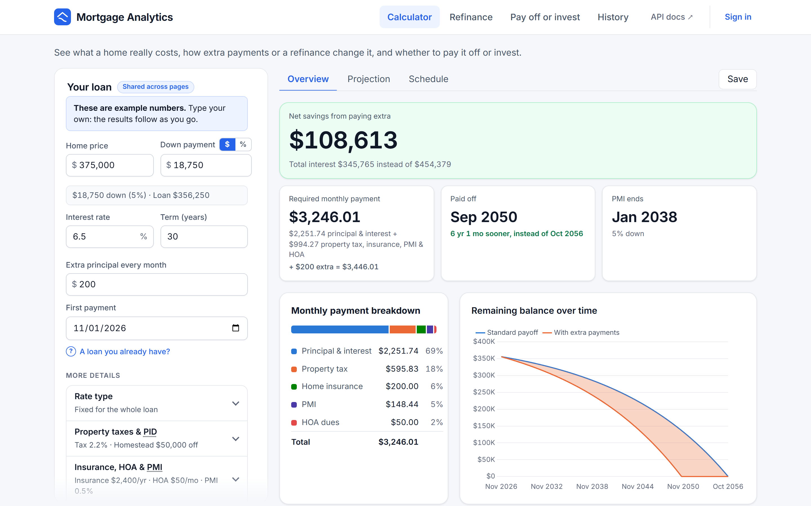
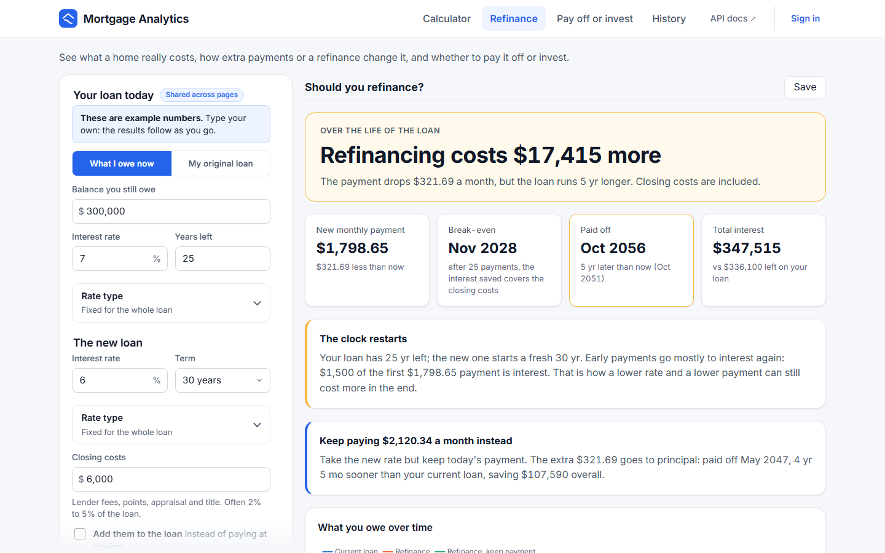
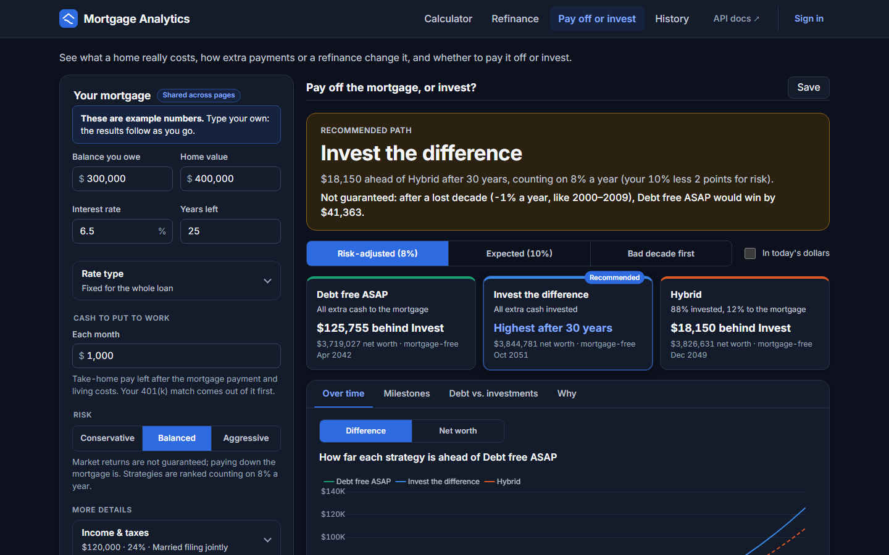

# Mortgage Analytics

**See what a home really costs, whether a refinance pays, and whether spare cash should pay down the mortgage or be
invested, with the real rules behind every number.**

[](https://github.com/bgrovogel/mortgage-analytics/actions/workflows/ci.yml)




A .NET 10 API and an Angular 22 app, shipped as one Docker container. It is small on purpose: the domain (exact money
math, lender recast rules, PMI removal, Texas homestead taxes, adjustable rates, buydowns, tax-aware investing) is
rich enough to show real engineering judgment, and the code is small enough to read in a sitting.

**Contents:** [What it does](#what-it-does) · [Highlights](#highlights) · [Quick start](#quick-start) ·
[Tests](#running-the-tests) · [API](#the-api) · [Architecture](#architecture) · [Documentation](#documentation) ·
[Tech stack](#tech-stack) · [Next](#what-id-add-next)

---

## What it does

| Page | The question it answers |
|---|---|
| **Calculator** | *What will this home cost me, month by month and year by year?* Principal and interest; property taxes (one rate, or Texas school, county/city and MUD taxes with homestead exemptions, the over-65 ceiling and the appraisal cap); insurance, HOA dues, PID and PMI; extra payments and lender recasts; buydowns and ARMs; and a projection of every cost over the loan. |
| **Refinance** | *Should I refinance?* The rest of today's loan against the new one, closing costs included, with the break-even. It catches the trap most calculators hide: a lower payment can cost more overall, because a new 30-year loan restarts the clock. |
| **Pay off or invest** | *Should spare cash pay down the mortgage, or be invested?* Three strategies played out month by month for 30 years, with the 401(k) match, IRA, RSUs, ESOP, ESPP, the standard deduction and taxes, in three markets, ranked on a risk-adjusted return. |
| **History** | Save any result under a name with a free account, and reopen it exactly as it was. The calculators need no account. |

A loan typed on one page is carried to the others. **Every rule, in detail: [What it does](docs/00-features.md).**

<p>
  
  
</p>

---

## Highlights

- **Money math you can trust.** `decimal` throughout, every schedule ends at exactly $0.00, and the expected values
  in the tests come from independent Python models, not from this code. Scripts compare 300 random purchases, 300
  refinances and 300 households with the live API, field by field. They have caught real bugs.
- **Tested from the domain to the browser.** 748 .NET, 513 Jest and 88 Playwright tests, written test-first. An 85%
  coverage gate, a mutation-score gate on the domain (Stryker.NET), a snapshot of the whole API contract, and
  assertion standards enforced at build time with Roslyn.
- **Built like it will be attacked.** Cookie-only sessions, account attempt limits, a Content-Security-Policy that
  every browser test runs under, only the identity endpoints the app uses, and CI that fails on a known vulnerability
  in anything that ships.
- **Designed for the people using it.** One visual language in light and dark mode, the answer first on a phone,
  results as you type, and WCAG 2.2 AA checked by axe on every page.
- **Clean Architecture, kept small.** The domain has no dependencies at all; no MediatR, no AutoMapper, nothing it
  does not need.

---

## Quick start

### With Docker

```bash
docker compose up --build
```

| | |
|---|---|
| The app | http://localhost:8080 |
| API docs (Swagger UI) | http://localhost:8080/swagger |
| Email inbox (Mailpit) | http://localhost:8025, where confirmation and password-reset emails land; nothing leaves your machine |

Accounts, saved calculations and the keys that sign sessions and emailed links live on the
`mortgage-analytics_calculations` volume, so they survive restarts.

### For development

Needs the .NET 10 SDK and Node 22.22+ (or 24+).

```bash
# Terminal 1: the API on http://localhost:5080 (Swagger at /swagger)
dotnet run --project src/MortgageAnalytics.Api

# Terminal 2: the app on http://localhost:4200 (it forwards /api to :5080)
cd client
npm install
npm start
```

> [!TIP]
> **Accounts work with no mail server.** Without SMTP settings the API writes emails to a local outbox, and in
> Development the app shows them at http://localhost:4200/dev/mailbox (the sign-up and forgot-password screens link
> to it). To send real email, set `Email:Smtp:Host`, `Port`, `Username`, `Password` and `Email:From`.

In Visual Studio or Rider, open `MortgageAnalytics.sln` and start **MortgageAnalytics.Api** and **client** together.
Every command is in the [commands guide](docs/02-commands.md).

### Running the tests

```bash
dotnet test                       # 748 NUnit tests, including the convention tests

cd client
npm run lint                      # angular-eslint: TypeScript and template rules
npm run typecheck                 # tsc over the test code, which Jest and Playwright run without checking types
npm test                          # 513 Jest unit tests; fails below 85% coverage
npm run e2e:install               # first time only: downloads Chromium
npm run e2e                       # 88 Playwright tests (13 are axe accessibility scans); builds the app and serves it from the API, as in production
```

How each layer is tested, the standards the build enforces, coverage and mutation testing:
[Testing and quality](docs/07-testing.md).

---

## The API

| Endpoint | Purpose |
|---|---|
| `POST /api/v1/amortization/calculate` | The purchase analysis (`?includePayments=false` for summaries only) |
| `POST /api/v1/refinance/analyze` | Keep the current loan or refinance it |
| `POST /api/v1/strategies/compare` | Pay off first, invest the difference, or a hybrid, in three markets |
| `POST /api/v1/account/register` · `login?useCookies=true` · `logout` | Create an account (a confirmation email is sent), sign in with a session cookie, sign out |
| `GET /api/v1/account/confirmEmail` · `POST resendConfirmationEmail` | Confirm the email with the code from its link; send the link again |
| `POST /api/v1/account/forgotPassword` · `resetPassword` | Email a reset link; set a new password with its code |
| `GET /api/v1/account/manage/info` | Who is signed in (401 when nobody is) |
| `GET /api/v1/calculations?search=` 🔒 | Your saved calculations, newest first, filtered by name |
| `GET` · `PUT` · `DELETE /api/v1/calculations/{id}` 🔒 | Read, rename or replace, delete one |
| `POST /api/v1/calculations` 🔒 | Save a calculation, refinance or strategy comparison under a name (201 with `Location`) |
| `GET` · `DELETE /api/v1/dev/outbox` | **Development only:** the local email outbox |

🔒 needs a signed-in user (401 otherwise). Another user's calculation is a **404**, not a 403, so the API never confirms
that it exists. Errors are RFC 9457 ProblemDetails, with validation errors keyed by JSON path. A full request and
response: [Calling the API](docs/04-backend.md#calling-the-api). The full contract: Swagger UI at `/swagger`.

---

## Architecture

```
Angular app ──HTTP──► Api ──────────► Application ──────────► Domain
(pages, stores,       endpoints,       contracts, validators,     loans, amortization, taxes,
 forms, charts)       filters, errors  mapping, services, ports   refinancing, strategies
                                             ▲                    (no dependencies at all)
                      Infrastructure ────────┘
                      EF Core + SQLite: the saved-calculations repository, migrations
```

Dependencies point inward only: **Api → Application → Domain**, and **Infrastructure → Application**. Application owns
the repository interface and Infrastructure implements it, so neither the domain nor the use cases know a database
exists. The domain references no packages and no ASP.NET types, so the money math is tested, and reusable, on its
own. One request traced from a keystroke to the database and back: [Architecture](docs/03-architecture.md).

---

## Documentation

The [developer guide](docs/README.md) explains how the app is built, and why, in pages meant to be read in order:

| | Page | Read it to know |
|---|---|---|
| 0 | [What it does](docs/00-features.md) | Every feature and rule, page by page |
| 1 | [Tech stack](docs/01-tech-stack.md) | Every tool and library, its version, and why it was picked |
| 2 | [Commands](docs/02-commands.md) | How to run, test, debug, migrate and ship it |
| 3 | [Architecture](docs/03-architecture.md) | The layers, the dependency rule, and one request end to end |
| 4 | [Backend](docs/04-backend.md) | Domain, Application, Infrastructure and API; calling the API; security |
| 5 | [Frontend](docs/05-frontend.md) | Stores, signals, forms, the shared loan, charts, the visual design |
| 6 | [The mortgage math](docs/06-mortgage-math.md) | Every rule with worked numbers, and the modelling decisions |
| 7 | [Testing and quality](docs/07-testing.md) | TDD, the test layers, the enforced standards, independent models, CI |
| 8 | [Interview guide](docs/08-interview-guide.md) | The pitch, likely questions, trade-offs and stories, grounded in the code |

---

## Tech stack

| | |
|---|---|
| **Backend** | ASP.NET Core 10 minimal APIs · FluentValidation · EF Core + SQLite (migrations) · ASP.NET Core Identity (cookie sessions, email confirmation, password reset) · MailKit · Swagger / OpenAPI · RFC 9457 ProblemDetails |
| **Frontend** | Angular 22 (standalone components, signals, typed reactive forms, OnPush, router) · Chart.js · self-hosted Inter |
| **Tests** | NUnit + NSubstitute: 748 backend tests · Jest: 513 Angular unit tests · Playwright: 88 E2E tests, including axe accessibility scans · Stryker.NET · coverage gated at 85% |
| **Delivery** | Multi-stage Dockerfile (one container) · GitHub Actions CI |

Versions, and why each was picked: [Tech stack](docs/01-tech-stack.md).

---

## What I'd add next

- **Tax rate changes:** per-year rate schedules, and the ceiling transfer when a qualifying owner moves.
- **Equity tracking:** home value minus the loan balance, year by year.
- **Closing costs and cash to close:** an up-front costs summary beside the down payment.
- **FHA and VA loans:** up-front and annual MIP and the VA funding fee, as new `IHousingCost` implementations.
- **Discount points** (a permanent buydown): points paid at closing for a lower note rate, with the break-even.
- **Mutation testing beyond the domain:** the Application layer's mapping and validators.

The design's known limits, and what would change them: [Trade-offs](docs/08-interview-guide.md#trade-offs-and-what-youd-change).
