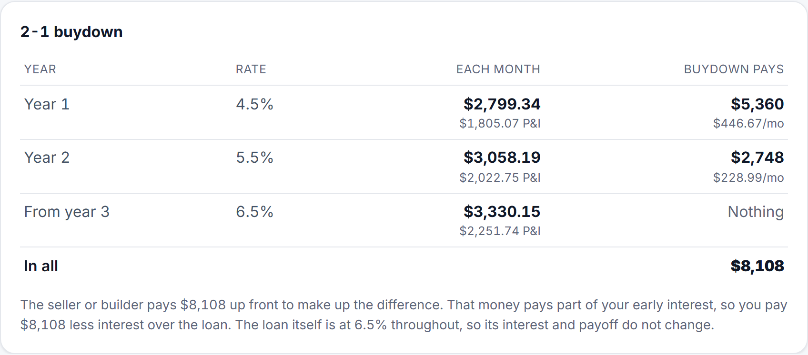
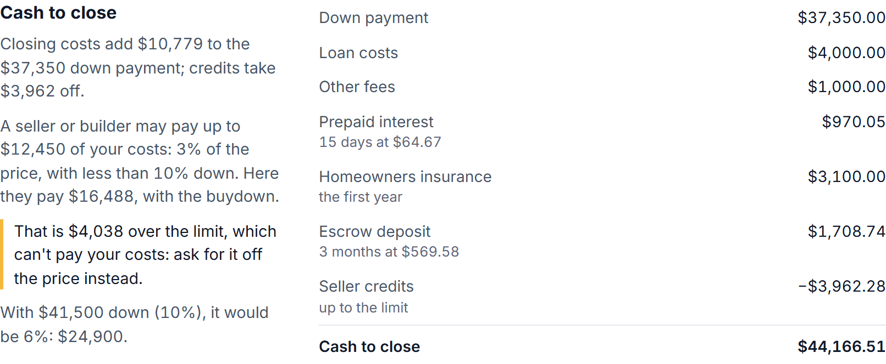
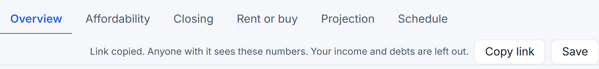
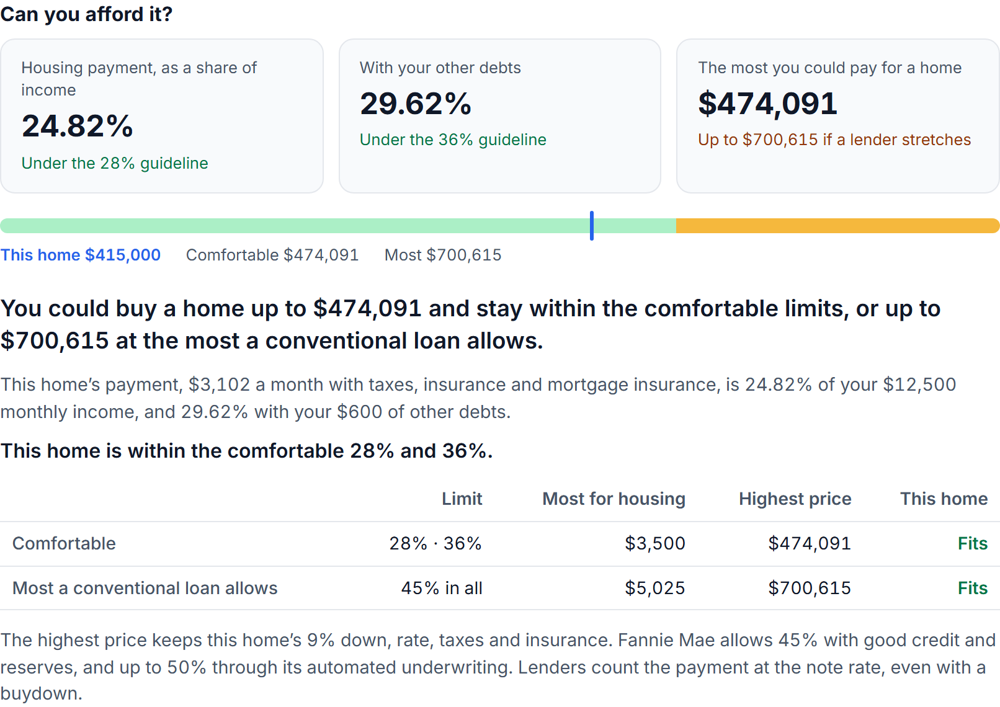
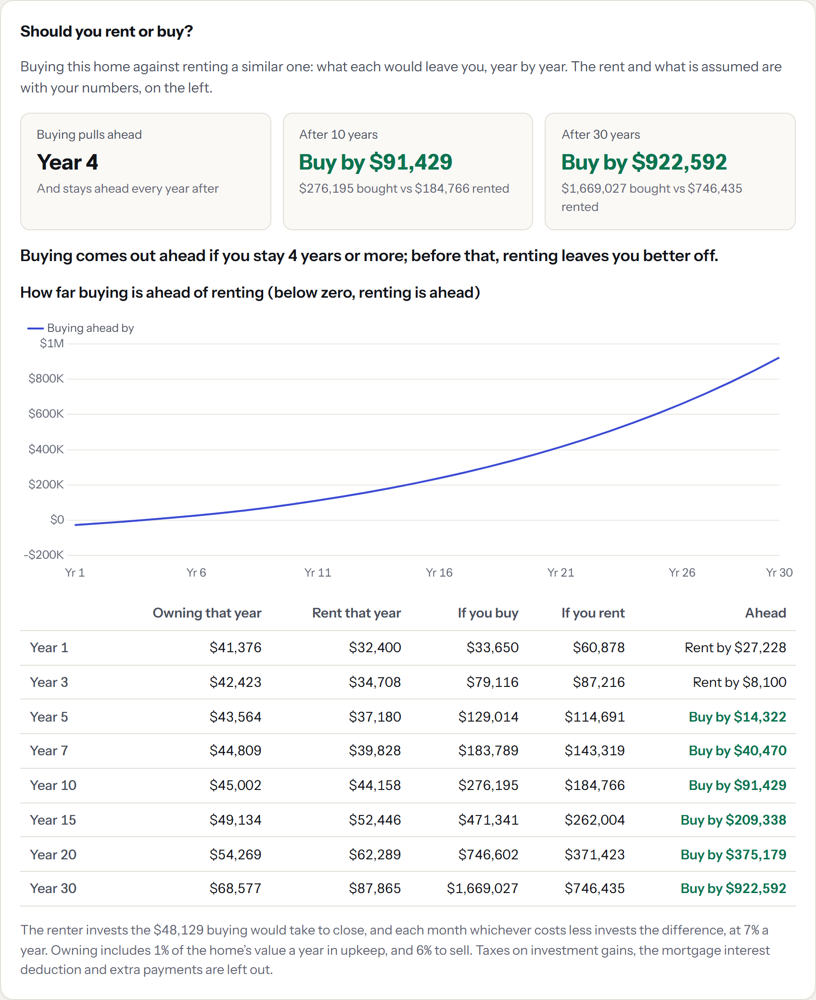
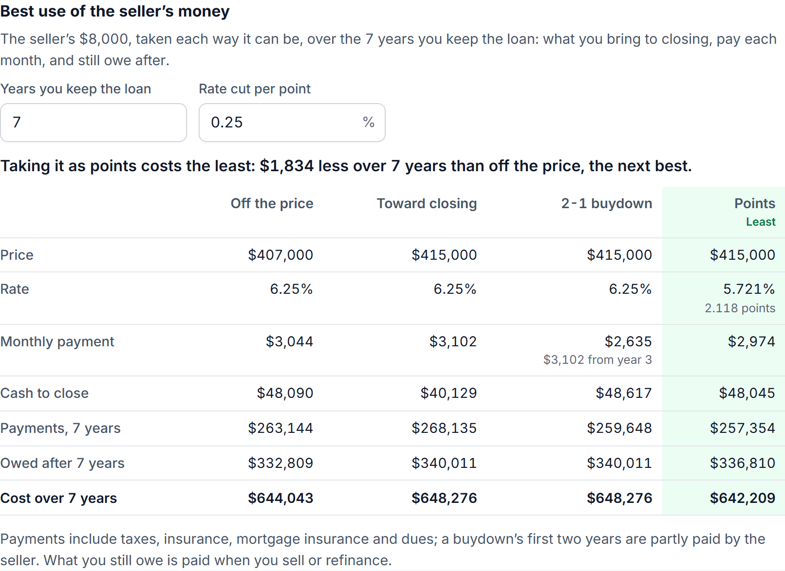
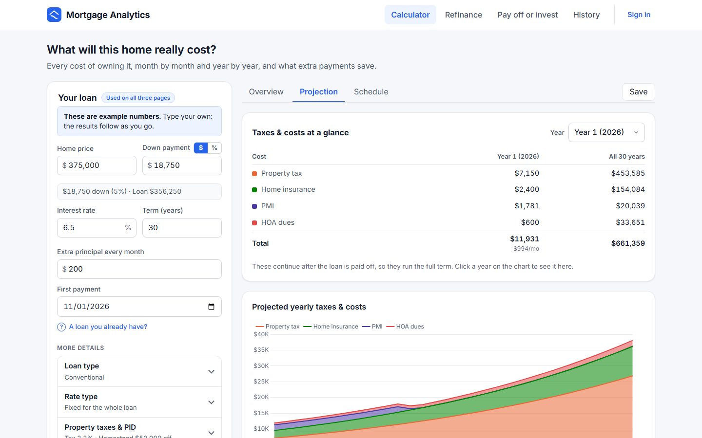
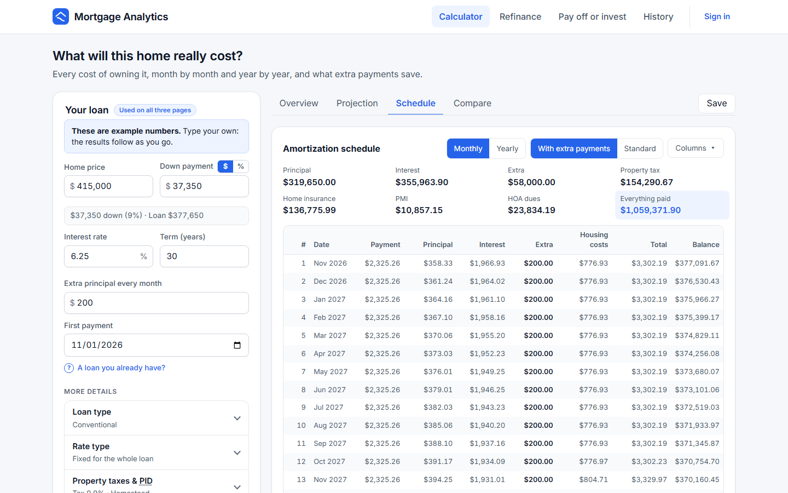
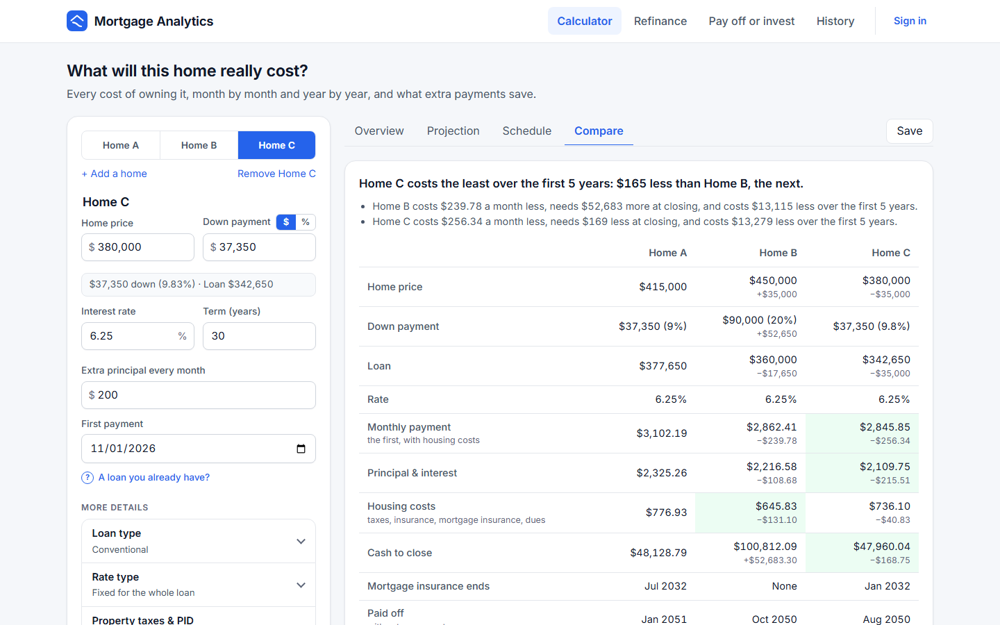

# 0. What it does

> **Three questions a home owner actually has, answered with the real rules behind each.**
>
> 1. **What will this home really cost me?** [The calculator](#the-calculator)
> 2. **Should I refinance?** [Refinance](#refinance)
> 3. **Should spare cash pay down the mortgage, or be invested?** [Pay off or invest](#pay-off-or-invest)
>
> A loan typed on one page is carried to the others, and an [account](#accounts-and-history) saves any result to
> reopen later. The calculators themselves need no account.

**Read time:** 10 min · **Best for:** what the app does, before how · **The formulas:** [6. The mortgage math](06-mortgage-math.md)

**On this page:** [The calculator](#the-calculator) · [Refinance](#refinance) ·
[Pay off or invest](#pay-off-or-invest) · [Across the pages](#across-the-pages) ·
[Accounts and History](#accounts-and-history)

---

## The calculator

What a purchase costs each month and to close, whether you can afford it, and what paying extra saves. The page
answers in that order: **Cost** leads with the payment and four answer tiles, then **Can I afford it?**, **Rent or
buy?** and **Compare**, each with its own answer; under Cost, one step down, are the **closing costs**, **year by
year** and **every payment**.

### The loan

- **Home price and down payment in, loan out.** The loan amount, down-payment percentage and loan-to-value are
  derived, so they can never disagree. The down payment can be typed in dollars or as a percentage (a **$ | %**
  switch converts it; the API always receives dollars).
- **Principal and interest** use the standard annuity formula in exact `decimal`, with interest rounded to the cent
  each month. The final payment absorbs the rounding, so every schedule ends at exactly **$0.00**.
- **A loan you already have.** Enter its real first payment: a date in the past makes the schedule start there, so
  the dates, the balance and PMI follow the original loan. The form says which payment is next and roughly what is
  owed; extra payments start with the next payment due, and a lump sum on a payment already made is flagged.

### Loan types

| Loan | Down payment | Mortgage insurance and fees |
|---|---|---|
| **Conventional** | At least 3% (5% with an adjustable rate); 10% on a second home, 15% on an investment property | PMI below 20% down (see the costs below) |
| **FHA** | At least 3.5% (10% with a credit score from 500 to 579; none below 500) | A **1.75% upfront MIP**, and an **annual MIP** from HUD's table: 0.55% of the balance for most 30-year loans with less than 5% down, 0.50% with 5% or more; lower on 15-year loans, higher above the national conforming limit ($832,750 in 2026). It lasts **11 years** at 90% LTV or less, otherwise the **whole loan**. The loan must be within **the county's limit**: pick the state and county, and the form shows HUD's 2026 limit there ($541,287 in most counties, up to $1,249,125) |
| **VA** | None needed | A **funding fee**: 2.15% with less than 5% down (3.3% when used before), 1.5% with 5%, 1.25% with 10%; none for veterans compensated for a service-connected disability. **No mortgage insurance** |

The upfront fee is added to the loan unless you choose to pay it at closing (then it is a cash-to-close line), so
the payment, interest and equity are on the whole amount borrowed. FHA's MIP is a twelfth of the annual rate on each
loan year's average balance on the original schedule, as HUD figures it; paying the loan off ends it, so extra
payments save it, and the results call it MIP, not PMI. $300,000 with 3.5% down borrows $294,566.25 with the upfront
MIP, and the first year's MIP is $134.33 a month.

**This home is** your home (the default), a second home or an investment property. A conventional loan can be at
most 97% of the price of a home you live in (95% with an adjustable rate), 90% of a second home and 85% of an
investment property, from Fannie Mae's Eligibility Matrix for a one-unit purchase; the form says how much more to put
down. FHA and VA are only for a home you will live in, and so is a homestead exemption. A seller may pay only 2% of an
investment property's price. The limits are on a loan being made: a loan already being paid, which can be owed above
the home's value, is shown as it is.

### Rate types

- **Fixed** for the whole loan.
- **Temporary buydowns** (1-0, 2-1, 3-2-1, 1-1). Each bought-down year is paid at the payment on the original amount,
  over the full term, at the reduced rate; a subsidy covers the rest. The loan itself stays at its note rate, so its
  interest and payoff do not change. A 2-1 on $356,250 at 5.99% is paid at $1,698.74, then $1,910.25, then $2,133.61,
  for a $7,899 subsidy.
  - **Every year, not just the first.** The results show a table with a row for each year of the buydown, then the
    note rate: what you pay each month (with that year's taxes, insurance and PMI, which rise each year, and the
    principal and interest under it), and what the buydown pays that year and each month ($5,218 then $2,680 on
    that loan), then its whole cost. The payment tile shows year 1 and where the payment ends up.

    
  - **Who pays decides what it saves.** Paid by the seller or builder, the subsidy pays part of your early interest,
    so you pay that much less ($403,950 of that loan's $411,848, and a 3-2-1 saves more). Paid by you at closing, it
    only moves your money earlier. The headline and the rate plan say which.
- **Discount points** (a permanent buydown): a fee at closing, a percentage of the loan, for a lower rate for the
  whole loan. Give the points and the rate the lender quotes without them (the loan's rate is the one with them); the
  Overview sets the two payments side by side and says what the points cost, the payment by which the interest they
  save covers that, and what they save over the loan, or that they never pay for themselves. One point on $200,000,
  6% instead of 6.25%, costs $2,000, saves $32.33 a month, and pays for itself by payment 48. The cost is a line in
  the cash to close. Not with an adjustable rate, whose two versions would reset differently.
- **Adjustable rates** (5/1, 7/1, 10/1, 5/6, 7/6, 10/6). The starting rate holds for the fixed period; each reset
  re-amortizes the balance over the payments left and moves toward the rate you expect, as far as the caps allow
  (first reset / later resets / lifetime, such as 5/2/5), and never below the **margin**, the rate's floor.
  - The results show each reset and its payment, and the **worst case**: rates rising as far and as fast as the caps
    allow, with the peak payment and total interest.
  - Extra payments lower the payment at each reset, as lenders re-amortize the smaller balance.

**What if the rate were different?** On a fixed-rate loan the Overview has a slider from a point and a half below the
rate to a point and a half above it, in eighths of a point. It prices the principal and interest at that rate and what
it does to the interest over the loan: on $377,650 at 6.25%, half a point more is $2,449.43 a month, $124.17 more. It
says what a quarter of a point is worth on this loan. It is left out for a buydown or an adjustable rate, which have
no single rate to move.

### Extra payments and recasting

- **Extra payments:** monthly, yearly and one-time lump sums, in any combination. An extra payment larger than the
  balance is capped.
- **Recasting** keeps the payoff date and lowers the payment instead. A lender recasts only after **one payment of
  at least its minimum** (default $10,000, never below $1,000), for a fee (default $250). Several smaller payments in
  a month do not add up to a qualifying one, and smaller extras still shorten the term. Each recast is listed with
  the old payment, the new payment and the fee.
- **Net savings = interest saved + PMI saved − recast fees.** Taxes, insurance and dues are left out on purpose: they
  continue after the loan is paid off.

### The full cost of owning

| Cost | How it works |
|---|---|
| **Property tax** | One combined rate by default, as most tax bills quote it, with a homestead exemption in dollars. Or, as in Texas, three taxing units: **school**, **county/city** and **MUD**, each on its own taxable value ("per $100" rates are entered as they are: $0.85 per $100 = 0.85%). Each year's bill is split into twelve installments that add up to it exactly. With no bill in hand, a list of the fifty states and DC starts the rate from the state's typical one (median tax paid over median home value, Census Bureau's 2024 American Community Survey, Table S2506): Texas 1.49%, Hawaii 0.27%. |
| **Homestead exemptions** | For a primary residence. School tax exempts a fixed amount ($140,000 in Texas); county/city tax can exempt a percentage (up to 20%, never less than $5,000: Texas Tax Code §11.13(n)); a MUD may grant its own percentage. Each exemption lowers only its own tax, as the law says. The form shows what they save in year 1. |
| **Over 65 or disabled** | From the year the owner qualifies: an extra school exemption ($60,000 in Texas since 2025) and a **school tax ceiling** that freezes school tax at that year's amount (it can fall, never rise). Counties and cities may add their own. An owner who **moves with a ceiling** keeps the same share of school tax at the new home (Texas Tax Code §11.26(g)): enter the share paid at the old one. |
| **Rate changes** | Each taxing unit adopts a new rate every year. **+ Add a tax rate change** gives a year and a new rate for each tax charged (blank keeps it); it applies from that year until the next change. A ceiling is set at the qualifying year's own rate, so a higher rate later can't raise the tax above it, and a lower one brings it down. |
| **Appraisal cap** | A homestead's *taxable* value rises at most a set percentage a year (10% in Texas), even when the market rises faster. |
| **PID assessment** | A fixed yearly amount, optionally ending after the district's remaining years. |
| **Insurance and HOA** | A yearly premium and monthly dues. |
| **PMI** | Only below **20% down**, as a percentage of the *original* loan. It comes off **on request at 80%**, using the actual balance (extra payments bring it forward, and that saving counts in net savings), which is the default, since a borrower paying extra asks as soon as they can. Or it comes off **automatically at 78%** of the original value, measured on the original schedule, which extra payments do not move. Either way it ends at the loan's **midpoint** whatever the balance, as the law says. The PMI tile says what the other way would do: on the example, if you don't ask, your servicer only has to remove it in Feb 2036 instead of Jul 2032, costing $6,766 more. Some servicers drop it once the actual balance passes 78%, but the law doesn't require it, so the app doesn't count on it. |
| **Future increases** | Home value growth drives each year's tax (within the cap); insurance and dues rise at their own rates. The defaults are long-run US averages, cited in the form: home values +4.3% a year (FHFA House Price Index, 1975–2025), insurance +4.8% (GAO-26-107867: $2,235 in 2019 to $2,829 in 2024), HOA dues +4%. |

### Cash to close

What you bring to closing besides the monthly payment, laid out as page 2 of a Loan Estimate lays it out
(**Closing costs & credits** in the form; the **Closing** tab shows it):

| Line | How it works |
|---|---|
| **Loan costs** and **other fees** | Typed in from the Loan Estimate: its total D (origination, appraisal, title), then sections E and H (recording fees, transfer taxes, an owner's title policy). |
| **Prepaid interest** | A day's interest at the note rate (loan × rate ÷ 365, to the cent), for the days from closing to the end of that month: $377,650 at 6.25% is $64.67 a day, so 15 days is $970.05. |
| **Homeowners insurance** | The first year's premium, always paid at closing. |
| **Escrow deposit** | Months of the first year's property taxes and insurance, a month being a twelfth of the year to the cent: (3,735 + 3,100) ÷ 12 = $569.58, so 3 months is $1,708.74. PID, HOA dues and PMI are not escrowed here. |
| **A buydown you pay for** | Its whole subsidy is paid at closing; a seller's buydown is not your money, so it is not in the total. |
| **Seller credits** and **lender credits** | They pay closing costs, the lender's first, and never the down payment: credits beyond the costs are shown as unused. The seller's are also held to the limit below. |

The Closing tab lists each line with how it was worked out, and the total. The example's $5,000 of fees, 15 days of
interest and 3 months of escrow on the $415,000 home come to **$10,778.79** on top of the $37,350 down payment.

**How long to save it.** Under the lines, the tab asks what you have saved, what you can put away each month and
what it earns (a savings account's 4% to start), and says how long until you would have the cash to close:
$1,000 a month from nothing at 4% reaches the example's $48,128.79 in 3 yr 9 mo. These three figures are the
panel's own and are not part of the loan.

#### What a seller or builder may pay

Builders often offer money toward closing, or a buydown, as an incentive, but the loan limits how much of it can pay
your costs. The limit is a percentage of the price, and a buydown the seller pays for counts toward it along with
their credits; the lender's credits do not:

| Loan | Most the seller or builder may pay |
|---|---|
| **Conventional** | **3%** with less than 10% down · **6%** with 10% to 25% down · **9%** with 25% or more (Fannie Mae's Selling Guide B3-4.1-02, for a home you live in or a second home) · **2%** for an investment property, whatever is put down |
| **FHA** | **6%** (HUD Handbook 4000.1 II.A.4) |
| **VA** | **4%**, and the seller may also pay your normal closing costs and discount points (the fees and prepaid interest here) |

The cash to close says what the limit is and why, and what the seller pays of it. When the offer is more than the
limit, the lender does not let the rest pay your costs: the seller credits are cut by that much, the total goes up,
and a note says to ask for it off the price instead. On a conventional loan it also says what more down would do:
on the example, **$41,500 down (10%) raises the limit from $12,450 to $24,900**.

#### How it's calculated, and the glossary

Two pages in the footer of every page explain the numbers. **How it's calculated** takes each answer in the order a
buyer meets it (the payment, taxes and insurance, mortgage insurance, cash to close, the APR, what you can afford, rent or
buy, refinancing, pay off or invest), worked through with the example loan, then says how the numbers are checked and
names the rules behind them. The **glossary** defines the words the app uses (PMI, MIP, escrow, APR, points, buydown,
loan-to-value) in a sentence or two; a link such as `/glossary#term-pmi` lands on one term. **Privacy**, in the same
footer, says what happens to what you type: nothing is saved without an account, a share link keeps the numbers after
its `#`, an account holds an email address, a scrambled password and what you save (all deleted with the account), and
the browser keeps only your column choice and theme. There is no analytics, advertising or tracking.

#### Paying every two weeks

Under the monthly extra, the form offers what paying **every two weeks** comes to: twenty-six half payments are thirteen
whole ones a year, so it is one extra payment a year, a twelfth of the payment added to each month ($193.77 on the
example). **Use it** fills the monthly extra with that amount, and the rest of the calculator follows.

#### A spreadsheet of every payment

The Schedule tab's **Download (CSV)** saves the schedule shown (monthly or yearly, with or without extra payments) as a
spreadsheet: every payment or year, with every column the schedule has, whichever are hidden from the table, in plain
numbers a spreadsheet can add up.

#### Comparing offers

**+ Add a home or another offer** (on Compare) adds a copy of Home A to change whatever differs: its price, or the
same home from another lender, with that lender's rate and fees. Up to four sit side by side.

The Closing tab has the figures a lender's Loan Estimate lists to compare one loan with another: the **APR**, what you
will have paid in 5 years (the first 60 payments of principal, interest, mortgage insurance and the lender's loan costs,
without extra payments) and the principal it pays off, and the **total interest percentage**: the interest over the whole
loan as a share of the amount borrowed (**127.543%** on a $200,000 loan at 6.5%).

#### A jumbo loan

A conventional loan above FHFA's conforming limit for the year it closes ($832,750 in 2026) is flagged above the answers:
jumbo loans have stricter rules, often more down and more in reserve, and are priced on their own. FHA and VA have limits
of their own and are never flagged.

#### The APR

The Cost view shows the **APR** beside the rate: the yearly cost of the loan once its fees are counted, **6.376%**
against the example's 6.25%. It counts the lender's loan costs, prepaid interest, discount points, an FHA or VA upfront
fee and mortgage insurance, and so compares offers with different fees. Compare shows each home's APR and marks the
lowest. **Reset to the example numbers** puts every field and section back to the worked example.

#### Share by link

**Share**, beside Save on every page, holds two choices. **Copy link** copies a link that opens the same numbers (and tab) in any browser, signed
in or not. The inputs travel in the link's `#share=` fragment, which a browser never sends to the server, so nothing is
stored. A purchase's link leaves out your income and debts; Pay off or invest needs them, so its link says it includes
them. A link cut short when copied opens the page as usual and says it could not be read.

#### Print or save as a PDF

**Print or save as PDF**, the Share menu's other choice, prints the page's results (or saves them as a PDF from the print dialog) under a line
saying what they are for: "Mortgage Analytics · Calculator: $415,000 home · 9% down · 6.25% · 30 yr · Oct 14, 2026".
The header, the form and the page's controls stay on the screen, and the page prints in the light theme even when the
screen is dark, charts included; the browser's own Print does the same.

#### Can you afford it?

Add your household's income a year and your other debts a month (**Income & debts**), and the **Affordability** tab
measures the home the way a lender does; the Overview's tile answers in a word (Yes, A stretch, Too much). Until an
income is given, the tile and the tab offer **Add your income**, which opens that section with the cursor in the field. The housing payment counts principal and interest at the note rate (a buydown's cheaper
first years are not qualified on), taxes, insurance, mortgage insurance, dues and PID. An adjustable rate is counted
as its program says: a conventional ARM fixed 3 years or less at the most it can reach in five years, one fixed 5
years at its first change's cap or the rate it is expected to reset to, and an FHA 1-year ARM with less than 5% down a
point above where it starts. The tab says which rate it used and why. It is shown as a share of gross
monthly income, alone and with the other debts. Each limit then says what it allows for housing, the highest price
it reaches with the same down payment share, rate and costs, and whether this home fits:

| Limit | Housing | With other debts |
|---|---|---|
| **Comfortable** | 28% | 36% |
| **Most a conventional loan allows** | (none) | **45%** (Fannie Mae's Selling Guide B3-6-02, with good credit and reserves; up to 50% through its automated underwriting) |
| **Most an FHA loan allows** | **31%** | **43%** (HUD; up to 40% and 50% with compensating factors) |
| **Most a VA loan allows** | (none) | **41%** (past it, VA asks for 20% more residual income) |

The tab leads with the answer to "how much house can I afford?": the most you could pay for a home, comfortably and
at the most the loan allows, before it measures the home in the form. The start page's question of the same name
opens it.

On the example with **$150,000** a year and **$600** of debts, the $3,102 payment is **24.82%** of the $12,500 monthly
income and **29.62%** with the debts: within the comfortable limit, which reaches **$474,091**. A conventional loan's
45% reaches **$700,615**. An FHA loan's 31% for housing alone can fail a home that conventional allows: its MIP adds
to the payment.

**A monthly budget** answers the question the other way round, with no income at all: say what you want to pay each
month, all in (the **Income & debts** section's last field), and the tab says the highest price that reaches, at the
same down payment share, rate, taxes and insurance, and what is down at that price. It counts the payment at the note
rate, since a budget is what will be paid. **Price a home at $X** (under a budget's answer, and under the lender's
view of what is comfortable) fills the form's home price with it, keeping your down payment share, so the rest of
the views show what that home would really cost.

#### Rent or buy

The **Rent or buy** tab weighs buying this home against renting a similar one. Type the rent (or **Try** a rent of about
0.65% of the price a month, to the nearest $25, a common rule of thumb); the rest has usual
values to change beside it: rent rising **3.5%** a year, investments earning **7%**, upkeep of **1%** of the home's
value a year, and **6%** to sell. The two households spend the same each month: whichever of owning and renting
costs less invests the difference, and the renter also invests what buying takes to close. Year by year, the buyer
is worth the home after a sale (its value, less what is owed and the selling costs) and their investments; the renter,
their investments.

The answer is how long you must stay for buying to come out ahead, with a chart of how far ahead it is each year
(crossing zero where it breaks even) and a table of the years 1, 3, 5, 7, 10, 15, 20 and 30. On the example, renting a
similar home for **$2,700** a month, buying comes out ahead **if you stay 4 years or more**; at **$2,100**, renting stays
ahead for all 30 years. Taxes on investment gains, the mortgage interest deduction and extra payments are left out.

#### The best use of the seller's money

The same money can be taken four ways, and the **Closing** tab weighs them whenever the seller offers some (credits,
or a buydown they pay for); without an offer, it says where to enter one. Each way is worked out as its own loan, on the standard schedule, and costed over the years you
expect to keep the loan (7 unless you change it): the cash to close, every payment with its taxes, insurance and PMI,
and what you still owe at the end, which you pay when you sell or refinance.

| Way | What changes |
|---|---|
| **Off the price** | The price is lower by the offer. With the same down payment the loan is smaller, and so are the taxes and PMI. It is not a concession, so the limit does not apply. |
| **Toward closing** | Seller credits, within the closing costs and the limit. |
| **2-1 buydown** | The seller pays the subsidy as far as the offer and the limit go. The buyer pays any shortfall at closing, and any of the offer left over goes toward closing. |
| **Points** | The offer buys as many points as it pays for within the limit, up to 5. Each point takes the rate cut per point off the rate: a quarter of a percentage point unless you change it. |

On the example with **$8,000** of seller credits, points cost the least over 7 years: **2.118 points** take the rate
from 6.25% to 5.721%, for **$642,209** against **$644,043** off the price and **$648,276** toward closing or as a
buydown. Those last two cost the same. Once the buydown's two years are over, the seller's money has paid the same
costs either way, sooner or later. Offer more than the closing costs or the limit allow, and only the price cut uses
all of it.

### The results

- **Cost (the Overview):** three equal answers: the **monthly payment** (principal and interest, and the housing
  costs; a buydown's year-1 payment), the **cash to close**, and **when it is paid off** and how much sooner. Under
  them, three that back them up: **can you afford it**, what **paying extra saves** (the net savings and the total
  interest, or without extra payments, the total interest over the loan, never a $0 saving), and **when PMI ends**.
  Then the rate what-if, the payment breakdown, and the balance over time with the gap between the two payoffs
  shaded. Closing costs, year by year and every payment are one step down, as links under the four views.
- **Can I afford it?** three figures of equal weight (the payment's share of income, with the debts, and the most you
  could pay), a bar placing this home against the comfortable and the most a lender allows, and each limit in a
  table (below).
- **Rent or buy?** when buying pulls ahead and where each side stands after 10 years and at the end, then the chart and
  the years (below).
- **Closing:** the cash to close and what a seller may pay, then the best use of the seller's money, with how it is
  weighed (the years you keep the loan, the cut per point) set beside the table it changes.
- **Projection:** the **quick numbers** for any year (each cost that year, through that year, and over the whole
  loan), then the yearly costs as stacked areas, the home's market value against what each tax is charged on, and
  your **equity**: what is still owed (on your plan, extra payments included) stacked under what is yours, so the top
  edge is the home's value. It starts at the down payment, and is the whole home from the year the loan is paid off.
  The year starts where the loan is now; pick another, or click the chart.
- **Schedule:** every payment, monthly or by year, with or without the extra payments, totals for every cost, and a
  **Columns** picker to show any cost as its own column. Recasts and the end of PMI are tagged on their row.
- **Compare** (the last view of Buy a home, on a page of its own): up to **four homes** side by side. **Home A** is the
  calculator's loan; **Home B** starts as a copy of it, and **Add a home** adds Home C and Home D the same way. A switch above the form edits any one of them, so any
  input can differ: price, down payment, rate, loan type, taxes, closing costs. **Remove** takes out the home being
  edited, down to two. A table shows each home's price, down payment, loan, rate, first payment (principal and
  interest, and housing costs; with extra principal too, once any home pays extra), cash to close, when mortgage
  insurance ends, when it is paid off, the interest over
  the loan, the **cost of the first 5 years** (interest, taxes, insurance, mortgage insurance and dues, plus the
  closing costs: what builds no equity), and the equity after 5 years.
  - **Differences:** under each figure is its difference from Home A; under a date, how much sooner or later it is
    ("2 yr 5 mo sooner").
  - **The best home on each line is shaded:** on the lines where less is better (the payment, cash to close,
    interest, the 5-year cost), sooner is (mortgage insurance ending, the payoff), or more is (equity).
  - **The summary:** with two homes, one line says what Home B costs more or less each month, at closing and over
    the first 5 years. With more, it names the home that costs the least over the first 5 years, then has the same
    line for each home against Home A, unless every home costs the same.
  - **On a narrow screen** nothing scrolls sideways: with three or four homes, each line's name goes above its
    figures, and on a phone the homes go two to a row, each named.

  Only Home A is the shared loan.

  
  

---

## Refinance

The rest of the current loan against a new one, with closing costs paid at closing or added to the loan.

- **The verdict over the life of the loan,** closing costs included, in green when refinancing saves and amber when
  it costs more. It catches the trap most calculators hide: a lower payment can cost more overall, because a new
  30-year loan restarts the amortization clock.
- **The monthly change, the months added, and the break-even:** the payment by which the interest saved covers the
  closing costs. That counts financed costs too, unlike the usual "costs ÷ monthly savings".
- **PMI on either loan,** from the home's value: today's PMI until the loan is down to 80% of it, and PMI on the new
  loan if it is above 80%. It counts in the payment, the totals and the break-even.
- **Cash out.** Enter cash to take out of the home's equity and it is borrowed on top of what you owe. The verdict
  becomes what the cash costs over the life of the loan, with the cash counted as money in hand; the break-even gives
  way to the cash in hand after closing costs. $50,000 out on the reference loan, at 6% for 30 years, makes a $350,000
  loan at $2,098.43 a month. Given the home's value, it says what share of it the new loan is and warns when that is
  over the 80% a cash-out refinance allows.
- **Keep paying today's payment.** When the new payment is lower, the new loan is also shown paid at today's payment:
  how to refinance without restarting the clock.
- **Your loan today, either way:** as what is owed now, or as the **original loan** (amount, term, first payment), from
  which the server works out the balance, the payments left and the next due date on that loan's own schedule.
- **Rate types on both loans.** An ARM on the current loan (its next reset counted from today, or from the original
  first payment); an ARM or a buydown on the new one, with each reset and the worst case. A buydown on a refinance is
  bought at closing, so it changes when you pay, not how much.

---

## Pay off or invest

Three ways to use the same spare cash, played out month by month for 30 years.

- **The strategies.** **Debt free ASAP** (every extra dollar to the mortgage, then everything invested), **Invest the
  difference**, and a **Hybrid** that splits the cash. All three take the free money first (the full 401(k) match at
  its after-tax cost, and any ESPP discount) and spend exactly the same each month.
- **Three markets.** The expected return; a **risk-adjusted** return (expected minus 4, 2 or 0 points for a
  Conservative, Balanced or Aggressive profile); and a **lost decade first** (−1% a year, like 2000–2009). The
  recommendation rests on the risk-adjusted return and always says whether a bad decade would reverse it.
- **Taxes as they really work.** Mortgage interest saves tax only on itemized deductions above the **standard
  deduction** (2026 amounts, rising with inflation; $750,000 debt limit), year by year, so paying down early also
  shrinks the deduction. Net worth counts every account **after the tax still owed** (a 401(k) at the income tax rate,
  capital gains on taxable growth, a Roth tax-free). Under the tax rates, the **2026 federal bracket** and long-term
  gains rate for the income entered: the example's $120,000 jointly is the 12% bracket, so its 17% is that plus a 5%
  state; at $500,000 the hint says 32%.
- **The hybrid split** follows the after-tax rate difference, and counts **stock that arrives anyway** (RSUs kept, an
  ESOP) toward its market share, so someone already heavy in company stock leans to the mortgage.
- **Rate types.** An ARM (paying down earns the rate's average over the loan, and a reset that raises the payment
  leaves less to invest) or a buydown on a new loan (its subsidy frees cash in every strategy).
- **PMI.** Paid until the balance is 80% of the home's value, so paying down ends it sooner; the Why tab says when
  each way ends it and what paying down saves. It is deductible like interest below $110,000 of income.
- **The results:** the recommendation, three cards (each led by how far it ends behind the leader), then the
  difference over time, net worth at years 5, 10, 15 and 30 (also in today's dollars), debt against investments, and
  why.

---

## Across the pages

- **One loan, typed once.** The balance, rate, years left, home value, rate type and PMI are shared by every page. Change
  them on one page and the next page opened starts from them, saying where they came from; each page keeps its own
  other inputs. On the calculator the shared loan becomes a purchase (the price is the home's value, the term the
  years left, rounded to whole years, and the rounding never flows back). Only a loan you type, or a saved one you
  open, is shared: a page's own example never overwrites yours.
- **Results as you type.** There is no Calculate button: every valid change is sent after a short pause, and a newer
  change replaces an older one in flight.
- **Answer first.** On a phone the results come first and the form follows, with **Edit your numbers** to jump to it;
  a sticky bar keeps the payment and savings in view, and the four pages are a bar along the bottom of the screen,
  where a thumb reaches. On a wider screen the form sits in its own column.
- **Each view answers its own question.** Buy a home has four views in a row: **Cost**, **Can I afford it?**, **Rent or
  buy?** and **Compare**; the closing costs, the year-by-year costs and every payment are one step down from Cost,
  as a quieter row of links. Under each view's question, once there is a result, the answer is set large with a
  sentence behind it: "$3,102 a month" with "$2,325 goes to the loan and $777 to taxes, insurance and the rest. You
  would bring $48,129 to closing. Paying extra pays it off 5 years 9 months sooner and saves $108,039"; or "Yes,
  comfortably" (or "Yes, but a stretch", "Not at this income") with the shares of income; or "Buy, if you stay 4 years
  or more" with the rent it was weighed against. Without an income or a rent, it says what to enter.
- **A first visit.** The start page offers six questions, each with what it comes to on the example numbers ("With
  the example: $3,102 a month"); each form says its numbers are an example until the first edit. An address that is
  not a page keeps its address and shows the same six questions, with a note that it is not one.
- **Reading pages.** How it's calculated (with its sections listed at the top), Glossary and Privacy sit in one row, so
  a reader moves between them without going back.
- **The form in a buyer's order.** The five main numbers, then six collapsed sections, each summarized in one line:
  Loan type & rate · Taxes, insurance, HOA & PMI · Closing costs & credits · Income & debts · Extra payments · Future
  increases.
- **Bookmarkable.** The calculator's Overview, Affordability, Closing, Rent or buy, Projection and Schedule tabs have their own
  URLs, and so does Compare homes (an old link to the Compare tab lands there); the back button works.
- **Light and dark mode,** following the system until you choose System, Light or Dark in the footer, which is
  remembered in the browser.

 

---

## Accounts and History

- **Sign up** with an email and a password, and confirm the email from the link sent to it. A forgotten password is
  reset by email.
- **Save** any calculation, up to four homes compared, a refinance comparison or a pay-off-or-invest comparison under a name.
- **History** lists them newest first, filtered by kind or searched by name. Open one on its own page (every number
  is restored), rename it, or delete it. Each person sees only their own.

---

[Guide contents](README.md) · Next: [1. Tech stack](01-tech-stack.md) →
