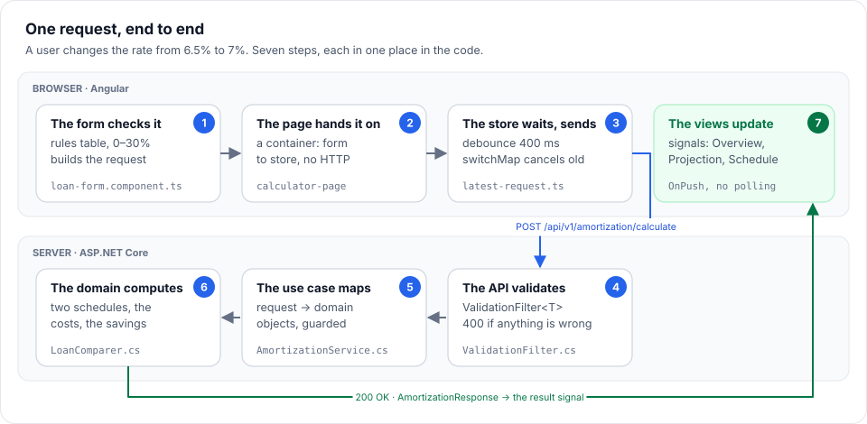

# 3. Architecture

> **How the pieces fit.** The layers and the rule that keeps them apart, one request traced from a keystroke to the
> database and back, how saving and signing in work, and where a new feature belongs.

**Read time:** 12 min · **Best for:** finding your way around the code · **Start at:** `src/MortgageAnalytics.Api/Program.cs`

**On this page:** [The shape of the system](#the-shape-of-the-system) ·
[One request, end to end](#one-request-end-to-end) · [Saving a calculation](#saving-a-calculation) ·
[Signing in](#signing-in) · [Design principles](#design-principles) ·
[Where to put a new feature](#where-to-put-a-new-feature)

---

## The shape of the system


This is a **Clean Architecture** (also called onion or ports-and-adapters) layout in four .NET projects:

| Project | Holds | Depends on |
|---|---|---|
| `MortgageAnalytics.Domain` | The business rules: loans, schedules, costs, refinancing, strategies. Pure C#. | Nothing at all: no NuGet packages, no ASP.NET |
| `MortgageAnalytics.Application` | Use cases: the public request and response contracts, validation, mapping to and from the domain, the services, the repository *interface* | Domain, FluentValidation |
| `MortgageAnalytics.Infrastructure` | Storage: `CalculationsDbContext`, the repository, migrations | Application (to implement its port), EF Core |
| `MortgageAnalytics.Api` | HTTP: endpoints, filters, error handling, accounts, email, startup | Application, Infrastructure (only to register it) |

### The dependency rule

Dependencies point **inward**: Api → Application → Domain, and Infrastructure → Application. The domain knows
nothing about HTTP or databases, and the use cases know nothing about EF Core. The Application layer owns the
`ISavedCalculationRepository` interface (a *port*); Infrastructure provides the implementation (an *adapter*).
This is the **Dependency Inversion Principle**: the high-level policy defines the interface the low-level detail
must meet.

Why it matters, in practice:
- **The math can be tested in isolation.** Domain tests are instant and need no setup.
- **The storage can change** (SQLite to PostgreSQL) without touching a use case.
- **The public API can't drift by accident.** Contracts are their own types, so renaming a domain class can't
  change the JSON. An architecture test fails if a contract ever exposes a domain type.

### Composition root

`Program.cs` is the only place that knows every layer. It calls `AddApplication()` (domain services, use cases,
validators), `AddInfrastructure(connectionString)` (EF Core and the repository), `AddAccounts(...)` (Identity),
and `AddEmail(...)`, then maps the endpoints. The domain services are **singletons**, because they hold no state.
The saved-calculation service and repository are **scoped** (one per HTTP request), like the EF Core `DbContext`
they use.

### One container

In production the Angular build is copied into the API's `wwwroot`, and `Program.cs` serves it
(`UseDefaultFiles`, `UseStaticFiles`, `MapFallbackToFile("index.html")`). So there is one process, one port, and
no CORS. Unknown `/api/...` routes return a JSON 404 instead of falling through to `index.html`. In development,
`ng serve` proxies `/api` to the API instead (`client/proxy.conf.json`), which gives the same single origin.

---

## One request, end to end

Follow a user changing the interest rate on the calculator from 6.5 to 7. Every step names the file to open.



### 1. The form notices the change (Angular)

`features/calculator/loan-form/loan-form.component.ts`

- The rate box is an `app-number-field` bound to the typed control `form.controls.annualInterestRate`. Its
  `appNumber` directive (a `ControlValueAccessor`) turns the text "7" into the number 7.
- The form's `valueChanges` fires. The component checks `canSend()`: are there no problems? Problems come from
  the form's **rules table** (`loan-fields.ts`), which mirrors the API's validator (0–30% for a rate), plus checks
  only the page can make, such as nothing left to borrow.
- If it can send, it builds the API request with `toLoanRequest()` (`loan-form.model.ts`): years become months,
  the down payment becomes dollars, the flat form becomes the request's nested groups. Then it emits `calculate`.

### 2. The page hands it to the store

`features/calculator/calculator-page.component.html`

```html
<app-loan-form form ... (calculate)="store.send($event)" (problems)="problems.set($event)" />
```

The page is a **container**: it wires the presentational form to `CalculatorStore`. The form knows nothing about
HTTP.

### 3. The store waits for a pause, then sends

`core/state/calculation-store.ts` → `core/state/latest-request.ts`

- `CalculationStore.send()` records the request at once (a signal) and sets `busy`.
- It also checks whether this request changed the loan. If it did, it updates the **shared loan**
  (`SharedLoanStore`), so the Refinance and Pay off or invest pages will start from it.
- `latestRequest` pushes it into an RxJS pipeline:
  - `debounceTime(400)`: typing "375000" sends one request, not six;
  - `switchMap`: a newer request cancels one still in flight, so a slow old answer can never overwrite a newer one;
  - `catchError` *inside* the `switchMap`: one failed request shows its error without ending the stream.
- `AmortizationApiService.calculate()` posts to `/api/v1/amortization/calculate`.

### 4. The API validates (ASP.NET Core)

`Api/Endpoints/AmortizationEndpoints.cs`, `Api/Filters/ValidationFilter.cs`

- Minimal APIs bind the JSON body to `AmortizationRequest` (enums as strings, via `JsonStringEnumConverter`).
- `ValidationFilter<AmortizationRequest>` runs `AmortizationRequestValidator`. If anything is wrong, it
  short-circuits with **400 ValidationProblem**, keyed by JSON path (`housingCosts.pid.remainingYears`), and the
  endpoint never runs.

### 5. The use case maps and runs the domain (Application)

`Application/Services/AmortizationService.cs`, `Application/Mapping/AmortizationMapper.cs`

```csharp
var purchase  = request.ToPurchase();                                  // price, down payment → loan amount, LTV, PMI?
var loan      = request.ToLoanTerms(purchase, clock.FirstOfNextMonth()); // + ARM rate changes, if any
var valuation = request.HousingCosts.ToValuation(purchase);             // market and taxable value by year
var plan      = request.HousingCosts.ToHousingCostPlan(purchase, valuation); // taxes, insurance, PMI, HOA, PID
var comparison = comparer.Compare(loan, request.ExtraPayments.ToExtraPaymentPlan(), request.ToRecastPolicy(), plan);
return comparison.ToResponse(...);
```

Mapping builds **domain objects**, whose constructors guard their own rules (a second line of defense after the
validator). "Today" comes from the injected `TimeProvider`.

### 6. The domain does the math (Domain)

`Domain/Amortization/LoanComparer.cs`, `AmortizationCalculator.cs`, `HousingCosts/HousingCostPlan.cs`

- `LoanComparer` runs the same loan twice through `AmortizationCalculator`: once as scheduled (the baseline),
  once with the extra payments (accelerated).
- For each month the calculator: re-amortizes if the rate changed (an ARM reset), charges interest rounded to
  cents, applies principal, applies extra principal (capped at the balance), and recasts if a single qualifying
  lump sum allows it.
- `HousingCostPlan` adds each month's taxes, insurance, PMI, HOA and PID to both schedules, and builds the yearly
  projection.
- `LoanComparison` works out the savings: **interest saved + PMI saved − recast fees** (taxes and insurance don't
  count, because they never stop).

### 7. The response comes back

- The service maps the domain result to `AmortizationResponse` (plain records, no domain types) and the endpoint
  returns `TypedResults.Ok(...)`; `?includePayments=false` drops the monthly rows.
- In the browser, `latestRequest` sets the `result` signal and clears `busy` only if this was the latest request.
- Every component reading `store.result()` updates: the Overview tab's headline numbers and charts, the
  Projection tab, the Schedule table. They are all `OnPush` and read signals, so only they re-render.

### When something fails

| Failure | What happens |
|---|---|
| A field is out of range in the browser | The field shows the message; no request is sent; the page shows "these results are for your last valid inputs" |
| The API rejects the request (400) | `toErrorMessages()` turns the ProblemDetails into readable lines under the form |
| A domain guard fires (a bug: input was validated first) | `DomainValidationException` → `GlobalExceptionHandler` → logged, and a generic 500 with no internal details |
| The API is down | The request's own `catchError` shows the error; the next change tries again |

---

## Saving a calculation

`shared/save-calculation/` → `SavedCalculationsApiService` → `POST /api/v1/calculations` → `SavedCalculationEndpoints`
→ `SavedCalculationService` → `ISavedCalculationRepository` → `SavedCalculationRepository` (EF Core) → SQLite.

- The endpoint group has `.RequireAuthorization()`: no session cookie means 401.
- The owner id comes from the signed-in user's claims, never from the request body.
- The repository filters by owner **in the query** (`WHERE OwnerId = @user`), so another user's calculation is
  simply not found: a 404, which doesn't reveal that it exists.
- The inputs are stored as **one JSON column per kind** (calculator, refinance, strategy), because they are always
  read and written whole. A test makes sure saves in today's format keep loading (see [Testing](07-testing.md)).
- Opening a saved calculation from History calls `CalculationStores.of(kind).open(saved)`: the right page's store
  loads it and the form restores itself from the request.

The tables, a stored row, every query and the migrations: [Data and storage](10-data-and-storage.md).

---

## Signing in

ASP.NET Core Identity provides the account endpoints (`MapIdentityApi`) under `/api/v1/account`, narrowed to the
ones the app uses (`ServeOnlyWhatTheAppUses`): sign-in is with a session cookie only, so the bearer-token paths
(sign-in without `useCookies=true`, `/refresh`) and two-factor setup are refused or not served.

1. **Register**: the password is hashed by Identity, and a confirmation email is sent (`AccountEmailSender`
   writes the link; SMTP or the file outbox delivers it).
2. **Confirm**: the link opens `/confirm-email` in the app, which sends the user id and signed code to Identity's
   `GET /confirmEmail`.
3. **Sign in** (`login?useCookies=true`): the response sets an **HttpOnly, SameSite=Strict** cookie. Scripts can't
   read it, and other sites can't make the browser send it. There's no token in `localStorage`.
4. On startup, `AuthService.load()` (an app initializer) asks `/manage/info` who is signed in, so the header and
   the History guard know at once.
5. **Forgot password** answers the same whether or not the address exists, so it can't be used to find accounts.
6. **Delete the account** (`DELETE /api/v1/account`, with the password): Identity deletes the user, the database
   cascades to their saves, and the session ends. Every request rechecks its session against the user, so the
   account's other sessions end at once too.

The cookie and the emailed codes are signed with Data Protection keys kept on disk (a Docker volume in
production), so a restart doesn't sign anyone out or break a link.

---

## Design principles

Where SOLID, KISS and DRY actually show up in the code, so the claim can be checked. For all five SOLID principles
worked through one section, with the code for each, see [SOLID by example](09-solid-by-example.md).

| Principle | Where |
|---|---|
| **Single responsibility** | `PaymentFormula` does the math, `AmortizationCalculator` builds schedules, `HousingCostPlan` applies costs, `LoanComparer` compares, the validator validates, and endpoints handle HTTP and nothing else. |
| **Open/closed** | A new prepayment kind is a new `IExtraPaymentRule`; a new ownership cost (flood insurance, a special assessment) is a new `IHousingCost`. Neither touches the calculator. Adding the school tax unit and yearly growth needed no change to the amortization engine. |
| **Liskov substitution** | Every rule and every cost can stand in for another behind its interface, and the composites (`ExtraPaymentPlan`, `HousingCostPlan`) sum whatever they hold. |
| **Interface segregation** | Small interfaces of one or two members: `IExtraPaymentRule`, `IHousingCost`, `IAmortizationCalculator`, `ILoanComparer`, `IAmortizationService`. |
| **Dependency inversion** | Services depend on `ILoanComparer` and `TimeProvider`, not on concrete classes or `DateTime.Now`, so tests inject a fixed clock. Application owns `ISavedCalculationRepository`; Infrastructure implements it. |
| **DRY** | Validation limits come from domain constants. The PMI rule lives only on `PropertyPurchase`. Compounding (`Growth`) and installments (`Installments`) are written once. One generic `ValidationFilter<T>` serves every endpoint. On the client, one `buildLineChart` and one `hostChart` serve every chart, and one `COST_CATEGORIES` list gives each category the same label and colour everywhere. |
| **KISS / YAGNI** | No MediatR or AutoMapper: nothing here needs them. The Infrastructure project arrived only with the first real need, saved calculations. Inputs are stored as one JSON column, because they are only ever read and written whole; that JSON has no version yet, and a test loads today's format so a rename or removal fails CI instead of quietly dropping values. |

---

## Where to put a new feature

| You want to add | Touch |
|---|---|
| A new ownership cost (flood insurance) | A new `IHousingCost` in Domain/HousingCosts, a request field, a mapper line, a validator rule. The calculator doesn't change (Open/Closed). |
| A new kind of prepayment | A new `IExtraPaymentRule`; `ExtraPaymentPlan` sums whatever it holds. |
| A new field on a form | The contract (C#) and the model (TS), the validator and the rules table (with the same limits), the form model's `toLoanRequest`/`restoreLoanForm`, the template. Then tests at each layer. |
| A new calculator page | A domain analyzer, a contract, validator, mapper and service, an endpoint; on the client a store extending `CalculationStore`, registered in `CalculationStores`, and a page using `app-calculation-page`. |
| A new column in the database | Change the entity, then `dotnet ef migrations add`. |

---

← Previous: [2. Commands](02-commands.md) · [Guide contents](README.md) · Next: [4. Backend](04-backend.md) →
