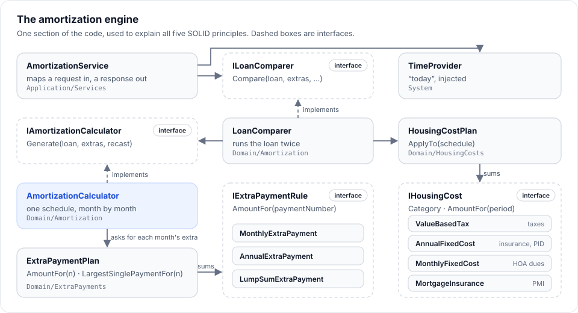

# 4. Backend

> **Four projects under `src/`, read from the inside out:** the domain first, because everything else serves it.
> Then the use cases, storage, and the HTTP API with its security.

**Read time:** 12 min · **Best for:** the classes that matter, and calling the API · **Code:** `src/`

**On this page:** [Domain](#domain-srcmortgageanalyticsdomain) ·
[Application](#application-srcmortgageanalyticsapplication) ·
[Infrastructure](#infrastructure-srcmortgageanalyticsinfrastructure) · [API](#api-srcmortgageanalyticsapi) ·
[Security](#security)

---

## Domain (`src/MortgageAnalytics.Domain`)

Pure C#: no NuGet packages, no ASP.NET, no I/O. Every type is immutable or stateless, so one instance can be
shared across requests.

### The folders

| Folder | Key types | What they do |
|---|---|---|
| (root) | `Money`, `DecimalMath`, `Growth`, `LoanCalendar`, `DomainValidationException` | Rounding to cents (once, here), `decimal` exponentiation, compounding, loan-year arithmetic, and the exception every guard throws |
| `Loans/` | `LoanTerms`, `PropertyPurchase`, `PaymentFormula`, `AdjustableRate`, `RateChange`, `TemporaryBuydown`, `LoanProgress` | The loan itself: its terms and rate changes, the purchase (loan amount, LTV, PMI rule), the payment formula, ARMs and buydowns, and where a loan stands on a given day |
| `ExtraPayments/` | `IExtraPaymentRule`, `MonthlyExtraPayment`, `AnnualExtraPayment`, `LumpSumExtraPayment`, `ExtraPaymentPlan` | Prepayment rules, combined into one plan |
| `Amortization/` | `AmortizationCalculator`, `AmortizationSchedule`, `ScheduledPayment`, `RecastPolicy`, `RecastEvent`, `RateChangeEvent`, `LoanComparer`, `LoanComparison` | The month-by-month engine, recasts, and baseline-vs-accelerated comparison |
| `HousingCosts/` | `IHousingCost`, `ValueBasedTax`, `TaxExemption`, `SeniorTaxRelief`, `PropertyValuation`, `MortgageInsurance`, `AnnualFixedCost`, `MonthlyFixedCost`, `Installments`, `HousingCostPlan`, `HousingCostSchedule` | Taxes (with exemptions, the appraisal cap, the over-65 ceiling), PMI, insurance, HOA, PID; applied month by month and projected by year |
| `Refinancing/` | `RefinanceOffer`, `RefinanceAnalyzer`, `RefinanceAnalysis` | Keep the loan or refinance: savings, months added, break-even |
| `Strategies/` | `StrategyOptimizer`, `StrategySimulator`, `MonthlyCashPlan`, `StrategyRates`, `MortgagePayments`, `TaxDeductions`, `InvestmentAccounts`, `Household`, … | Pay off, invest, or a hybrid, simulated month by month in three market scenarios |

### Patterns you will see, and where

| Pattern | Where | Why |
|---|---|---|
| **Guard clauses** in constructors | `LoanTerms`, `AdjustableRate`, `PropertyPurchase`, … | An invalid object can't exist. `new LoanTerms(-5, …)` throws `DomainValidationException` with a message naming the problem. |
| **Immutable records** | `LoanTerms`, `RecastPolicy`, `AdjustableRate`, events | Value semantics and safe sharing. `with` makes a changed copy: `arm with { Margin = 2.75m }`. |
| **Strategy** (behind an interface) | `IExtraPaymentRule`, `IHousingCost` | Each prepayment kind and each cost is its own small class. |
| **Composite** | `ExtraPaymentPlan`, `HousingCostPlan` | The calculator asks the plan for one total and never knows how many rules or costs there are. |
| **Static factory / named constructors** | `RecastPolicy.Never`, `RecastPolicy.OnLumpSum(...)`, `ExtraPaymentPlan.None` | Intent-revealing creation. |
| **Pure functions** | `PaymentFormula.MonthlyPayment`, `Money.Round`, `Installments` | Same input, same output; trivial to test. |
| **Open/Closed** | Adding a cost or a rule | A new `IHousingCost` (say, flood insurance) is added without changing `AmortizationCalculator`. |

### Money rules (the ones interviewers poke at)

- **`decimal`, never `double`.** `double` can't represent 0.1 exactly, which is fine for physics and wrong for
  cents. `Math.Pow` only works in `double`, so `DecimalMath.Pow` does exponentiation by squaring in `decimal`.
- **One rounding rule, in one place:** `Money.Round` rounds to cents, half away from zero.
- **Interest each month** = balance × annual rate ÷ 1,200, rounded to cents (`LoanTerms.MonthlyInterestOn`). It is
  written that way rather than balance × (rate ÷ 12) because 7 ÷ 12 repeats forever; the independent reference
  found a half-cent difference that this fixed.
- **The final payment absorbs the drift**, so every schedule ends at exactly $0.00.
- **Yearly bills split exactly:** `Installments` makes $5,000 into eleven payments of $416.67 and one of $416.63.

### The engine in one loop



`AmortizationCalculator.Generate(loan, extraPayments, recastPolicy)`, for each period:

1. If the rate changed this period (an ARM reset), re-amortize: new payment = formula(balance, new rate, payments
   left). Record a `RateChangeEvent`.
2. Interest = `MonthlyInterestOn(balance, rate)`.
3. Principal = payment − interest, capped at the balance (the last period takes the whole balance).
4. Extra principal = the plan's amount, capped at what's left.
5. If the period's **largest single** prepayment meets the `RecastPolicy` minimum, re-amortize over the remaining
   term (the payoff date stays, the payment drops). Record a `RecastEvent` with its fee.

ARMs don't change this loop: `loan.WithAdjustableRate(arm)` asks the ARM for its `RatePath()` (a list of
`RateChange`s) from the loan's own rate and term, and attaches it. The loop only asks `loan.AnnualRateFor(period)`.
Every caller (the calculator, both refinance loans, the strategy mortgage, the ARM worst case) goes through that one
method.

---

## Application (`src/MortgageAnalytics.Application`)

The use cases: what the API offers, and the translation between the outside world and the domain.

| Folder | Contents |
|---|---|
| `Contracts/` | Request and response records: `AmortizationRequest`, `AmortizationResponse`, `RefinanceRequest`, `StrategyRequest`, `SavedCalculation…`. Plain data with XML docs and `<example>` values (they become the Swagger docs). They never expose domain types. |
| `Validation/` | One FluentValidation validator per request. `RateOptionValidators.cs` holds the ARM and buydown rules shared by all three. Limits come from domain constants (`LoanTerms.MaxAnnualInterestRate`), so they are written once. |
| `Mapping/` | Extension methods from contracts to domain objects and back: `request.ToLoanTerms(...)`, `comparison.ToResponse(...)`. `RateOptionMapper` maps ARMs and buydowns the same way for every page. |
| `Services/` | `AmortizationService`, `RefinanceService`, `StrategyService`: map in, call the domain, map out. They depend on interfaces (`ILoanComparer`, `IRefinanceAnalyzer`, `IStrategyOptimizer`) and `TimeProvider`. |
| `SavedCalculations/` | `SavedCalculation` (the entity), `ISavedCalculationRepository` (the port), `SavedCalculationService` (stamps times, trims names, maps). |
| `Sessions/` | `UserSession` (one sign-in with a session cookie), `IUserSessionRepository` (the port) and `DeviceLabel` ("Chrome on Windows" from a user agent, reading only the few words that tell devices apart). |
| `Rates/` | `AverageRates`, `IAverageRates` (the port) and `PmmsCsv`, which reads Freddie Mac's survey history by column name and gives nothing for anything that is not it, or for a rate no loan could have. |
| `Passkeys/` | `Passkey` (the entity: a credential id, its public key, the user handle, a counter and a name) and `IPasskeyRepository` (the port). |
| `Preferences/` | `UserPreferences` (the entity: what one user has chosen about how the app looks to them) and `IUserPreferencesRepository` (the port); the key-figure arrangement is kept here. |
| `DependencyInjection.cs` | `AddApplication()`: registers all of the above. |

**Two layers of validation, two purposes.** The validator gives the *user* friendly, field-level messages. The
domain guards protect the *code*: no caller, now or later, can build an invalid loan. If a guard ever fires in
production, input got past the validator, which is a bug, so it is logged and returned as a 500.

**Why the mapping is hand-written.** Each mapping makes decisions (a strategy of "Recast" becomes
`RecastPolicy.OnLumpSum(min, fee)`, a zero amount means "none", PMI applies only below 20% down). Writing them as
code puts those decisions where they can be read and unit-tested one by one, which a mapping library would hide.

---

## Infrastructure (`src/MortgageAnalytics.Infrastructure`)

| File | Purpose |
|---|---|
| `CalculationsDbContext.cs` | EF Core context: Identity's tables (it derives from `IdentityDbContext`) plus `SavedCalculations`, `UserPreferences` and `Passkeys` |
| `UserSessionRepository.cs` | Records sign-ins; says whether a session is still wanted and notes its use at most every five minutes; lists a user's by last use (clearing those older than the cookie lasts); ends one, or all but one, by owner in one statement |
| `PasskeyRepository.cs` | Finds a passkey by the credential id a device sends; lists, adds, records a sign-in's counter and time, and deletes by owner |
| `UserPreferencesRepository.cs` | Reads and replaces a user's key-figure arrangement (names kept comma-separated); one row per user |
| `SavedCalculationRepository.cs` | The port's implementation: list (with a case-insensitive, wildcard-safe search), find, add, update, delete; always filtered by owner |
| `DependencyInjection.cs` | `AddInfrastructure(connectionString)` and `MigrateDatabaseAsync()`, run at startup |
| `Migrations/` | Generated by `dotnet ef migrations add`. Edited by hand only to add SQL that moves data, marked "Added by hand" (`CompareUpToFourHomes`) |

Details worth knowing (the whole picture, with the schema: [Data and storage](10-data-and-storage.md)):
- **Inputs are JSON columns.** Each kind of inputs (`Inputs`, `OtherHomes`, `Refinance`, `Strategy`) is one column,
  converted with `System.Text.Json` through a `ValueConverter`. `OtherHomes` is a JSON array, each home in it stamped
  with its own format version like any save, so each upgrades on its own (`StoredJson.ReadList`). The contracts can grow without a schema change. A
  `ValueComparer` compares the JSON, so replacing inputs with an equal copy isn't seen as a change.
- **SQLite can't sort `DateTimeOffset`**, so the times are stored as sortable 64-bit numbers
  (`DateTimeOffsetToBinaryConverter`).
- **An index on (OwnerId, UpdatedAt)** matches the one query every list makes.
- **Cascade delete:** deleting a user deletes their calculations (a foreign key to Identity's users table).
- **`ExecuteDeleteAsync`** deletes in one SQL statement, without loading the row first.

---

## API (`src/MortgageAnalytics.Api`)

| File | Purpose |
|---|---|
| `Program.cs` | Composition root and middleware pipeline |
| `Endpoints/*.cs` | One static class per area, each with a `Map…Endpoints` extension: amortization, refinance, strategies, saved calculations, account |
| `Filters/ValidationFilter.cs` | Generic endpoint filter: finds the `TRequest` argument, validates it, returns a 400 ValidationProblem or calls the endpoint |
| `Errors/GlobalExceptionHandler.cs` | `IExceptionHandler`: unreadable requests keep their status (400, 413); anything else is a logged, generic 500 |
| `Security/SecurityHeaders.cs` | The Content-Security-Policy and the other browser security headers, on every response |
| `Email/` | `AccountEmailSender` (the email text and links), `SmtpMailTransport` (MailKit), `FileOutbox` (local dev), `EmailSetup` (wiring, and the Development-only outbox endpoints) |

### The pipeline (in `Program.cs` order)

1. `UseRequestLogging()`: first, so every request gets its id before anything else runs, and its log line has the
   final status, errors included.
2. `UseSecurityHeaders()`: so even errors and static files carry the CSP and the other headers.
3. `UseResponseCompression()`: Brotli or gzip for the JSON and the app's own files.
4. `UseExceptionHandler()` + `UseStatusCodePages()`: every error becomes ProblemDetails.
5. Swagger and Swagger UI (in every environment: the docs are part of the showcase).
6. `UseDefaultFiles()` + `UseStaticFiles()`: the Angular app from `wwwroot`.
7. `UseAuthentication()` + `UseAuthorization()`, then `UseRateLimiter()` (the account attempt limit).
8. Endpoints: `/health`, the API groups, the dev outbox (Development only).
9. A JSON 404 for unknown `/api/...` routes, then `MapFallbackToFile("index.html")` so Angular's router handles
   every other URL.

### An endpoint, annotated

```csharp
group.MapPost("/calculate", Calculate)                                // POST /api/v1/amortization/calculate
    .WithName("CalculateAmortization")                                // operationId in OpenAPI
    .WithSummary("...")                                               // shown in Swagger
    .AddEndpointFilter<ValidationFilter<AmortizationRequest>>()       // validate first
    .ProducesValidationProblem()                                      // document the 400
    .ProducesProblem(StatusCodes.Status500InternalServerError);       // and the 500

private static Ok<AmortizationResponse> Calculate(
    AmortizationRequest request,          // bound from the JSON body
    IAmortizationService service,         // injected from DI
    bool includePayments = true)          // bound from the query string
    => TypedResults.Ok(...);              // TypedResults: OpenAPI knows the 200 shape
```

The endpoint does HTTP only. Validation is in the filter, and the work is in the service.

### API design decisions

- **Minimal APIs with `TypedResults`,** so the OpenAPI response types are inferred from the code.
- **A versioned route** (`/api/v1/...`).
- **ProblemDetails for every error:** validation (400, field names keyed by JSON path), unreadable bodies (their own
  status: 400, 413...), an unknown API route (404), and server-side failures (500 with a generic title, logged). A
  broken domain rule is a 500 too: input is validated first, so it means a bug, and its message is never shown.
- **Contracts own their types.** Requests and responses never expose Domain types (an architecture test enforces it),
  so renaming something in the domain cannot silently change the public API. A snapshot test pins the whole contract.
- **Response size is the client's choice.** `?includePayments=false` drops the up to 1,200 monthly rows and keeps every
  summary and the yearly projection.
- **Source-generated logging** (`[LoggerMessage]`), and the recommended .NET analyzers.
- **Every request has an id** (`Observability/RequestLogging.cs`): the caller's `X-Request-ID` when it is short and
  plain (so a proxy's logs line up with ours), otherwise a new one. It is sent back in `X-Request-ID`, put in every
  ProblemDetails body as `requestId` (the app shows it as "Reference: …" on a server error), and is a scope on every
  log line the request writes.
- **One log line per request:** `GET /api/v1/calculations responded 401 in 2.1 ms (request 7f3a…)`, with method, path,
  status and time as fields. API requests are logged at Information; health checks and static files only at Debug.
  The query string is never logged, because emailed links carry their codes in it.
- **JSON logs in Production** (`appsettings.json`: the console's `json` formatter, with scopes and UTC timestamps), so
  a log store can search by field; plain lines in Development, for a person reading the terminal.
- **One container.** The API serves the compiled Angular app from `wwwroot`: one port, one deployment, no CORS.

### Calling the API

`POST /api/v1/amortization/calculate`. The smallest request is a price, a down payment, a rate and a term:

```json
{ "homePrice": 375000, "downPayment": 18750, "annualInterestRate": 6.5, "termInMonths": 360 }
```

<details>
<summary><b>The same request with every option set</b> (extra payments, a recast, Texas taxes, PMI)</summary>

```json
{
  "homePrice": 375000,
  "downPayment": 18750,
  "annualInterestRate": 6.5,
  "termInMonths": 360,
  "firstPaymentDate": "2026-11-01",
  "strategy": "Recast",
  "recast": { "minimumLumpSum": 10000, "fee": 250 },
  "extraPayments": {
    "monthlyAmount": 200,
    "annual": { "amount": 2000, "firstPaymentNumber": 12 },
    "lumpSums": [{ "paymentNumber": 12, "amount": 25000 }]
  },
  "housingCosts": {
    "schoolTaxRate": 1.0,
    "localTaxRate": 1.1,
    "mudTaxRate": 0.85,
    "isHomestead": true,
    "schoolHomesteadExemption": 140000,
    "localHomesteadExemptionPercent": 0,
    "homesteadAssessmentCap": 10,
    "over65OrDisabled": { "qualifiesInYear": 6, "schoolExemption": 60000, "localExemption": 0, "localTaxCeiling": false },
    "homeValueGrowthRate": 4,
    "insuranceIncreaseRate": 5,
    "hoaIncreaseRate": 3,
    "pid": { "annualAssessment": 1200, "remainingYears": 20 },
    "annualHomeownersInsurance": 2400,
    "monthlyHoaDues": 50,
    "pmiRate": 0.5,
    "pmiCancellation": "BorrowerRequested"
  }
}
```

</details>

The response holds:

| Field | What it is |
|---|---|
| `purchase` | The loan amount, down-payment percentage, loan-to-value, and whether PMI is required |
| `baseline`, `accelerated` | The schedule without and with the extra payments: the monthly payment (with a housing-cost breakdown and the all-in total), lifetime totals, the interest you pay after any buydown subsidy, the PMI end date, any recasts and rate resets, and every monthly row |
| `savings` | Interest saved, PMI saved, recast fees, net savings, payments saved, and both payoff dates |
| `projection` | One row per loan year: market value, what each tax is charged on, and every cost |
| `buydown`, `adjustableRate` | The buydown's years, cost and who pays it; an ARM's worst case. Null when not used |

Invalid input is a `400` with field-level errors keyed by JSON path:

```json
{
  "title": "One or more validation errors occurred.",
  "status": 400,
  "errors": {
    "downPayment": ["Down payment must be less than the home price."],
    "housingCosts.pid.remainingYears": ["'PID remaining years' must be between 1 and 50. You entered 99."]
  }
}
```

The full contract, with descriptions and example values, is in Swagger UI at `/swagger`.

---

## Security

Input is validated **twice, for different reasons**: FluentValidation (Application) gives people friendly,
field-level messages, and guard clauses (Domain) make invalid objects impossible to construct from *any* caller. If a
guard ever fires, it is a bug, and the exception handler logs it as one. The Angular form mirrors the main limits to
save a round trip; the server never trusts it.

Accounts follow the same habit of not trusting the client:

| Measure | What it does |
|---|---|
| **Session cookie** | HttpOnly and SameSite=Strict: scripts cannot read it and other sites cannot send it. No token in `localStorage`. Passwords are hashed by Identity, and five wrong passwords lock the account for five minutes. Every request rechecks the session against its user (not every 30 minutes, Identity's default), so a deleted account or a password reset ends the other sessions at once. |
| **Passkeys** | WebAuthn, checked by the Fido2 library: the challenge, the signature, the site it was made for (the passkey is for this domain, and an answer made for another origin is refused), the user handle, and a counter that must not go back. Each ceremony's challenge travels in a sealed, five-minute token (`PasskeyState`, with the data-protection keys every instance shares) bound to its purpose and, when registering, to the user, and each is opened once. Signing in needs a confirmed email and no lockout, like a password. The same attempt limit applies. A passkey is for the site it was made on: the domain and origin come from the request (the believed scheme, and the `Host` the proxy passes on), so behind a reverse proxy it must keep `Host` and be listed in `ForwardedHeaders:KnownProxies`, or the origin will not match the browser's. Passkeys made on `localhost` do not work on another domain. |
| **Only the endpoints the app uses** | Identity's built-in set also issues bearer tokens (sign-in without `useCookies=true`, `/refresh`) offers two-factor setup the app has no screen for, and changes the password or email through `POST /manage/info` without the lockout check. Sign-in without a cookie is a 400, and `/refresh`, `/manage/2fa` and `POST /manage/info` are 404s, gone from the API document (`ServeOnlyWhatTheAppUses`). The app's own `POST /password` changes a password: it needs the current one, counts wrong ones toward lockout, and keeps the session that made the change. |
| **Ownership in the query** | The repository filters by `OwnerId` in SQL rather than checking afterwards, and another user's item is a 404, never a 403. Deleting an account (`DELETE /api/v1/account`, which needs the password) deletes its calculations with it (cascade). |
| **A real inbox** | Sign-in waits for the emailed confirmation. "Forgot password" and "resend" answer the same whether or not an account exists, so they cannot reveal who is registered. Emailed codes are single-purpose, expire, and are signed with keys kept on disk, so links and sessions survive a restart. |
| **No open redirect** | Sign-in returns only to paths on this site (`/history`, never `//evil.example`). |
| **Attempt limit** | 10 sign-in, sign-up, resend and reset attempts a minute from one address (`RateLimiting:AccountPermitsPerMinute`), then a 429 that says when to try again. Reads and the calculators are not limited. |
| **Security headers** | A Content-Security-Policy that allows scripts only from the app's own files and forbids framing, plus `nosniff` and `Referrer-Policy: no-referrer` (emailed links carry codes in the URL). Every browser test runs under it. |
| **Behind an HTTPS proxy** | `X-Forwarded-For` and `X-Forwarded-Proto` are believed only from the proxies configured in `ForwardedHeaders:KnownProxies` or `KnownNetworks` (`Security/ProxyHeaders.cs`). Then a request that reached the proxy over HTTPS is HTTPS here: the session cookie (`SameAsRequest`) is marked `Secure`, HSTS is sent for a year, and the attempt limit counts each client, not the proxy. From anyone else the headers are ignored, so they cannot fake HTTPS or dodge the limit. `docker compose --profile https up` shows it with Caddy. |
| **Known vulnerabilities** | CI fails on any vulnerable NuGet package (transitive ones too) and on `npm audit` of the browser's dependencies. |

---

← Previous: [3. Architecture](03-architecture.md) · [Guide contents](README.md) · Next: [5. Frontend](05-frontend.md) →
