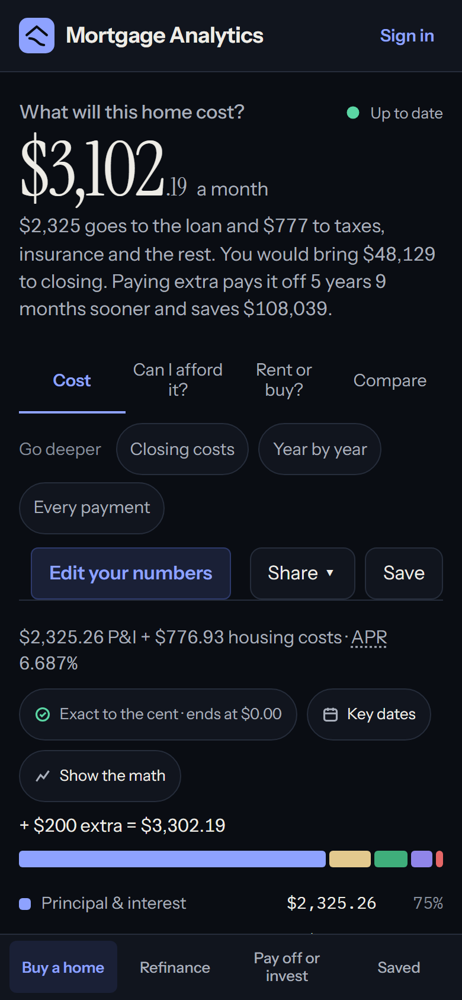

# 5. Frontend

> **An Angular 22 single-page app in `client/`.** Standalone components, signals for state, RxJS for timing, typed
> reactive forms, and `OnPush` everywhere.

**Read time:** 13 min · **Best for:** stores, forms, the shared loan and charts · **Code:** `client/src/app/`

**On this page:** [Folder map](#folder-map) · [The patterns, one by one](#the-patterns-one-by-one) ·
[Testing the frontend](#testing-the-frontend)

---

## Folder map

```text
client/src/app/
  app.routes.ts, app.config.ts, app.component.*      routes, providers, the shell (header, page tabs)
  core/                     used by every feature; knows nothing about any one page
    auth/                   AuthService (who is signed in, as a signal), signedInGuard, safe return URLs
    charts/                 buildLineChart, hostChart, the injectable ChartFactory
    errors/                 toErrorMessages: any HTTP failure → readable lines
    formatting/             format.ts (usd, pct, monthOf…), duration, describe-inputs (names for saved items)
    forms/                  FieldRule tables, app-number-field, the appNumber directive, setChanged
    layout/                 header-height and in-view directives
    loans/                  loan-progress: payments made, balance after n payments, the date helpers
    models/                 TypeScript mirrors of the API contracts
    services/               one thin HTTP service per API area
    state/                  latestRequest, CalculationStore (base class), SharedLoanStore
  shared/                   UI pieces several pages use
    calculation-page/       the layout every calculator page shares
    rate-options/           fixed / buydown / ARM controls, used by all three forms
    save-calculation/       the Save button and dialog
  features/                 one folder per page
    calculator/             page, store, loan-form (+ loan-form.model.ts, loan-fields.ts, sections/), result tabs and charts
    compare/                Compare homes: the page, its store, the results table and the figures it compares
    refinance/  strategy/   page, store, form (+ *-fields.ts), results
    history/                saved calculations: search, filter, open, rename, delete
    account/                sign in / up, confirm email, forgot / reset password, dev mailbox
    calculation-stores.ts   every page's store, for History and sign-out
client/e2e/                 Playwright specs, page objects and fixtures
```

---

## The patterns, one by one

### Standalone components + OnPush + signals

Every component is `standalone` (it lists its own `imports`) and uses `ChangeDetectionStrategy.OnPush`. State
lives in **signals**:

```ts
readonly loanAmount = computed(() => Math.max(0, (this.values().homePrice ?? 0) - this.downPaymentAmount()));
```

`computed` re-evaluates only when a signal it read changes, and the template re-renders only the parts that read
it. Inputs and outputs use the signal APIs (`input<T>()`, `output<T>()`). A form's values become a signal with
`toSignal(form.valueChanges, …)`.

### Container and presentational components

- **Pages** (`*-page.component.ts`) are containers: they inject the store and wire it to the children.
- **Forms and result components** are presentational: they take `input()`s and emit `output()`s, and know
  nothing about HTTP. That makes them easy to test (set inputs, check outputs).

### Stores: `CalculationStore` and its four subclasses

`core/state/calculation-store.ts` is an **abstract base class** holding everything a calculator page needs:

| Member | What it is |
|---|---|
| `request`, `result`, `errors`, `busy` | Signals: the latest inputs, the latest answer, the latest failure, "waiting" |
| `saved` | The saved calculation this page is linked to (so Save can update it in place) |
| `send(request)` | Queue a request (debounced, see below) and share its loan if the user changed it |
| `open(saved)` | Load a saved calculation of this page's kind |
| `loanToApply()` | The loan another page changed since this page last sent one |
| `savePayload`, `suggestedName` | Computed: what Save stores, and the name it suggests |

Each page's store (`CalculatorStore`, `ComparisonStore`, `RefinanceStore`, `StrategyStore`) says only what differs:
`kind`, `route`, `pageName`, how to call the API (`send$`), how to describe and name its inputs, and where its loan is
(`loanOf`). This is the **Template Method** pattern: the base class runs the algorithm, the subclasses fill in the
steps.

`ComparisonStore` is Compare homes' store (`features/compare`): its request is a list of two to four calculator
requests (`homes`), and `send$` calculates each with the calculator's endpoint (`forkJoin`), so comparing needs nothing
new from the API. It leaves out a seller's offer and affordability, which the comparison does not show. Home A is the calculator's own loan, which the page passes on as it changes; opening a saved comparison
puts Home A back in the calculator too. Saved, the first home is `inputs` and the rest `otherHomes`. The page has one
loan form at a time: the switch above it makes a new form for the chosen home from its store (an `@for` over the one
home being edited, tracked by it, so switching from Home B to Home C makes a new form), so element ids stay unique.
**Add a home** appends a copy of Home A; **Remove** takes out the home being edited, never Home A, and keeps two.

`CalculatorStore` adds two sets of settings to every request it sends: how a seller's offer is weighed
(`offerSettings`: the years kept and the cut per point) and the rent to weigh buying against (`rentSettings`, null until
a rent is given). Each is set beside the answer it changes, on the Closing and Rent or buy tabs (`setOfferSettings`,
`setRentSettings`), rather than in the form; a saved request that brings its own sets them.

### The loan form: one form, six section components

The loan form is one `FormGroup`, so the request is built in one place (`loan-form.model.ts`), but its template is
the five main numbers and then one component per section (`loan-form/sections/`): loan type & rate; taxes, insurance,
HOA & PMI; closing costs & credits; income & debts; extra payments; future increases. Each section injects the form
through the `LOAN_FORM` token, reads its values and what it works out from them, and provides the form's
`ControlContainer`, so its `formControlName`s bind to the one form group.

A result that needs an input asks `FormNavigator` (`core/forms`) for it: **Add your income** calls
`open('income', 'annual-income')`, and the form showing the calculator's loan opens that section, scrolls the field into
view and focuses it. Only requests made after the form was built count, so a form made later does not jump.

The stores are `providedIn: 'root'`, so they live for the whole app: leave a page and come back, and its
numbers are still there.

`CalculationStores` (`features/calculation-stores.ts`) lists the four stores, so History can open, describe,
rename or unlink a saved item of any kind without a `switch` on its kind.

### Results as you type: `latestRequest`

`core/state/latest-request.ts`, used by every store:

```ts
queue.pipe(
  debounceTime(400),                               // wait for a pause in typing
  switchMap(({ request, id }) =>                   // cancel the previous request when a new one starts
    call(request).pipe(
      map((response) => ({ response, id })),
      catchError((error) => { errors.set(toErrorMessages(error)); settle(id); return EMPTY; }),  // per request
    )),
  takeUntilDestroyed(destroyRef),
)
```

Three details matter:
- **`switchMap`, not `mergeMap`**, so an old response can never overwrite a newer one.
- **`catchError` inside** the `switchMap`: if it were outside, the first error would end the stream and the page
  would stop updating.
- **Numbered requests:** `busy` clears only when the answer to the *latest* request arrives, not an older one; the
  results region is `aria-busy` meanwhile, and fades slightly so stale numbers are not mistaken for fresh ones.

### One loan, typed once: `SharedLoanStore`

`core/state/shared-loan.store.ts`. The pages ask about the same mortgage, so its key facts are shared:

```ts
interface SharedLoan {
  balance: number; annualInterestRate: number; remainingTermInMonths: number;
  homeValue: number | null;          // when the page knows it
  start?: OriginalLoan | null;       // the loan as taken out, when known
  rate?: SharedRate | null;          // fixed, a buydown, or an ARM (its next reset counted from today)
}
```

- Each change gets a **version number**. A page remembers the last version it saw; `loanToApply()` returns the
  shared loan only if it's newer, and the form then fills itself from it and says where it came from.
- **Only a loan the user changes is shared** (or a saved one they open). Opening a page with its example never
  overwrites the user's loan.
- **No echo:** the calculator rounds the term to whole years. `matchesShared` recognises "this is the shared loan,
  as close as I can hold it", so the rounding doesn't get shared back to the other pages.
- **Merging:** a page that doesn't know the home's value, the original loan or the rate type keeps what was
  already shared instead of erasing it.

### Forms

**Typed reactive forms.** `NonNullableFormBuilder` gives every control a compile-time type. The calculator's form
lives in `loan-form.model.ts`: `loanForm(fb)` builds it with its defaults, `toLoanRequest()` turns it into the
API request, `restoreLoanForm()` fills it back from one. The component (`loan-form.component.ts`) keeps what the
page shows: the section summaries, the hints, the problems list.

**One rules table per form** (`loan-fields.ts`, `refinance-fields.ts`, `strategy-fields.ts`, plus
`RATE_OPTION_RULES`):

```ts
annualInterestRate: { label: 'Interest rate', unit: '%', min: 0, max: 30, decimals: 4 },
```

From that one line come the validators (`validatorsFor`), the message under the field ("Interest rate must be
between 0% and 30%."), the line in the "results are for your last valid inputs" notice (`problemsIn`), and the
box's `$` or `%`. The limits mirror the API's validator by hand; on Pay off or invest, an e2e test sends every
field at the edge of its range and checks that the form and the API agree.

**`app-number-field` + `appNumber`.** Every number box is one component. The `appNumber` directive is a
`ControlValueAccessor`: it shows "415,000" with the `$` inside the box, switches to "415000" while you edit,
selects the text on focus, and marks unreadable text invalid instead of reading it as 0.

**Collapsible sections with summaries.** Each `<details>` section shows a one-line summary when closed
("Tax 0.9% · Homestead", or "Tax 2.2% · Homestead $50,000 off" with an exemption), and says "Check the values in this section" if a closed section holds an
invalid value, so a problem is never hidden.

**Only the active options are validated.** Switching "One tax rate" / "Separate taxes", or fixed / ARM, enables
one set of controls and disables the other. Disabled controls are neither validated nor sent.

**Every form follows the same lifecycle:**
1. `ngOnInit`: restore from `initial` (the store's last request or a saved one), then apply the shared loan,
   then send once.
2. While `restoring` is true, value changes update what the page shows but don't send requests.
3. After that, every change that leaves `canSend()` true emits a request.

### Rate options (`shared/rate-options/`)

Fixed, temporary buydown (1-0, 2-1, 3-2-1, 1-1), or ARM (5/1, 7/1, 10/1, 5/6, 7/6, 10/6, or other). One
`rateOptionsForm()` builder, one `app-rate-options` component, and helpers (`rateOptionsRequest`,
`setRateOptions`, `applySharedRate`, `rateSummary`) used by all three forms. An ARM is given either by its type
(a new loan: "7/1" means 84 payments fixed) or by the payments until its next reset (a loan already being paid).

### The shared page layout (`shared/calculation-page/`)

`<app-calculation-page>` gives every calculator page the same structure through **content projection**: the
form goes in the `form` slot, results in the default slot. It opens with the page's question and one line on how it
answers it (`heading`, `intro`), then handles Save, API errors, the "results are for your last valid inputs" notice
(the results fade beneath it, so old numbers aren't read as current), and the placeholder before the first result.
The form is part of the page and scrolls with it: an earlier version kept it in view in a box that scrolled on its
own, which hid its last sections.

### Charts

`core/charts/line-chart.ts` builds every line chart's Chart.js configuration (`buildLineChart`), and
`hostChart` owns one chart per component: it rebuilds when inputs or the OS theme change, or the page switches to the
light theme to print (`core/layout/print.ts`, on the browser's `beforeprint` and back on `afterprint`), and destroys
it with the component. Charts are created through an injected `ChartFactory`, so Jest tests (jsdom has no canvas) provide a
fake and assert on the configuration. Every chart has a written takeaway and a data table, and colors come from a
palette checked for colorblind safety in light and dark mode.

- **Readable axes.** X-axis labels are chosen in code (`tickIndices`), so the last point is always labelled, on whole
  years for monthly data, and only as many as fit the width.
- **Lines that stay visible.** The gap between the two payoffs on the balance chart is shaded, so the time and
  interest saved show as an area; taxable value is dashed, so it shows where it overlaps market value; later series
  draw on top.
- **Tabs that follow WAI-ARIA.** Where charts share a card, the tabs take arrow keys and Home/End, with one tab in the
  tab order.
- **Clickable when it helps.** `buildLineChart`'s optional `onPick` reports the point clicked (the projection uses it
  to choose a year), with a pointer over the plot.
- **The app's typeface,** read from the `--font-sans` token like the colours.

### Visual design

A calm fintech look, built from shared parts so every page stays consistent:

- **Tokens** (`styles.scss`): colours by role (`--surface-1`, `--text-secondary`, `--positive`), defined once for light
  and once for dark mode, plus shape and depth (`--radius-md`, `--shadow-card`, `--focus-ring`). Components never use a
  raw hex value. Every text colour meets WCAG AA on its surfaces; the axe scans check it in both modes.
- **Colour carries meaning, the same way everywhere:** blue for action and plain facts, green only for a good outcome
  (money saved, time saved), amber only for "look again" (a refinance that costs more, a recommendation a bad decade
  would reverse), red only for errors.
- **Surfaces** (`core/layout/_surfaces.scss`): `card`, `tile` and `verdict` mixins, so panels, figures and each page's
  headline answer look alike on every page.
- **Controls:** one `control` mixin (`core/forms/_form-fields.scss`), applied once globally to every number box, date,
  drop-down, email and password field: same size, a firm border, a soft focus ring.
- **Type:** Inter, self-hosted (`@fontsource-variable/inter`; the CSP allows fonts only from the app itself), with
  tabular figures everywhere, so amounts line up in tables and do not jitter while they update.
- **Brand:** `BrandMarkComponent`, a roof over a balance falling to zero, in a full-width header bar; the same mark
  is the browser-tab icon (`public/favicon.svg`, with a PNG for iOS home screens), and the toolbar colour follows the bar.
- **Charts in the same type:** `buildLineChart` reads `--font-sans` like its colours, so Chart.js draws its legend, axes
  and tooltips in Inter rather than its default Helvetica or Arial.

The flows are designed around the people using it:



- **A first visit:** each form opens on a worked example and says so ("These are example numbers"), until the first
  edit (`exampleUntilEdited`). A form restored from a saved item, or filled in from another page, never says it.
- **A phone:** results come first, so `app-calculation-page` offers "Edit your numbers", which scrolls to the form
  (instantly for anyone who prefers reduced motion) and moves focus there. Once the headline scrolls away, a bar
  keeps the payment and the savings in view; with a buydown it says "in year 1", since the payment rises after.
- **Help a few people need:** each loan program says what it asks for in one line, with the details under "More
  about…", a `details.help` toggle, so the form stays short.
- **Signing up:** the sign-in page lists what an account adds, and says the calculators never need one.
- **Your account:** the email in the header (a person icon on a phone) opens it. Changing the password asks for the
  current one and clears both boxes once done. Deleting the account takes two
  deliberate steps, "Delete my account…" and then the password, and the button that deletes is red. A
  wrong password shows the server's own message; success unlinks the pages from the saves that went with it.
- **The form card:** the main group's heading is a real heading, tagged "Shared with the other pages" (the long "Filled in
  from your loan on the Refinance page" line only appears when it happened). What the numbers add up to is a summary
  chip; help only some need is a `details.help` toggle; the optional sections are one divided list under **More
  details**; each top-level group after the first starts below a rule. These styles are one global `form-card` mixin
  (`core/forms/_form-fields.scss`), so every form shares them and no component carries its own copy.
- **"What will I have paid by year 10?"** The Projection tab opens on the quick numbers (`CostTotalsComponent`): for a
  chosen year, each cost that year, through it, and over the whole loan, from the same projection as the chart
  (`cost-totals.ts`, pure functions). It starts at the year the loan is in now, so "through" is what has been paid; the
  picker or a click on the chart (`buildLineChart`'s `onPick`, with a pointer over the plot) chooses another. On a phone
  the cost names stay pinned while the amounts scroll sideways.

<br clear="right" />

### Routing and auth

`app.routes.ts`: `/` (the start page: a question first, six cards that each open the page answering it),
`/calculator` (with child routes `overview`, `affordability`, `closing`, `rent-or-buy`, `projection`, `schedule`),
`/compare`, `/refinance`, `/strategy`, `/history` and `/account` (both behind `signedInGuard`), and the account pages (a focused layout
without page tabs, which `/account` uses too). An app initializer asks the API who is signed in before the first navigation, so the guard already knows. The
guard redirects to `/sign-in?returnUrl=…`, and only same-site paths are accepted as return URLs (no open
redirect). The header's Sign in and account links carry the page they were clicked on the same way, so signing in
comes back to it, and the account pages' way back names it ("← Back to Refinance"); Saved (the History page) is left
out of that while signed out, as going back to it would only lead to signing in again. An address that is not a page
leads to the start page.

The header has four links, one for each thing a buyer decides: **Buy a home** (the calculator and Compare, which is its
last view, so the link stays marked on both), **Refinance**, **Pay off or invest** and **Saved**. The calculator and
Compare show the same row of views (`BuyTabsComponent`), so the way between them is never lost.

### Talking to the API

One service per area (`AmortizationApiService`, `RefinanceApiService`, `StrategyApiService`,
`SavedCalculationsApiService`, `AuthService`), each a thin wrapper over `HttpClient` with the URL and types.
Models in `core/models/` mirror the C# contracts by hand. A contract snapshot test (`ContractSnapshotTests`) fails
on any change to the API's shape (a path, schema, property, type or enum value) and leaves a `.received.json` file
to diff against the approved one, so the change to follow here is spelled out; the e2e consistency suite then checks
the numbers the pages show.

---

## Testing the frontend

- **Jest + `TestBed`**: create a component, set inputs with `fixture.componentRef.setInput()`, change controls,
  and assert on emitted requests and rendered text (`data-testid` attributes). HTTP is tested with
  `HttpTestingController`; time with Jest fake timers (the 400 ms debounce).
- **Playwright** drives the real app in Chromium through **page objects** (`e2e/calculator.page.ts`,
  `history.page.ts`) and **fixtures** (`e2e/fixtures.ts`: each History test signs up a brand-new user and reads
  the confirmation email from the dev mailbox).

See [Testing and quality](07-testing.md) for the whole picture.

---

← Previous: [4. Backend](04-backend.md) · [Guide contents](README.md) · Next: [6. The mortgage math](06-mortgage-math.md) →
