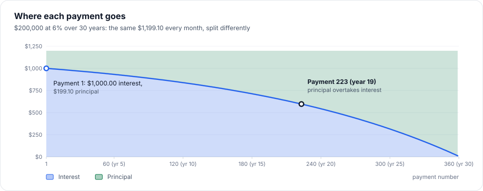
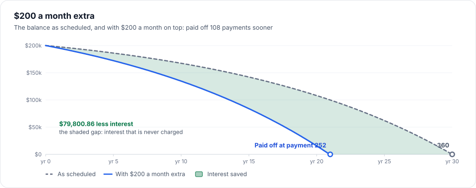
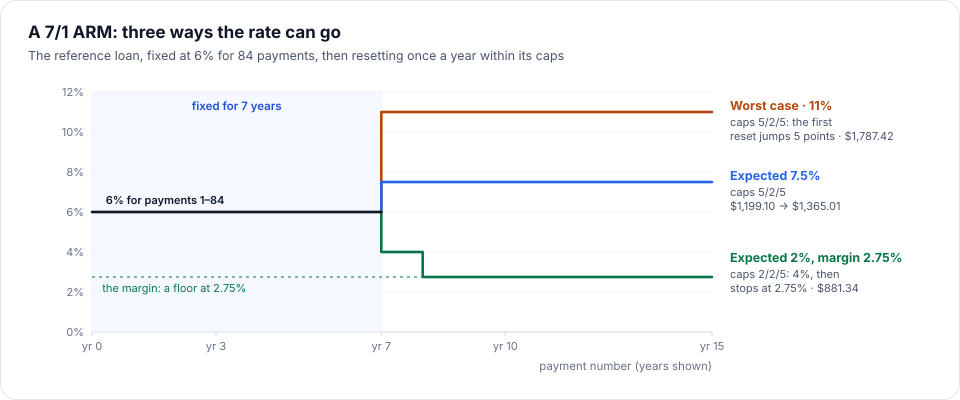
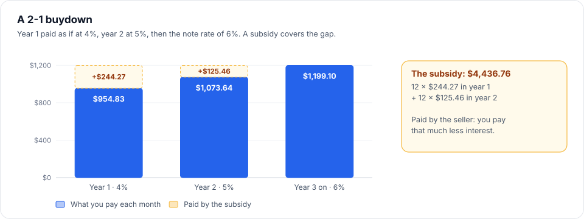
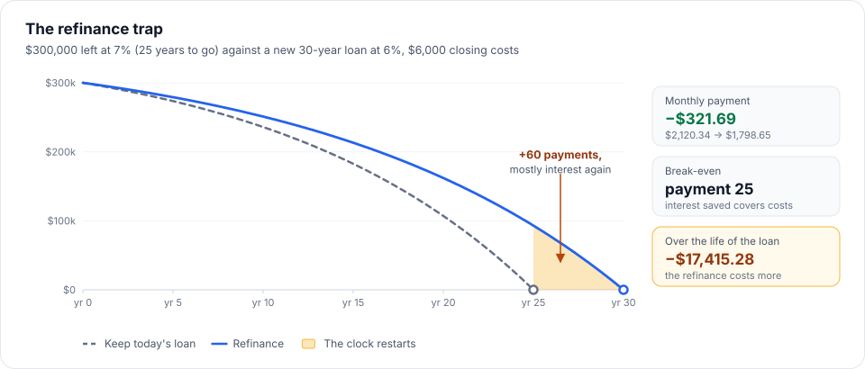

# 6. The mortgage math

> **The domain in plain terms, with the worked numbers the tests pin.** Every number here was computed by an
> independent Python `Decimal` model and is asserted to the cent in the test suite.
>
> The **reference loan** used throughout is **$200,000 at 6% over 30 years** (a $250,000 home with $50,000 down).

**Read time:** 14 min · **Best for:** checking the numbers · **Code:** `src/MortgageAnalytics.Domain/`, `tools/`

**On this page:** [Amortization](#amortization) · [Extra payments](#extra-payments) · [Recasting](#recasting) ·
[Net savings](#net-savings) · [Equity](#equity) · [PMI (private mortgage insurance)](#pmi-private-mortgage-insurance) ·
[FHA and VA loans](#fha-and-va-loans) ·
[Property taxes](#property-taxes) · [Adjustable-rate mortgages (ARMs)](#adjustable-rate-mortgages-arms) ·
[Temporary buydowns](#temporary-buydowns) · [Discount points](#discount-points) · [Cash to close](#cash-to-close) · [Refinancing](#refinancing) ·
[Pay off early or invest?](#pay-off-early-or-invest) · [Modelling decisions](#modelling-decisions) ·
[Why independent models](#why-independent-models)

---

## Amortization

A fixed-rate mortgage has one level monthly payment that pays off the loan exactly over its term:

```text
M = P × r × (1 + r)ⁿ / ((1 + r)ⁿ − 1)        P = principal, r = annual rate ÷ 12, n = number of payments
```

`PaymentFormula.MonthlyPayment` computes it in `decimal`. For the reference loan, **M = $1,199.10**.

Each month:
- **Interest** = balance × annual rate ÷ 1,200, rounded to cents. Month 1: $200,000 × 6 ÷ 1,200 = **$1,000.00**.
- **Principal** = payment − interest. Month 1: $1,199.10 − $1,000.00 = **$199.10**.
- Early payments are mostly interest, and late ones mostly principal. That's why restarting a loan (refinancing)
  matters so much.
- Rounding to cents leaves a few cents of drift, so the **final payment** takes the exact remaining balance:
  **$1,200.14**. Total interest: **$231,677.04**.



---

## Extra payments

Money paid on top of the payment goes straight to principal, so every later month charges less interest.

- **$200 a month extra** on the reference loan: paid off in **252 payments instead of 360** (108 sooner), with
  **$79,800.86** less interest.
- Kinds: monthly, annual (from a given payment number), and one-time lump sums, in any combination.
- An extra payment bigger than the balance is capped, so the loan is never overpaid.
- On a loan already being paid, extra payments can only start with the next payment.



---

## Recasting

Extra payments normally **shorten** the loan; the payment stays the same. A **recast** keeps the payoff date
and **lowers the payment** instead: the lender re-amortizes the smaller balance over the months left.

- Lenders recast only after **one lump sum of at least their minimum** (often $10,000), for a fee (often $250).
  The engine compares the month's *largest single* prepayment with the minimum, not the month's total: $200 a
  month plus a $9,900 lump sum does not recast. The tests pin the boundary: $9,999.99 doesn't, $10,000 does.
- Reference: a **$50,000 lump sum with payment 12**, then a recast: the payment drops to **$895.60**, and total
  interest is $176,056.85.

---

## Net savings

**Net savings = interest saved + PMI saved − recast fees.** Taxes, insurance and HOA dues are left out on
purpose: they don't stop when the loan is paid off, so counting the months of escrow you "skip" would overstate
the benefit. A test locks this in.

---

## Equity

**Equity = the home's market value − what is owed**, at the start of each loan year. What is owed follows your plan,
extra payments included, because that is what you will actually owe: the whole loan in year 1 (so the equity is the
down payment), the balance after each year's last payment after that, and nothing once the loan is paid off. On the
reference loan with 3% growth, year 2 starts owing $197,543.99 of a home worth $257,500: $59,956.01 of equity.

---

## PMI (private mortgage insurance)

- Required when the down payment is **under 20%**. `PropertyPurchase` holds this rule, once.
- Priced as a yearly percentage of the **original** loan (e.g. 0.5%), paid monthly.
- Removal follows the Homeowners Protection Act, two ways:
  - **Automatic at 78%** of the original value, measured on the **original schedule**, so extra payments don't
    move it.
  - **On request at 80%**, which may use the **actual** balance, so extra payments bring it forward, and that
    saving counts in net savings. This is the default: a borrower paying extra asks as soon as they can. The PMI tile
    says what the other way would do: when not asking would end it and what that costs, or, with automatic removal
    chosen, what asking would save.
  - Either way, **at the loan's midpoint** (payment 180 of 360) whatever the balance: the Act's final termination.
    It matters at high rates, where the balance falls slowly: 3% down at 12% would otherwise pay PMI 28 months longer.
- Each month therefore carries two balances: the actual one and the original schedule's.
- **On the other pages** (`LoanPmi`), only a loan and the home's value are known. PMI already on a loan is the premium
  on the statement, until the balance is 80% of the home's value today, when the borrower can ask for it to go. A new
  loan (a refinance) needs PMI only above 80% of the value, at a yearly rate on the loan, until 80% or its midpoint.

---

## How the home is used

The buyer says whether the home is theirs to live in (the default), a second home or an investment property. It
decides:

| | Home you live in | Second home | Investment property |
|---|---|---|---|
| Most a conventional loan may be | 97% of the price (95% with an ARM) | 90% | 85% |
| FHA or VA | Yes | No | No |
| Homestead exemption | Yes | No | No |
| Seller's limit, conventional | 3% / 6% / 9% by loan-to-value | 3% / 6% / 9% | 2% |

- The loan-to-value limits are Fannie Mae's Eligibility Matrix for a one-unit purchase (August 5, 2026, Desktop
  Underwriter 12.1). Above 95% on a home lived in, its note (1) asks that at least one borrower be a first-time
  homebuyer; the calculator does not ask, so it allows 97%.
- FHA insures a principal residence: at least one borrower must live there within 60 days of signing (HUD Handbook
  4000.1 II.A.1.b.iii). The same section allows a secondary residence only with HUD's written approval, never a
  vacation home, and no investment property but a few nonprofit and HUD-owned-home cases; the calculator allows
  neither. VA asks the veteran to certify they will live there (38 U.S.C. 3704(c)). Texas's homestead is a home
  "occupied as the individual's principal residence by an owner" (Tax Code 11.13(j)(1)(D)).
- The limits are on a loan being made: a first payment today or later. A loan already being paid can be owed above
  the home's value, and is shown as it is.
- Not modelled: the higher rates lenders charge for a second home or an investment property (the rate is what you
  enter), Fannie Mae's rule that a second home not be rented out, and rental income for qualifying.
- The domain is `Occupancy` and `OccupancyRules` (`Domain/Loans`); the validator holds a loan being made to them, and
  the Python model's random purchases include second homes and investment properties.

## FHA and VA loans

Neither has PMI. Each has an **upfront fee** on the base loan (the price less the down payment), usually added to
the loan, so everything after (the payment, interest, prepaid interest, points, equity) is on the larger amount.

**FHA** ([HUD Mortgagee Letter 2023-05](https://www.hud.gov/sites/dfiles/OCHCO/documents/2023-05hsgml.pdf), case
numbers endorsed from 20 March 2023): at least 3.5% down, a **1.75%** upfront MIP, and an annual MIP from this table,
by the base loan's LTV and whether it is above the national conforming loan limit
([FHFA](https://www.fhfa.gov/news/news-release/fhfa-announces-conforming-loan-limit-values-for-2026): $726,200 in
2023, $766,550 in 2024, $806,500 in 2025, $832,750 in 2026; the year the loan closes, taken as the month before the
first payment):

| Term | Base loan | LTV | Annual MIP | For |
|---|---|---|---|---|
| Over 15 years | Up to the limit | ≤ 90% | 0.50% | 11 years |
| | | > 90%, ≤ 95% | 0.50% | the whole loan |
| | | > 95% | 0.55% | the whole loan |
| | Above the limit | ≤ 90% / ≤ 95% / > 95% | 0.70% / 0.70% / 0.75% | 11 years / whole / whole |
| 15 years or less | Up to the limit | ≤ 90% / > 90% | 0.15% / 0.40% | 11 years / whole |
| | Above the limit | ≤ 78% / ≤ 90% / > 90% | 0.15% / 0.40% / 0.65% | 11 / 11 years / whole |

Each loan year's monthly MIP is `round(round(average balance × rate) ÷ 12)`, the average being that year's 12
opening balances on the **original** schedule at the starting rate, so extra payments don't lower it; paying the loan
off ends it. $300,000 with 3.5% down at 6.5%: $289,500 base loan, $5,066.25 upfront MIP, $294,566.25 borrowed; 0.55%
for 360 payments; $134.33 a month in year 1, $132.77 in year 2, $31,790.40 over the loan.

**VA** ([VA.gov, from 7 April 2023](https://www.va.gov/housing-assistance/home-loans/funding-fee-and-closing-costs/)):
no down payment needed and no mortgage insurance. The funding fee for a purchase:

| Down payment | First use | Used before |
|---|---|---|
| Less than 5% | 2.15% | 3.3% |
| 5% or more | 1.5% | 1.5% |
| 10% or more | 1.25% | 1.25% |

Veterans receiving compensation for a service-connected disability (and some others) pay none. $400,000 with nothing
down, first use: $8,600, so $408,600 is borrowed.

**FHA's other limits:**
- **Credit score** (the decision score; [HUD ML 2010-29](https://www.hud.gov/sites/documents/10-29ml.pdf)): 580 or
  more needs the 3.5% minimum down; 500 to 579, 10% (a 90% LTV at most); below 500, FHA does not insure the loan.
  Left blank, the score counts as 580 or more.
- **The county's loan limit** ([HUD ML 2025-23](https://www.hud.gov/sites/dfiles/hudclips/documents/2025-23hsgml.pdf),
  one-unit homes, case numbers from 1 January 2026): the base loan must be within it. The app ships HUD's whole table,
  3,235 counties from the $541,287 floor to the $1,249,125 ceiling (higher in Alaska, Hawaii and the territories),
  built from HUD's own file by `tools/fha-limits`; Bexar County, Texas, is $557,750.

What is **not** modelled: loans endorsed before 20 March 2023 (which paid more MIP), FHA limits for two to four units,
and the VA's limits on what the buyer may pay.

---

## Property taxes

Two ways to enter them:

1. **One combined rate** (the default, how most tax bills read): e.g. 2.2% of the taxable value, with one
   **homestead exemption in dollars** taken off the value first. A $50,000 exemption at 2.2% saves
   **$1,100 a year**.
2. **Separate taxes** (as in Texas): school, county/city and MUD, each with its own rate and its own exemption.
   - **School:** a fixed amount off ($140,000 for a Texas homestead since 2025).
   - **County/city** and **MUD:** a percentage off (up to 20% in Texas, at least $5,000).
   - Each exemption lowers **only its own tax**. Applying the $140,000 school exemption to the whole bill would
     understate taxes by thousands a year.
   - **Over 65 or disabled:** an extra school exemption ($60,000 in Texas) and a **school tax ceiling**: from
     the qualifying year, school tax can fall but never rise. It is set in the year the owner qualifies (at that
     year's rate), not at purchase.
   - **A ceiling brought from a former home** ([Texas Tax Code §11.26(g)](https://texas.public.law/statutes/tex._tax_code_section_11.26)):
     the new home's ceiling is its first year's school tax times the share paid at the old one (the tax under the
     old ceiling over the tax without it). Paying 40% there, a new home owing $500 is capped at $200. A county or
     city ceiling moves only within the same county or city, which is not modelled; nor is the yearly lowering of
     school ceilings when the state compresses school rates (§11.26(a-10)).

And for both ways:
- **Rates can change** from a given loan year until the next change (each tax on its own): $250,000 at 2% is
  $5,000 a year, and $3,750 from the year it drops to 1.5%.
- **Texas rates are quoted per $100 of value**, so "$0.85 per $100" is entered as 0.85%.
- **Appraisal cap:** a homestead's *taxable* value can rise at most 10% a year in Texas, even when the market
  rises faster. `PropertyValuation` tracks market value and taxable value separately; the gap shows on the Home
  value chart.
- **Home values grow** by a yearly rate (default 4.3%, the FHFA long-run average), which drives each year's bill.
  Insurance (+4.8%) and HOA dues (+4%) grow by their own rates.
- **Installments add up exactly:** a $5,000 yearly bill is 11 × $416.67 + $416.63, never $5,000.04.

---

## Adjustable-rate mortgages (ARMs)

An ARM's rate is fixed for a first period, then **resets** at a regular interval. A **7/1** is fixed for 7
years (84 payments), then resets every year; a **7/6** resets every 6 months.

- At each reset the payment is **re-amortized**: the balance left, over the payments left, at the new rate.
- Nobody knows future rates, so the user gives an **expected rate**, and each reset moves toward it **as far as
  the caps allow**. Caps are quoted like "5/2/5": the most the **first** reset can move, the most **each later**
  one can, and the most the rate can **ever** differ from the start (the lifetime cap).
- The **margin** (often 2.75%) is the rate's **floor**: ARM notes don't let the rate fall below it. With a
  margin, the lifetime cap only limits the rise.
- The results also show the **worst case**: rates rising as far and as fast as the caps allow.

Worked examples on the reference loan as a 7/1:

| Scenario | What happens |
|---|---|
| Expected 7.5%, caps 5/2/5 | Payment 85 resets to 7.5%: **$1,199.10 → $1,365.01**. Total interest $277,467.08. |
| Worst case, caps 5/2/5 | The first reset can jump 5 points, straight to 11%: peak payment **$1,787.42**. |
| Expected 2%, caps 2/2/5, **no margin** | 4% at payment 85 ($994.55), then 2% at payment 97 ($817.23). |
| Expected 2%, caps 2/2/5, **2.75% margin** | 4% at payment 85, then it **stops at 2.75%** ($881.34). Total interest $145,332.19. |



In code: `AdjustableRate.RatePath()` produces the list of rate changes, and the ordinary amortization loop
re-amortizes whenever `loan.AnnualRateFor(period)` changes.

---

## Temporary buydowns

A **2-1 buydown**: the borrower pays as if the rate were 2 points lower in year 1 and 1 point lower in year 2. A
**subsidy** (usually paid up front by the seller or builder) covers the difference. The loan itself stays at the
note rate, so its interest and payoff don't change.

Each year's payment is the standard payment on the original amount, over the full term, at the reduced rate.
For the reference loan with a 2-1:

| Year | Paid as if at | Payment |
|---|---|---|
| 1 | 4% | $954.83 |
| 2 | 5% | $1,073.64 |
| 3 on | 6% | $1,199.10 |

The subsidy is the sum of the differences: **$4,436.76**. Options: 1-0, 2-1, 3-2-1, 1-1.



**Who pays for it decides what it saves.** The loan charges its note-rate interest either way ($231,677.04 on the
reference loan), and the principal paid each month does not change, so the subsidy pays interest:

- **The seller or builder pays** (a concession, the usual case): you pay **$231,677.04 − $4,436.76 = $227,240.28** of
  the interest. Each buydown saves a different amount: a 3-2-1 more than a 2-1, a 1-0 less.
- **You pay, at closing:** the subsidy is your own money, paid up front and returned as lower payments over the
  buydown years. It changes **when** you pay, not how much: you pay all $231,677.04.

`TemporaryBuydown.InterestYouPay` applies this to each schedule (with extra payments too: a loan paid off during the
buydown years needs less subsidy), and every schedule in the response carries `buydownSubsidy` and `interestYouPay`.
The headline and the rate plan say which case applies. (A **permanent** buydown is different: it lowers the note
rate for the whole loan. See [Discount points](#discount-points).)

---

## Discount points

A **permanent** buydown: a fee at closing, `points × loan ÷ 100` to the cent, for a lower note rate for the whole
loan. Whether it pays is a comparison with the same loan at the rate the lender quotes without points, each on its
standard schedule (extra payments left out, so the answer is about the points alone):

| One point on the reference loan | |
|---|---|
| Cost | 1% of $200,000 = **$2,000** |
| Payment | $1,231.43 at 6.25% → $1,199.10 at 6%: **$32.33** a month less |
| Interest over the loan | $243,319.13 → $231,677.04: **$11,642.09** saved, **$9,642.09** after the cost |
| Break-even | Payment **48**, when the interest saved ($2,004.68) first covers the cost |

- **The break-even counts interest, not payments,** the same rule as the refinance break-even (one shared domain
  method, `InterestBreakEven`): principal repaid is not a cost.
- Sell or refinance before the break-even and the points cost more than they saved; the results say so.
- **Not with an adjustable rate:** the two versions of the loan would reset differently, so there is no fair
  comparison. The validator refuses the combination.

---

## The Loan Estimate's comparison box

Beside the APR, a Loan Estimate lists two more figures, both on the standard schedule (an estimate leaves extra payments
out):

- **In 5 years:** the first 60 payments of principal, interest and mortgage insurance, plus the lender's loan costs (not
  the other fees, which are government charges and services the borrower may shop for), and the principal those
  payments pay off. For $200,000 at 6.5% over 30 years with $4,000 of loan costs: **$79,848.40** paid, **$12,778.36**
  of principal.
- **Total interest percentage (TIP):** the interest over the whole loan as a percentage of the amount borrowed, to a
  thousandth: $255,085.82 on $200,000 is **127.543%**.

The domain figures come from the schedule (`LoanEstimateFigures`, `Application/Services`); the Python model sums them
from its own schedule, and the random purchases match.

## Jumbo loans

FHFA sets a conforming loan limit each year (the baseline for a one-unit home: $726,200 in 2023, $766,550 in 2024,
$806,500 in 2025, $832,750 in 2026). A conventional loan above it is a **jumbo** loan. The year is the one the loan
closes in, the month before its first payment, so the same $820,000 loan is jumbo for a first payment in January 2026
(closing in December 2025, limit $806,500) and conforming for February (closing in 2026, limit $832,750). An FHA or VA loan
is never flagged: FHA has county limits and VA has none. The limit is the same table FHA's annual MIP uses
(`ConformingLoanLimit`).

## APR

The note rate is what the loan charges; the **APR** is what it costs once the fees paid up front are counted, so two
offers with different fees can be compared. It is the yearly rate at which the payments, each discounted by a month's
interest, add up to what the borrower actually received (Regulation Z's actuarial method, with a monthly unit period):

```
received  = amount borrowed − finance charges paid up front
received  = Σ payment[k] ÷ (1 + i)^k          for k = 1 … n
APR       = 12 × i × 100, to a thousandth of a point
```

- **Finance charges counted:** the lender's loan costs, prepaid interest, discount points, and an FHA or VA upfront
  fee (whether borrowed or paid at closing). Recording fees, transfer taxes, title and the escrow deposit are not.
- **The payments** are the starting rate's payment every month, plus that month's mortgage insurance (PMI, or FHA's
  MIP): a later rate reset and a temporary buydown's cheaper years are not part of the rate a lender quotes.
- **On the example** ($377,650 at 6.25%, $4,000 of loan costs, $970.05 of prepaid interest) the borrower receives
  $372,679.95 for payments of $2,325.26, which is an APR of **6.376%** counting the fees alone. The app also puts the
  example's PMI ($157.35 a month until July 2032) in the payments, which makes it **6.687%**, the figure the Cost view
  shows. With no fees and no mortgage insurance it is the note rate.
- The domain is `AnnualPercentageRate` (`Domain/Loans`), and `AprAnalysis` (`Application/Services`) gathers what it
  counts. The Python model solves it its own way, and the random purchases match it.

## Cash to close

What the buyer brings to closing, as a Loan Estimate works it out. Each daily or monthly amount is rounded to the
cent **before** it is multiplied, because that is the number the Loan Estimate prints ("$63.44 per day for 15 days"):

```text
daily interest  = round(loan × rate ÷ 365)                 $356,250 at 6.5%  → $63.44
monthly escrow  = round((year-1 taxes + year-1 insurance) ÷ 12)   (7,150 + 2,400) ÷ 12 → $795.83

closing costs   = loan costs + other fees + daily interest × days + year-1 insurance
                  + monthly escrow × months + (a buydown the buyer pays for) + (discount points)
lender credits  = min(lender's offer, closing costs)
seller room     = min(seller's offer, closing costs − lender credits)
concessions     = seller's buydown + seller room − (for VA: the part of it paying fees, prepaid interest and points)
over the limit  = max(0, concessions − limit)
seller credits  = seller room − min(over the limit, the part of seller room that counts)
cash to close   = down payment + closing costs − lender credits − seller credits
```

| Reference purchase | |
|---|---|
| Fees | $4,000 + $1,000 |
| Prepaid interest | 15 days × $63.44 = $951.60 |
| Insurance, first year | $2,400.00 |
| Escrow | 3 months × $795.83 = $2,387.49 |
| **Closing costs** | **$10,739.09** |
| Cash to close, with $3,000 of credits | $18,750 + $10,739.09 − $3,000 = **$26,489.09** |

- **Interest is at the note rate**, even with a buydown: the subsidy pays monthly payments, not interest before the
  first one. An adjustable rate uses its starting rate.
- **365 days**, the common US convention for prepaid interest (some lenders use 360; the difference on this loan is
  $0.88 a day).
- **Credits never pay the down payment.** Seller and lender credits may pay closing costs and prepaids, not the
  buyer's own down payment, so any beyond the costs are reported as unused rather than taken off.
- **The seller's are limited** (Fannie Mae's "interested party contributions"): a conventional loan allows 3% of the
  price with a loan above 90% of it, 6% from 75.01% to 90%, 9% at 75% or less (Selling Guide B3-4.1-02); FHA 6% (HUD Handbook
  4000.1 II.A.4: toward origination fees, other closing costs, prepaid items and discount points); VA 4% of the reasonable value, besides the normal closing costs and
  discount points (VA Pamphlet 26-7, chapter 8, and VA.gov's funding fee and closing costs page). A buydown the seller pays for counts. Lenders take anything
  beyond the limit off the price instead, so here it is taken off the seller's credits and reported. With 5% down on
  the reference purchase the limit is 3%, **$11,250**; a $9,000 seller buydown and the $3,000 of credits is $750
  over it, so $2,250 of the credits are used and the cash to close is **$27,239.09**.
- An **investment property**'s conventional limit is **2%** at any loan-to-value (the same topic, dated 05/07/2025),
  so it has no next tier. A second home has a home lived in's tiers.
- The limit is on the price, as lenders figure it on the lower of the price and the appraised value; the next
  conventional tier is the down payment that leaves a loan of exactly 90% (or 75%), rounded up to the cent.
- The domain is `ClosingCosts`, `CashToClose` and `ConcessionLimit` (`Domain/Closing`); the Python model in `tools/calculator-check`
  prices the same lines independently, and 300 random purchases match it to the cent.

### Can you afford it?

Lenders qualify a buyer on debt-to-income: the housing payment as a share of gross monthly income (the "front-end"
ratio), and it with the other monthly debts (the "back-end").

```
monthly income   = income a year ÷ 12, to the cent
housing payment  = principal and interest at the qualifying rate + the first month's taxes, insurance, PMI or MIP, dues, PID
housing %        = housing payment ÷ monthly income × 100, to two decimals
total %          = (housing payment + other debts) ÷ monthly income × 100
most for housing = min(income × total limit − debts, income × housing limit), rounded down to the cent, never below 0
```

- **Co-buyers** are counted together: the income and the debts of everyone on the loan are added, so the ratios and
  every price are for the whole household. The down payment is shared out by what each co-buyer puts in (a percentage,
  rounded to the cent; the first buyer puts in what is left, so the shares add up exactly), and the first month's payment
  is split in proportion to income by `PaymentSplit.ByIncome`: each share rounded down to the cent, and the cents left
  over going to the largest remainders, so the shares add up to the payment. Splitting by income is an assumption;
  how two people really divide a mortgage is their own agreement.
- **The limits:** comfortable is 28% and 36%. The most allowed is the program's: conventional 45% in all (Fannie
  Mae's Selling Guide B3-6-02, for a manually underwritten loan with the credit score and reserves its matrix asks;
  its automated underwriting goes to 50%). FHA is 31% and 43% (HUD's 2013 manual underwriting
  rule in the Federal Register, and Mortgagee Letter 2014-02, which lets compensating factors raise them to 37%/47% and
  40%/50%). VA is 41% in all (38 CFR 36.4340); past it, VA asks for residual income 20% over its guideline.
- **A temporary buydown is qualified at the note rate**, as Fannie Mae requires, so its first years do not help.
- **The qualifying rate** is the note rate, except for an adjustable rate, where each program has its rule:

  | Loan | Qualified at |
  |---|---|
  | Conventional ARM fixed 3 years or less | the most the caps let the rate reach in the first five years (payments 1 to 60) |
  | Conventional ARM fixed 5 years | the note rate plus the first change's cap (within the lifetime cap), or the fully indexed rate (here, the expected rate) if higher |
  | Conventional ARM fixed longer | the note rate |
  | FHA 1-year ARM with a loan of 95% or more | the starting rate plus 1 point |
  | Any other FHA or VA ARM | the starting rate |

  The conventional rules are Fannie Mae's Selling Guide B3-6-04; FHA's is HUD Handbook 4000.1's Section 251
  adjustable rate. VA's own rule is not modelled. The rate is found once, from this home's loan-to-value, and held at
  every price searched, since the share of the price borrowed stays the same. On the reference purchase, a 5/1 ARM at
  6.5% with a 2-point first cap and an expected 7% is qualified at **8.5%**.
- **The highest price** keeps the down payment's share of the price (rounded up to the cent, so a program's minimum
  is never missed), the rate and every cost, and changes only the price. The payment rises with the price, but through
  taxes after exemptions and mortgage insurance that no formula inverts, so the price is searched: doubling from this
  home's price until the budget is passed, then halving the gap to the whole dollar. A price no loan can have (past a
  county's FHA limit) counts as beyond reach.
- Each price needs only the first month's payment, not a schedule (`HousingCostPlan.FirstMonth`), so the search adds
  about 10 ms to a calculation. FHA's MIP still needs the original schedule.
- On the reference purchase ($250,000, 5% down, 6.5%, Texas taxes) with $90,000 a year and $400 of debts, the
  comfortable limit allows **$2,100** for housing (28% of $7,500; 36% less the debts would be $2,300).
- The domain is `DebtToIncome`, `DebtToIncomeLimit`, `QualifyingRate`, `MostAffordable` and `PaymentSplit` (`Domain/Affordability`),
  and `AffordabilityAnalysis` (`Application/Services`). The Python model checks every price at its edge, from its own
  first-month costs, and finds the qualifying rate its own way, counting the cap steps rather than following the rate
  path. The random purchases include incomes from $40,000 to $400,000, and ARMs fixed 1, 3, 5, 7 and 10 years.

### Rent or buy

Two households that spend the same each month: one buys, one rents a similar home. Month by month, for up to 30
years (or the loan's term):

```
owning      = principal and interest + housing costs − a buydown's subsidy + upkeep
upkeep      = home value that year × upkeep % ÷ 12, to the cent
rent        = the rent × (1 + rise %)^(year − 1), to the cent
buyer       = buyer × (1 + return % ÷ 12) + max(0, rent − owning)
renter      = renter × (1 + return % ÷ 12) + max(0, owning − rent)      (starting with the cash to close)
```

At each year's end the buyer is worth the home's value then, less what is owed and the selling costs, plus their
investments; the renter, their investments. Buying **breaks even** in the first year from which it is ahead (or level)
every year after; one good year followed by a bad one does not count.

- It uses the loan's standard schedule: extra payments are an investment choice, like the renter's.
- Left out: taxes on investment gains and renters insurance. The mortgage interest deduction is left out unless the
  owner's taxes are given (below).
- **The tax owning saves** (only with `ownerTaxes`): each year the owner deducts the larger of the standard deduction
  and `other + min(state and local taxes + property tax, $40,400) + mortgage interest`, where the interest is cut to
  the share of a $750,000 debt limit when the loan is larger; the renter, the larger of the standard deduction and
  `other + min(state and local taxes, $40,400)`. The saving is `(owning − renting) × tax rate`, to the cent, and each
  month `owning` becomes `owning − saving ÷ 12` in the two lines above. The standard deduction and the other amounts
  rise 2.5% a year (year 1 is 2026's figures); the $40,400 limit does not (it is scheduled to revert in 2030, which
  this does not model).
- On the reference loan ($200,000 at 6%, $1,199.10 a month) with $50,000 to close against $1,200 of rent and nothing
  else, after a year the buyer has **$52,456.01** of equity and **$10.80** invested; the renter has the **$50,000**.
- **If prices differ** is the same comparison with the home's value moving by another yearly rate: the value, and so the
  upkeep and the sale price, are price × (1 + rate)^year, and the rest (the loan's schedule, the housing costs, the rent)
  is the plan's. The request carries up to three yearly changes (−20% to 20% each; the page sends a fall and 0), and each
  scenario has its own break-even year. A change equal to the plan's own gives the plan's years exactly.
- The domain is `RentOrBuyComparison` (`Domain/RentOrBuy`), and `RentOrBuyAnalysis` (`Application/Services`). The
  Python model compares every year its own way: 300 of 300 random purchases match, 123 of them with a rent, 58 of
  those with the owner's taxes and 69 with value scenarios.

### If you sell

What a sale at the end of each year leaves (`HomeSale`, `Domain/Selling`; up to 30 years, or the loan's term):

```
costs     = value then × selling cost %, to the cent
gain      = value − costs − price paid
tax-free  = min(max(gain, 0), exclusion), from year 2 only
tax       = (max(gain, 0) − tax-free) × rate on the gain, to the cent
proceeds  = value − owed − costs − tax
```

The value is the projection's market value; what is owed is the balance after that year's last payment on the plan
with its extra payments (nothing once it is paid off). The exclusion (IRC 121) is **$250,000**, or **$500,000** for a
couple filing jointly, and applies only to a home the seller lives in and has owned two years; a second home or an
investment property gets none, and a head of household has the single filer's. A loss is not taxed, and not deducted.

- The price paid is the basis: the costs of buying and any improvements would raise it and lower the gain, so the tax
  leans high. State tax, the 3.8% tax on net investment income (unless it is folded into the rate) and the partial
  exclusion for a sale before two years are left out.
- A $300,000 home rising 10% a year and sold after 8 years, owing $250,000, with 6% costs and a 15% rate for a single
  filer: it sells for **$643,076.64**, costs **$38,584.60**, so the gain is $604,492.04 − 300,000 = **$304,492.04**; the
  first $250,000 is tax-free and the other **$54,492.04** pays **$8,173.81**; the seller keeps
  643,076.64 − 250,000 − 38,584.60 − 8,173.81 = **$346,318.23**.
- **If prices differ** is the same sale with the value moving by another yearly rate: value = price × (1 + rate)^year, to
  the cent, and everything after it is as above. What is owed does not depend on the value, so the plan's balances serve
  every case. The request carries up to three yearly changes (−20% to 20% each; the page sends a fall and 0). On the
  $250,000 purchase with 5% down at 6.5% over 30 years, 6% to sell and 15% on a gain: after 5 years a home falling
  3% a year is worth **$214,683.51**, costs **$12,881.01** to sell, and leaves **−$20,523.72** against the $222,326.22
  still owed (a shortfall to bring, and a loss that is not taxed); a flat one, after 20 years, sells for $250,000 and
  leaves **$102,794.03**; one rising 10% a year, after 20 years, sells for **$1,681,874.99**, the gain is
  **$1,330,962.49**, the first $250,000 is tax-free and the other $1,080,962.49 pays **$162,144.37**, leaving
  **$1,286,612.15**.
- The domain is `HomeSale`, and `SaleAnalysis` (`Application/Services`) feeds it the projection's values and the plan's
  balances. The Python model works every year its own way: 300 of 300 random purchases match, 135 of them with a sale and 59 of those with value scenarios.

### A second loan instead of PMI

Two analyses of the same purchase, each without extra payments or a buydown (`SecondLoanComparison`, `Application/Services`):
the request as made, and the request with the second loan's amount added to the down payment, so the first loan is
smaller by it and, at 80% of the price, carries no PMI. Each is costed as the seller's offer is, over the years kept:

```
cash to close = what the calculator works out for that analysis, less the second loan's amount (it is not cash)
payments      = the first loan's payments (principal, interest, taxes, insurance, dues, PMI) + the second loan's
balance       = what the first loan still owes + what the second still owes, after the years kept
cost          = cash to close + payments + balance
saved         = cost with PMI − cost with the second loan
```

- The second loan is level-payment and fixed-rate over its own term; a term shorter than the years kept is paid off, so
  nothing is owed on it. Its payment on $25,000 at 8% over 15 years is **$238.91**.
- The down payment is the buyer's own in both, so the cash to close is the same up to what the smaller first loan changes in
  the costs figured on it. The second loan's own closing costs are left out.
- Not allowed with an FHA or VA loan. The second loan must be less than what is borrowed.
- The Python model works both analyses its own way: 300 of 300 random purchases match, 55 of them with a second loan.

### As a rental

What the home earns if it is let out (`RentalYear`, `RentalReturns`, `Domain/Rental`; up to 30 years, or the loan's term):

```
gross       = rent × (1 + rise %)^(year − 1), to the cent, × 12
vacancy     = gross × vacancy %, to the cent
collected   = gross − vacancy
manager     = collected × management %, to the cent
upkeep      = home value at the year's start × upkeep %, to the cent
operating   = the year's property taxes, assessments, insurance and dues (not mortgage insurance)
NOI         = collected − manager − upkeep − operating
debt        = the year's principal and interest + mortgage insurance − any buydown subsidy
cash flow   = NOI − debt
```

The first year gives the measures: **cap rate** = NOI ÷ price; **cash-on-cash** = cash flow ÷ cash invested (the cash to
close, or the down payment without closing costs; none when nothing was put in); **debt service coverage** = NOI ÷ debt
(none without a loan); **gross rent multiplier** = price ÷ gross; **rent to price** = monthly rent ÷ price; and the
**break-even rent**, where cash flow is nil: `(upkeep + operating + debt) ÷ ((1 − vacancy %)(1 − management %)) ÷ 12`.

- Mortgage insurance is counted with the loan, not the operating costs, because it ends with the loan's balance and a
  lender's coverage test counts it in the payment. Extra payments, income tax, depreciation and the home's growth in
  value are left out.
- A hand-worked year, in a test: $2,500 a month on a $400,000 home, 5% vacancy, 8% manager, 1% upkeep, $9,000 of
  operating costs and $18,000 of payments: gross **$30,000**, vacancy $1,500, manager $2,280, upkeep $4,000, NOI
  **$13,220**, cash flow **−$4,780**, a cap rate of 3.31% and coverage of 0.73.
- The domain is `RentalYear` and `RentalReturns`, and `RentalAnalysis` (`Application/Services`) feeds them the
  schedule's payments and the housing costs. The Python model works every year its own way: 300 of 300 random purchases
  match, 84 of them let out.

### The best use of the seller's money

The offer is the seller's credits plus a buydown they pay for. Each way to take it is the same request analyzed again
as it would be, with no extra payments, so it is priced exactly as the calculator prices any loan:

```
off the price    price − offer, the same down payment, no seller credits     (only when it leaves a loan)
toward closing   seller credits = offer
2-1 buydown      seller's share = min(offer, subsidy, limit)
                 the buyer pays subsidy − share at closing; seller credits = offer − share
points           budget = min(offer, limit)                                   (VA: the offer; its limit leaves points out)
                 points = min(5, ⌊budget ÷ loan × 100, to a thousandth⌋)
                 rate   = max(0, rate − points × cut per point), to a thousandth, half up; seller credits = offer
```

Each is costed over the years kept (up to the loan's end):

```
cost = cash to close + Σ (principal + interest + housing costs − buydown subsidy) + the balance still owed
```

- The balance counts because a price cut or points leave less owed: comparing payments alone would miss that.
- **Not used** is the part of the offer that pays nothing: beyond the closing costs, or the limit. A price cut uses all
  of it.
- The best is the lowest cost. Not with an adjustable rate (points and buydowns are priced differently) or with
  points of the buyer's own, which already set the rate.
- On the reference purchase ($250,000, 5% down, 6.5%) with $5,000 offered, $5,000 is **2.105 points**, and the rate
  is 6.5 − 2.105 × 0.25 = 5.97375, so **5.974%**. A 2-1 buydown costs $5,405.28, so the buyer pays $405.28 of it.
- The domain is `SellerOffer` and `OwnershipCost` (`Domain/Closing`), and `SellerOfferComparison` runs the ways
  (`Application/Services`). The Python model reruns each way its own way, and the random purchases ask for it.

---

## Refinancing

Compare the rest of the current loan with a new one. Reference: **$300,000 left at 7%, 25 years to go**
($2,120.34 a month), refinanced to **6% for a new 30 years** with $6,000 closing costs.



| Result | Value |
|---|---|
| New payment | **$1,798.65**, $321.69 a month lower |
| Lifetime savings | **−$17,415.28**: the refinance costs *more* overall |
| Why | The clock restarts: **60 more payments**, mostly interest again |
| Break-even | Payment **25**, when the interest saved first covers the closing costs |
| The same, on a home worth $360,000, with $120 of PMI now | Both loans carry PMI to $288,000 (80%): the new one $125 a month, for longer, so it costs **$18,440** more and breaks even at payment **26** |
| Keep paying $2,120.34 on the new loan | Paid off in **247 payments**, and **$107,590.12** saved |

Key ideas:
- **Lifetime savings** = everything still owed on the current loan − (everything paid on the new one + closing
  costs paid up front).
- **Break-even counts interest, not payments**: principal repaid isn't a cost. The common "closing costs ÷
  monthly savings" overstates the benefit when costs are financed or the term is longer.
- **PMI counts wherever the payment does**, given the home's value: in the monthly change, the lifetime totals and the
  break-even. A new 30 years keeps PMI longer, and borrowing the closing costs can push the new loan back above 80%.
- The loan today can be entered as **what's owed now**, or as **the original loan** (amount, term, first
  payment), from which the server works out the balance on that loan's own schedule.
- A buydown on the new loan is paid at closing, so it changes **when** you pay, not how much.
- **A debt paid off with the cash out** (`DebtPayoffComparison`, `Application/Services`) is costed two ways over the years kept
  (84 payments for 7 years) as **what is paid in them plus what is still owed after**. Keeping the debt is its own schedule:
  each month interest = balance × rate ÷ 1,200 to the cent, the payment, and the last one smaller; $20,000 at 22% with
  $600 a month takes **52** payments and charges **$11,192.21** of interest, so 31,192.21 is paid and nothing is owed. Paying
  it off adds its balance to the new loan, and what that costs is the new loan less **the same refinance with the balance out
  of the cash** (PMI included, and the points, which are a share of a smaller loan): $350,000 less $330,000 at 6% over 30
  years adds **$119.91** a month, **10,072.44** paid in 84 payments and **17,927.95** still owed, 28,000.39 in all. It saves
  31,192.21 − 28,000.39 = **$3,191.82**, and the monthly payments fall by 600 − 119.91 = **$480.09** while the card would
  have lasted. The same $20,000 as a 4% car loan (49 payments, 21,682.43) costs **$6,317.96 more** moved onto the mortgage,
  because spread over 30 years most of it is still owed after 7: a lower payment is not a saving. The validator needs the
  cash out to cover the balance and a payment above a month's interest, or the debt would never shrink. With an income, the
  **debt-to-income** is (monthly debts × 1,200) ÷ annual income, to two places (half to even): before = today's loan payment
  with PMI + the debt's payment + other debts; after = the new loan's payment with PMI + other debts. Taxes and insurance
  are left out, so a lender's own ratio is higher. On a $120,000 income with $500 of other debts, (2,120.34 + 600 + 500) ÷
  10,000 = **32.20%** becomes (2,098.43 + 500) ÷ 10,000 = **25.98%**; on $72,000 with none, 45.34% becomes 34.97%.
- **Points on the new loan** (`DiscountPoints`, as on a purchase) cost a percentage of what is borrowed before any financed
  costs, to the cent, and are added to the closing costs (so financed with them when those are); the rate asked is the
  rate with the points. They are then weighed on their own, as two loans of the same size (the other financed costs in
  both, the points paid at closing), one at the rate with and one at the rate without, each on its standard schedule: the
  payment saved, the interest saved over the whole loan, and the first payment by which the interest saved covers the cost
  (interest only, as for the refinance's own break-even). On the reference refinance ($300,000 at 7% with 25 years left,
  to 6% over 30 years, $6,000 of closing costs), one point against a 6.25% rate without is **$3,000**; $300,000 over 30 years
  is $1,798.65 at 6% and $1,847.15 at 6.25%, a saving of **$48.50** a month and **$17,460.36** of interest, which covers the
  $3,000 by the **48th** payment, so the points save **$14,460.36** over the whole loan. In the refinance the same
  $3,000 is part of the $9,000 paid at closing: the lifetime figure is −$20,415.28 against −$17,415.28 without them, and the
  refinance's own break-even moves from the 25th payment to the 39th. With the costs financed the new loan is $309,000
  ($1,852.61), while the comparison is of $306,000 loans ($1,834.62 and $1,884.09, break-even 47) so that it is about the
  points alone. A fixed rate only: the validator rejects points with an adjustable rate or a buydown.
- **Cash out** is borrowed on top of the balance, so the new loan is balance + cash (+ financed costs). The cash is
  money in hand, so lifetime savings add it: 636,100.16 − (755,431.84 + 6,000) + 50,000 = **−$75,331.68** for $50,000
  out at 6% for 30 years, a $350,000 loan at $2,098.43. The break-even stops being the question, so the page shows the
  cash in hand ($50,000 less closing costs paid up front). A conventional cash-out refinance may borrow at most 80% of
  the home's value, so the response says what share of the value the new loan is and whether it is over.
- **Borrowing the cash instead** keeps the current loan and adds a fixed-rate home-equity loan for the cash, on its own
  schedule. Each way is costed over the years kept (84 payments for 7 years) as **what is paid in them (PMI included)
  plus what is still owed after, plus what is paid at closing**: counting only payments would call a way that borrows
  for longer cheaper. $50,000 at 8% over 15 years beside the $300,000 loan at 7% (25 years left) is $2,120.34 + $477.83 =
  $2,598.17 a month and 218,246.28 paid with 293,803.71 still owed, 512,049.99 in all; the refinance to 6% over 30 years
  with $6,000 of closing costs is $2,098.43 a month, 176,268.12 paid, 313,737.59 owed and 6,000 at closing, 496,005.71
  in all: the home-equity loan costs **$16,044.28 more** here, because keeping the 7% loan costs more than refinancing
  to 6%. Equity available is 80% of the home's value less what is owed ($100,000 at $500,000); the combined
  loan-to-value is (owed + cash) ÷ value (70%), and it is flagged over 80%.
- **A line of credit instead of a loan** (a HELOC) is drawn in full at once and pays **interest only** for its draw
  period: balance × rate ÷ 1,200 a month, to the cent, with nothing paid down. When the draw period ends it is repaid
  like a loan over its term, at the rate expected by then (a line's rate moves with the market, so the rate while it is
  drawn is not assumed to be the rate it is repaid at; with none given, its own rate is kept). $50,000 at 8% interest
  only for 120 months is 50,000 × 8% ÷ 12 = **$333.33** a month; repaid over 240 months at an expected 9% it is
  **$449.86**. Kept 7 years, inside the draw period: 206,108.28 paid (84 payments on the current loan and 84 of interest
  on the line) and 310,003.67 still owed, **all $50,000 of the line** and 260,003.67 of the current loan, 516,111.95 in
  all against the refinance's 496,005.71: the line costs **$20,106.24 more**. Kept 12 years, past the draw period: 120
  interest-only payments, then 24 of repayment, 356,125.20 paid and 264,825.95 owed, 620,951.15 in all against 584,951.36:
  **$35,999.79 more**.

---

## Pay off early or invest?

For a household with spare cash each month, three **strategies** played out month by month for up to 30 years:

1. **Debt free ASAP:** every extra dollar to principal; once the loan is gone, everything is invested.
2. **Invest the difference:** pay the required payment, invest the rest.
3. **Hybrid:** split the extra cash by how the after-tax rates compare.

**Free money first.** Every strategy first takes the full 401(k) employer match (at its after-tax cost) and any
ESPP discount, because no mortgage rate beats an instant 50–100% return. Only the cash left over is directed
differently, so all three spend the same each month.

**Three market scenarios.** Each strategy runs at:
- the **expected** return (e.g. 10%, the S&P 500's long-run average with dividends);
- a **risk-adjusted** return: the expected return minus 4, 2 or 0 points for a Conservative, Balanced or Aggressive
  profile. **The recommendation is ranked on this**, because paying down a mortgage earns its rate for certain and
  the market doesn't;
- a **lost decade first**: −1% a year for 10 years (like 2000–2009), then the risk-adjusted return. The page always
  says whether a bad decade would reverse the recommendation.

**Taxes, realistically:**
- Mortgage interest only saves tax on itemized deductions **above the standard deduction**, year by year. Paying
  down early shrinks the deduction too. The $750,000 debt limit applies.
- **The tax rates are the household's own,** federal plus state. The form shows the 2026 federal bracket and the
  long-term gains rate for the income, filing status and deductions entered, so a rate that doesn't fit the income
  stands out: $120,000 jointly is the 12% bracket; $500,000 is 32%, with 3.8% more on investment income.
- **PMI** is paid from the same budget until the balance is 80% of the home's value, so paying down ends it sooner: a
  return investing does not earn. From 2026 it is deductible like interest, phasing out by 10% for each $1,000 of
  income over $100,000 (pay less the 401(k) contribution), so none from $110,000.
- Net worth counts every account **after the tax still owed**: a 401(k) at the income tax rate, capital gains on
  taxable growth, a Roth tax-free.

**The hybrid's split** compares what a dollar earns on the mortgage, after tax (the rate, less the share of the
interest the deduction actually gives back: all of the tax rate only when every dollar is deducted, about 1% of it for
a household that itemizes by a little),
with what it earns invested, after tax. Stock that arrives anyway (RSUs kept as shares, ESOP) counts toward the
market share, so someone already heavy in company stock leans toward the mortgage. An **ARM** uses its average
rate over the payments left; a **buydown's** subsidy frees cash in every strategy.

---

## Modelling decisions

The choices behind the numbers, each pinned by a test:

**Getting the money right**
- **`decimal` everywhere, never `double`.** `Math.Pow` works in `double`, so the annuity formula raises to a power by
  squaring in `decimal` instead (`DecimalMath.Pow`).
- **One rounding rule, in one place.** `Money.Round` rounds to cents, half away from zero.
- **Every schedule ends at exactly $0.00.** The final payment absorbs the rounding drift, asserted across a range of
  loan shapes.
- **Yearly bills add up exactly.** A $5,000 tax bill is eleven installments of $416.67 and a twelfth of $416.63, never
  $5,000.04: the same rule as the final payment, in one shared `Installments` helper.

**Following the real rules**
- **The down payment is an input; the loan is derived.** A loan amount and a home value typed separately could
  disagree. `PropertyPurchase` derives the loan, the LTV and whether PMI applies, so the 20% rule is written once.
- **Recasts follow lender rules.** The calculator compares the period's *largest single* prepayment with the minimum,
  not the month's total, so $200 a month plus a $9,900 lump sum does not recast. The tests pin the boundary: $9,999.99
  does not, $10,000 does. A zero minimum is rejected, or every routine extra payment would trigger a recast and its fee.
- **PMI removal follows the law.** Automatic removal at 78% is measured on the original schedule, so extra payments do
  not move it; a request at 80% may use the actual balance, so they do, and only that saving counts. Each cost period
  therefore carries both balances: the actual one and the original schedule's.
- **Homestead rules are per taxing unit.** The Texas $140,000 exemption applies only to school tax, so school tax is
  its own unit with its own `TaxExemption`. Applying it to the whole bill would understate taxes by thousands a year.
- **The over-65 ceiling is set in the qualifying year,** not at purchase: a 60-year-old buyer sees normal growth for
  five years, then a freeze. The bill is the lower of this year's tax and the qualifying year's, so it can still fall.
- **Market value and taxable value are tracked separately.** When the market outruns the cap, the owner is taxed on
  the lower figure, and the home value chart shows the gap.

**Comparing honestly**
- **Projections follow the full term,** on the standard schedule, because taxes, insurance and dues continue whether
  or not the loan is paid off early. Mortgage insurance, the balance and equity follow the plan with its extra
  payments instead: PMI stops when the loan actually paid reaches 80%, as the overview says.
- **Savings leave out costs that do not go away.** A shorter loan collects taxes and insurance through escrow for
  fewer months, but the owner keeps paying them. `LoanComparison.NetSavings` counts only interest and PMI, less recast
  fees, and a test locks that in.

---

## Yearly figures

Some figures are set by the year, and the app uses one year's at a time (2026 today) rather than offering a choice: a
home decision is about the years ahead, and a year's figures are only worth putting in once they are published and checked.
When a new year's arrive, change them in every place below together, then run the Python cross-checks and the tests; the
docs' examples that quote them (a standard deduction, a limit) change with them.

| Figure | Where it lives | Published by | When |
|---|---|---|---|
| Federal standard deductions, by filing status | `Domain/Strategies/TaxDeductions.cs`; `client/.../strategy-form/tax-brackets.ts`; `tools/strategy-check/strategy_model.py` and `tools/calculator-check/calculator_model.py` (`STANDARD_DEDUCTION`) | IRS revenue procedure on the year's inflation adjustments | Late October to early November |
| Federal ordinary-income brackets and the long-term gains 15%/20% line | `client/.../strategy-form/tax-brackets.ts` | The same revenue procedure | The same |
| 401(k) deferral and IRA limits | `Domain/Strategies/TaxLimits.cs` (the ESPP's $25,000 is in the law, not indexed) | IRS notice on retirement limits, which needs September's CPI | Early November |
| The limit on state and local taxes ($40,400 in 2026) | `Domain/RentOrBuy/OwnerTaxProfile.cs`; `tools/calculator-check/calculator_model.py` (`SALT_LIMIT`) | Set by law, which raises it 1% a year to 2029 and reverts it in 2030 | The law |
| Conforming loan limit | `Domain/Loans/GovernmentLoan.cs` (`Limits`, a row per year); `tools/calculator-check/calculator_model.py` (`CONFORMING_LIMITS`) | FHFA | Late November |
| FHA county limits | `tools/fha-limits/build_fha_limits.py` writes `Application/Data` from HUD's file | HUD | Each December, for the new year |
| Michigan's yearly cap on taxed value (the lesser of inflation or 5%: 2.7% for 2026) | `client/.../loan-form/state-property-tax.ts` (Michigan's `assessmentCap` and its note) | Michigan State Tax Commission, a bulletin with the next year's inflation rate multiplier | Before March 1 |
| Oklahoma's homestead cap (3%; State Question 847 on the 3 November 2026 ballot would make it 1.75% from tax year 2027) | `client/.../loan-form/state-property-tax.ts` (Oklahoma's `assessmentCap` and its note) | The ballot result | After 3 November 2026: change the cap and the note if it passes |
| Fannie Mae's loan-to-value and concession limits | `Domain/Loans`, `Domain/Closing`, with the date of the Selling Guide or matrix they were read from in the docs | Fannie Mae | When it revises them |

The 2027 federal figures were not yet published on 21 October 2026, and none is in the app. Third-party projections exist
(for example $16,600 single and $33,200 joint for the standard deduction), but a projection is not a figure to put in front of
someone deciding on a home. The deductions in Rent or buy are indexed 2.5% a year from the year's figure to look ahead; that is
a separate assumption from the year's own figures.

---

## Why independent models

The expected numbers in the tests don't come from this code. They come from Python `Decimal` models written from
the rules:
- `tools/rate-check/rate_model.py` for ARMs and buydowns;
- `tools/calculator-check/calculator_model.py` for the purchase calculator (schedule, PMI, taxes, costs, projection,
  savings) and the refinance comparison, plus `compare_with_api.py`, which checks 300 random purchases and 300 random
  refinances against the live API, every field;
- `tools/strategy-check/strategy_model.py` for pay off or invest, plus `compare_with_api.py`, which checks 300 random
  households against the live API, field by field.

This has caught real bugs: a half-cent interest rounding difference (7% ÷ 12 repeats forever, so interest is now
balance × rate ÷ 1,200), and a 100% employer match the validator wrongly rejected.

---

← Previous: [5. Frontend](05-frontend.md) · [Guide contents](README.md) · Next: [7. Testing and quality](07-testing.md) →
