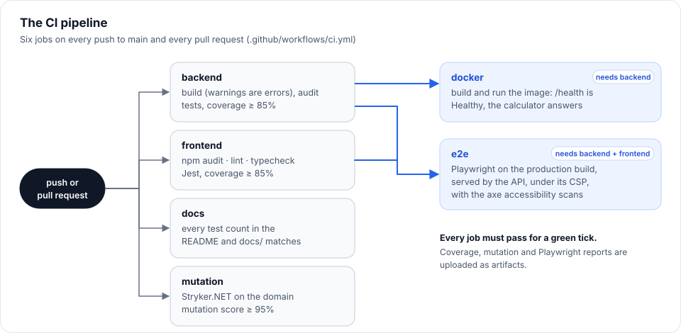

# 7. Testing and quality

> **About 3,240 automated tests in seven suites, written test-first, with the standards enforced by the build.**

**Read time:** 12 min · **Best for:** how quality is kept, and proved · **Code:** `tests/`, `client/e2e/`, `.github/workflows/ci.yml`

**On this page:** [How a feature gets built (TDD)](#how-a-feature-gets-built-tdd) ·
[What each layer proves](#what-each-layer-proves) ·
[Test standards, enforced by the build](#test-standards-enforced-by-the-build) ·
[Dependency audit](#dependency-audit) · [Independent models](#independent-models) · [Coverage](#coverage) ·
[Mutation testing](#mutation-testing) · [The CI pipeline](#the-ci-pipeline-githubworkflowsciyml) ·
[Code-quality settings that act like tests](#code-quality-settings-that-act-like-tests)

| Suite | Count | Tools | Speed |
|---|---|---|---|
| Domain | 718 | NUnit | < 1 s |
| Application | 581 | NUnit, NSubstitute, `FakeTimeProvider` | < 1 s |
| Infrastructure | 71 | NUnit, SQLite in memory; 3 on a real PostgreSQL (Testcontainers, run locally) | ~1 s, ~5 s with PostgreSQL |
| API integration | 164 | NUnit, `WebApplicationFactory`, NSubstitute | ~2 s |
| Conventions | 7 | NUnit, Roslyn, regex | < 1 s |
| Angular unit | 1,421 | Jest, jest-preset-angular | ~10 s |
| End-to-end | 283 | Playwright (Chromium), axe-core | ~30 s, with the production build |

---

## How a feature gets built (TDD)

Take the ARM margin floor as an example of the order of work:

1. **The independent model first.** Add the rule to `tools/rate-check/rate_model.py` and print the expected
   values: 6% falling toward 2% with 2/2/5 caps stops at 2.75% ($881.34).
2. **A failing domain test** that pins those values (`AdjustableRateTests.TheMargin_IsTheFloor_SoAFallingRateStopsThere`).
3. **The smallest domain change** that makes it pass (`AdjustableRate.Margin`, one line in `RatePath`).
4. **Outward, layer by layer:** a validator test and rule, a mapping test (`RateOptionTests.AnArmsMargin_ReachesTheEngine`),
   the contract; then Jest tests for the form field and the request it sends; then a Playwright test that types
   the margin and reads the schedule.
5. **Refactor with the tests green**, e.g. moving the ARM mapping into one shared `RateOptionMapper`.
6. **Run everything**, including the 300-household comparison against the model.

---

## What each layer proves

**Domain**
- The payment formula against known values.
- Invariants for every loan shape: it ends at exactly $0.00, the principal sums to the loan, every amount is
  whole cents, the balance never rises.
- Every guard, identified by its message.
- The rules: recast boundaries, PMI at 78% and 80%, exemptions, the cap, ceilings, installments, ARMs, buydowns,
  refinance savings and break-even, every strategy and scenario, all against the independent models.

**Application**
- **Unit tests:** the domain comparer is substituted (NSubstitute), so each test checks one mapping decision (for
  example, "Recast" becomes a recast policy, or PMI applies only below 20% down).
- **Sociable tests:** a request in, the reference numbers out, through the real engine.
- **Validators:** every rule at its boundaries.
- **An architecture test:** no contract exposes a domain type.

**Infrastructure**
- The repository on a real SQLite database built by the real migrations: each owner sees only their own
  calculations, every input survives the round trip, newest first, and search is case-insensitive and literal.
- **The migrations match the model** (`HasPendingModelChanges`): forget `dotnet ef migrations add` and this fails.
- **Deleting a user deletes their calculations**, and no one else's: the database's own cascade, since the test never
  loads the calculations it expects to disappear.
- **Stored format** (`StoredFormatTests`): a save of each kind, in today's JSON (`StoredFormats/*.json`, every
  option set), must still load with every value. Adding a field passes; renaming or removing one fails and names
  it. That is the signal to keep the old name, or to raise the format version and add an upgrade.
- **Format versions** (`StoredJsonTests`): saves are stamped, an old save is upgraded step by step (tested with a
  made-up three-version format), an unversioned one is version 1, a newer one is refused, a missing step is caught.
- **Automatic backups:** a whole copy that opens on its own, one a day at most, only the newest kept, and the
  settings; an API test sees the first copy taken at startup.
- **The database provider:** SQLite by default, PostgreSQL by configuration with its own context and migrations
  (which match the model too), the signing-keys table, and no app backups on PostgreSQL.
- **On a real PostgreSQL** (`[Category("Postgres")]`, Testcontainers): the migrations, a round trip, owners,
  the cascade, a case-insensitive search, and moving a saved second home into the list of other homes and back.
- **The data a migration moves:** `HomeComparisonMigrationTests` migrates an empty SQLite database to the migration
  before, saves a comparison the old way, then migrates up and down, checking the home both ways. They need Docker, so they run locally, not in CI:
  `dotnet test --filter TestCategory=Postgres`.

**API integration**
- The real pipeline in Production mode, on a temporary SQLite file, with one shared host (`[SetUpFixture]`).
- Accounts end to end: sign-up, cookie flags, confirmation and reset through the captured emails, sign-out.
- Lockout at its limit: four wrong passwords still let the right one in; five lock the account (`LockedOut`).
- Deleting an account: it needs the password (a wrong one deletes nothing and counts toward lockout), takes the
  saves with it, frees the email, and ends the account's other sessions at once, not half an hour later.
- Saved-calculation CRUD: 201 + Location, 401 when signed out, another user's item is a 404.
- Errors: JSON paths in 400s, malformed bodies, and a substitute service that throws to prove a 500 leaks nothing.
- Swagger, health, the JSON 404 for unknown API routes.
- Several instances: two hosts on one database share a session when the keys are kept in it, and lose it when each
  keeps its own (`SharedKeysTests`).
- Behind a proxy: a trusted proxy's HTTPS makes the cookie `Secure` and sends HSTS, and the limit counts each client
  behind it; an untrusted caller's `X-Forwarded-*` headers change nothing.
- Request logging: every response has an `X-Request-ID` (a safe caller id is reused), every error body names it,
  each API request is one log line without its query string, and JSON logs in Production. A test logger
  (`CapturedLogs`) keeps each entry with its scopes.
- Brotli and gzip responses, the security headers on every response, and the account attempt limit (a 429 with
  `Retry-After`; reads and calculations are never limited).
- Changing the password: it needs the current one (a wrong one changes nothing and counts toward lockout), keeps
  the rules, keeps this session and ends the others.
- Only the account endpoints the app uses: no bearer token is ever issued, and `/refresh`, `/manage/2fa` and
  `POST /manage/info` are 404s.
- **The contract itself:** `ContractSnapshotTests` compares the OpenAPI document (its shape, without the prose)
  with `Snapshots/openapi.v1.approved.json`. Any change of a path, property, type or enum value fails in seconds and
  writes `openapi.v1.received.json` beside it: diff the two, update the TypeScript models, then copy received over
  approved. Renaming one field's JSON name compiles and passes the C# tests that share the types; this catches it.

**Angular (Jest)**
- Every component and service: form-to-request mapping, derived values, validation messages, restoring a saved
  request, the shared loan.
- Timing: `switchMap` cancelling and recovering, the debounce.
- Chart configurations (through the fake chart factory).
- ProblemDetails messages.

**End-to-end (Playwright)**
- **Spanish** (`e2e/language.spec.ts`): the switch changes the page at once and is remembered; a browser that prefers Spanish
  starts in it. Every page is then opened in Spanish on a phone and must have no line left in English, no sideways scroll
  and no axe violation, and the calculator, refinance and pay-off pages are checked again after switching on an open page.
  In Jest, `translations.spec.ts` fails on any message with no Spanish, a Spanish that loses a placeholder, or a stale entry.
- **Layout rules** (`e2e/layout.spec.ts`): the bugs a screenshot comparison would catch, written as what must be true, so there
  are no baseline images to keep in step across operating systems. On every page, on a desktop, a tablet and a phone: the page
  does not scroll sideways, no table is cut off at its edge (the payment schedule is the one that may scroll), no text is clipped
  with an ellipsis, no number reads `NaN` or `undefined`, there is one `h1`, and on a phone what is pressed is at least 40px
  tall. It was added after a page-by-page review found tables and filters cut off on a phone.
- **Other browsers** (`e2e/cross-browser.spec.ts`, plus the layout and chart specs): Chromium runs everything and is the
  only browser CI installs, so the other engines are run by hand with `npm run e2e:cross:install` and `npm run e2e:cross`
  (Firefox and WebKit, two workers, since Firefox crashes under more). They cover what differs between engines: the
  calculator and every results view without a script error, a chart read with the arrow keys, the native dialog and where
  focus goes when it closes, a theme kept in storage, the switch to Spanish (with its month names, loaded on demand), and the layout rules and chart geometry (the dots on their lines). The first
  run found that Safari does not focus a button when it is clicked, so a dialog gave focus back to the page's main area
  instead of the button that opened it; the dialog now remembers what was clicked. The counts in these docs are Chromium's.
- **Accessibility** (`e2e/accessibility.spec.ts`): axe scans every page and results tab against WCAG 2.2 A and AA, in
  light and dark mode, on desktop and a phone, signed in and out, with every form section open, and with each rate plan (a buydown's year-by-year table, an
  adjustable rate's resets). A failure names
  each rule broken and the elements that break it. Automated scans catch about a third of real problems (contrast,
  missing names and roles, invalid structure); keyboard paths are covered by the other specs, and a screen-reader
  pass still needs a person.
- The real browser on the **production build, served by the real API** (a scratch database), as the container
  serves it, through page objects and fixtures. So every test runs under the API's Content-Security-Policy, and an
  automatic fixture (`withinContentSecurityPolicy`) fails any test in which the browser blocked something; the Angular
  dev server sends no CSP, so tests run against it would never notice. `security.spec.ts` checks the page carries
  the policy.
- The calculator, the shared loan between pages, ARMs and buydowns, refinance, pay off or invest.
- FHA's county: the limit shown, in the results too, and a warning once the loan is over it.
- FHA and VA: the payment on the loan with its upfront fee, the MIP named as such, and the VA's funding fee.
- A tax rate change: the quick numbers before and after its year.
- Discount points: both payments, the break-even payment and date, and the line in the cash to close.
- The equity chart: the down payment at the start, and the year the loan is paid off.
- Sign-up with the email from the dev mailbox, password reset, saving and reopening all four kinds from History,
  and deleting the account from its page (a wrong password first, then the right one).
- A consistency suite checks every number on the Pay off or invest page (banner, cards, milestones in each scenario
  and in today's dollars, crossover notes, the fact sheet) against the API response it came from, for three very
  different households, and that the form and the API agree on every field's limits. Other specs cover a bad decade,
  stock-heavy households and the risk profiles, all against the reference numbers.

---

## Test standards, enforced by the build

`MortgageAnalytics.Conventions.Tests` parses every C# test file with **Roslyn**, and every Playwright spec with a
regex, and fails listing each violation as `file:line`:

1. **Constraint model only:** `Assert.That(...)`, never `Assert.AreEqual`.
2. **Every assertion has a message** explaining what a failure means, in C# and in Playwright
   (`expect(actual, 'message')`).
3. **More than one assertion in a test means `Assert.Multiple`**, so one run reports every failure, not just the
   first.
4. **Every Playwright spec takes `test` from `e2e/fixtures.ts`**, so checks shared by every test (the
   Content-Security-Policy guard) cannot be skipped by importing from `@playwright/test` directly.

They catch real slips: while adding `StoredFormatTests`, rule 3 failed the build until the setup check moved
inside `Assert.Multiple`.

### Supporting conventions

- **Builders, not copy-paste:** `A.Request.FivePercentDown().WithMonthlyExtra(300).WithHousingCosts(c => c.AsHomestead())`
  (`tests/MortgageAnalytics.Testing/Builders/`).
- **One source of expected values:** `ReferenceLoans`, `ReferenceRefinances`, `ReferenceStrategies`, shared by every
  layer.
- **Base classes:** `AmortizationTestBase`, `ValidatorTestBase`, `SociableAnalysisTestBase`, `RepositoryTestBase`,
  `ApiTestBase`.
- **NSubstitute for every double**, `FakeTimeProvider` for the clock: no hand-written fakes.
- **A size budget, enforced by the build:** the first download (the app's scripts and styles before any page loads) is
  766 kB today (178 kB over the wire); the production build warns at 800 kB and fails at 900 kB, and no single script,
  pages loaded on demand included, may pass 450 kB (warning at 350 kB; the largest, the app's own code, is 330 kB). A component's styles warn at 6 kB and fail at 8 kB.
  CI builds the app, so a change that bloats it fails there instead of slowly slowing every first visit.
- **No retries in Playwright:** a flaky test should fail loudly and be fixed, not be hidden by a second attempt.

---

## Dependency audit

CI fails on any known vulnerability in what ships: `dotnet list package --vulnerable --include-transitive` for
every NuGet package, and `npm audit --omit=dev` for the browser's dependencies. Both are clean.

<b>The one advisory accepted, and why</b> (a dev-only <code>sprintf-js</code> report)

The full `npm audit` reports one moderate advisory, 21 times over: `sprintf-js` (GHSA-hp3w-g68c-fv3c, a denial of
service through huge precision specifiers), reached through Jest's coverage instrumentation (`babel-plugin-istanbul`
→ `js-yaml` 3 → `argparse` 1). It is accepted, for three reasons: no fixed `sprintf-js` exists (1.1.3 is the latest,
and affected); `js-yaml` 3 loads `argparse` only in its command-line tool, never in the library Istanbul calls, so
the code never runs here; and it is a test tool that never ships. Forcing `argparse` 2 in with an `overrides` entry
would silence the report by breaking `js-yaml`'s command-line tool, which is a worse trade. Look again when Istanbul
moves to `js-yaml` 4.

---

## Independent models

| Model | Checks | Run |
|---|---|---|
| `tools/rate-check/rate_model.py` | ARM resets, caps, margin, worst case; buydown payments and subsidies | `python tools/rate-check/rate_model.py` |
| `tools/calculator-check/compare_with_api.py` | 300 random purchases and 300 refinances against the live API: every monthly row, cost, total, date, projection year and saving | API on :5080, then run it: expect all identical |
| `tools/strategy-check/strategy_model.py` | Every strategy, scenario and year | `python tools/strategy-check/strategy_model.py` |
| `tools/strategy-check/compare_with_api.py` | 300 random households (seeded) against the live API, every field | API on :5080, then run it: expect "300 identical" |

They are written from the rules, not translated from the C#. If the code and the model were both translated from
the same misunderstanding, they would agree and prove nothing.

---

## Coverage

| Code | Lines | Branches | Gate |
|---|---|---|---|
| Backend | ~99% | ~97% | CI fails below 85% (ReportGenerator summary + `jq`) |
| Angular | ~99% | ~91% | `npm test` fails below 85% (`jest.config.js` `coverageThreshold`) |

Coverage is a floor, not a goal: it tells you what is *unchecked*, not that what's checked is right. The
independent models do that job.

---

## Mutation testing

**Stryker.NET** measures the domain tests' strength rather than their reach. It makes about 1,400 small changes
(mutants) to `MortgageAnalytics.Domain` (`<` to `<=`, `+` to `-`, `Sum` to `Max`, an emptied message, a deleted
statement) and runs the tests against each. A mutant no test notices *survives*, and points at an assertion that is
missing. **The score is 98.3%; CI fails below 95%** (`tests/MortgageAnalytics.Domain.Tests/stryker-config.json`), and
uploads the HTML report.

<b>What the first run found</b>: 87%, with 118 survivors, sorted into four kinds

- **Untested guard limits.** `if (interval is < 1 or > 120)` survived becoming `>= 120`; seven of `Household`'s guards
  could be deleted outright; many guard messages were never read. `GuardLimitTests` now has one row per limit: the
  limit itself is accepted, and just past it is rejected with that guard's own message.
- **Behaviour no test pinned.** An ARM without a margin falling to its lifetime floor, the periodic cap after the
  first reset, an annual extra from payment 3 (from payment 6, `p − 6` and `p + 6` land on the same payments), an ARM
  loan already being paid, the buydown cost at closing, a refinance that never breaks even, ESPP money in the IRA share.
- **Code that could never change a result**, now removed: `RecastPolicy`'s `> 0` (the minimum is always positive),
  `MonthlyCashPlan`'s `AfterTaxShare > 0` (at least 0.4 under the 60% cap), a balance check in the first year's
  interest, and optional `null`s nobody passed.
- **Equivalent mutants**, which no test can kill because they behave identically: `>>=` and `>>>=` on a non-negative
  number, `First()` and `FirstOrDefault()` on a list that always has three entries, a `>=` that only differs on an
  exact-to-the-cent tie. The 20 survivors are all of this kind.

**The Application layer** (mapping and validators) is mutation-tested too, locally rather than in CI, to keep CI
minutes for the gates (`tests/MortgageAnalytics.Application.Tests/stryker-config.json`; run `dotnet stryker` there).
Its first run scored 88.7%: rules no test reached (a VA funding-fee type, a yearly extra's floor, FHA's 3.5% exactly,
each tax's rate-change message), refinance boundaries (a loan whose last payment is today), mapped fields nobody
asserted (an FHA response's loan type, a rate reset's date), and code that could not matter, now removed (a first
payment date resolved twice, a cap of 50 rate changes that one-a-year in a 50-year loan never reaches). It now scores
**97.8%**: of the 19 left, 9 are messages on `switch` arms and data lookups that validation makes unreachable, and the rest are
equivalent ("empty list → None" shortcuts, `Append` against `Prepend` before a `Max`) or boundaries another rule
already covers.

**The Angular logic** is mutation-tested with **StrykerJS**, locally too (`client/stryker.config.json`; `npm run
mutation` in `client/`, about an hour for about 2,000 mutants, then minutes for a rerun, which reuses the last results).
It mutates the code that decides things, not templates or HTTP wiring: the form models and their rules, the stores and
the shared loan, the chart builders, the formatting and the summaries. Its first run scored 84.3%, and found two real
gaps. The rules for when a page shares its loan with the others (the fix for the echoing-loan bug) were pinned only by
Playwright, so a wrong `<` passed every unit test; they now have their own, case by case. And the loan form's defaults,
its blank-to-zero mapping and its restore were checked only through the whole component, so a lost default or a value
dropped on the way back went unnoticed; `loan-form.model.spec.ts` now checks them directly, with a round trip through
every unusual value. It scored **97.9%** then; the survivors were almost all equivalent: caches that only save work,
`emitEvent: false` on changes nothing listens to yet, and guards whose fallback gives the same answer (a balance after
the last payment is 0 either way). After the makeover's first batch of new code (the Share menu, theme switch, answer
sentence, what-if, state rates and the form's new fields) it fell to **94.5%**: the weak files were the tax-bracket
tables (built as module constants, so no test could reach their mutants: they are functions now, and the boundary of
every bracket is tested), the chart host, and the strategy names. With those fixed it scores **97.0%** (2,420
mutants, 15 survivors and 68 without coverage, most of them the strategy names and colours, a module-level table the
runner cannot attribute to a test). The loan form component and the calculation page are not in the mutated set; they
are covered by their own specs and the browser tests.

---

## The CI pipeline (`.github/workflows/ci.yml`)

On every push to `main` and every pull request:

The test counts in these pages are checked, not trusted: `tools/doc-check/doc_counts.py` holds one rule for each
place a count appears and fails CI naming the file and line of any that is stale. A "N ... tests" phrase that no rule
covers fails too, so a new count cannot slip past it.

NuGet packages are cached on the `packages.lock.json` files, and npm packages on `package-lock.json`.
Coverage reports and, on failure, the Playwright report (with traces and screenshots) are uploaded as artifacts.

---

## Code-quality settings that act like tests

- **Warnings are errors**, with the recommended .NET analyzers on (`AnalysisLevel latest-recommended`).
- **Missing XML docs are errors** on production code (CS1591), so every public member is documented. Interface
  implementations use `<inheritdoc />`, so each contract is described once, and the same comments feed Swagger and
  IntelliSense. Angular components and services carry JSDoc on their public members.
- **Nullable reference types** everywhere.
- **NUnit.Analyzers** and **NSubstitute.Analyzers** catch test-code mistakes at compile time.
- **TypeScript strict mode** in the Angular app.

---

← Previous: [6. The mortgage math](06-mortgage-math.md) · [Guide contents](README.md) · Next: [8. Interview guide](08-interview-guide.md) →
