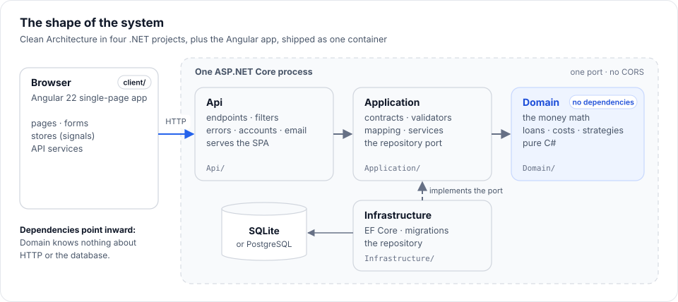

# 8. Interview guide

> **How to present this project, and answers to the questions you are likely to get.** Every answer points to
> real code, so you can open the file and show it. Practise them out loud; don't memorise them word for word.

**Read time:** 25 min, out loud · **Best for:** the pitch, likely questions, trade-offs and stories

**On this page:** [The pitch](#the-pitch) · [Walk me through the architecture](#walk-me-through-the-architecture) ·
[Running the demo](#running-the-demo) · [Likely questions](#likely-questions) · [Trade-offs and what you'd change](#trade-offs-and-what-youd-change) ·
[Stories for "tell me about a hard bug"](#stories-for-tell-me-about-a-hard-bug) ·
[If you're asked how you built it](#if-youre-asked-how-you-built-it) ·
[Numbers worth remembering](#numbers-worth-remembering)

---

## The pitch

**In 30 seconds:**
> "Mortgage Analytics is a full-stack mortgage calculator: a .NET 10 API and an Angular 22 app in one Docker
> container. It answers three questions: what a home really costs to own, with taxes, PMI and extra payments;
> whether refinancing actually saves money; and whether spare cash should pay down the mortgage or be invested.
> The math is exact to the cent and checked against independent Python models, and over 3,400 tests run in CI."

**In 2 minutes, add:**
1. **Architecture:** Clean Architecture in four projects. The domain has no dependencies at all, so the money
   math is tested in isolation. Validation happens twice: friendly messages at the edge, guard clauses in the domain.
2. **The interesting domain rules:** PMI comes off on the *original* schedule; recasts need *one* qualifying lump
   sum; Texas homestead exemptions apply per tax; ARMs reset within caps and stop at a margin floor; a refinance can
   lower the payment and still cost more.
3. **Frontend:** results update as you type (debounce + `switchMap`), one loan is shared across the pages,
   and every form is driven by one rules table that mirrors the API.
4. **Quality:** TDD, an 85% coverage gate, and conventions tests that use Roslyn to fail the build when a test
   breaks the team's assertion standards.

---

## "Walk me through the architecture"

Draw four boxes: Api → Application → Domain, and Infrastructure → Application. Then:



> "Dependencies only point inward. The **domain** is pure C#: loans, amortization, taxes, refinancing, strategies.
> It references no packages. The **application** layer holds the use cases: request and response contracts,
> FluentValidation validators, explicit mapping, and services. It also owns the repository *interface*.
> **Infrastructure** implements that interface with EF Core and SQLite, which is dependency inversion: the
> high-level policy defines the port. The **API** is thin minimal-API endpoints, one generic validation filter,
> and a global exception handler that turns everything into ProblemDetails. In production the API also serves the
> Angular build, so it's one container with no CORS."

Then trace one request: [Architecture → One request, end to end](03-architecture.md#one-request-end-to-end).

---

## Running the demo

About eight minutes, then questions. Start it once beforehand and leave it running:

```bash
docker compose up --build
```

The app is on http://localhost:8080, the API docs on http://localhost:8080/swagger and the email inbox (Mailpit)
on http://localhost:8025. Stop any `dotnet run` or `npm start` first, so the ports are free.

| # | Do this | Say, and point at |
|---|---|---|
| 1 | **Buy a home**, with the example numbers: an average US purchase, a $415,000 home, 9% down, today's average 6.25%, 30 years, 0.9% property tax, $3,100 of insurance, $200 a month extra. Change the price and let it update. | Results follow as you type, with no button. The answer is set large under the question ("$3,102 a month"), then three equal figures: the payment, the cash to close ($48,128.79) and when it is paid off, with can you afford it (Add income), the savings and when PMI ends under them. $108,039 net savings ($103,476 less interest plus $4,563 of PMI), paid off 5 years 9 months sooner. PMI ends in July 2032, 2 years 5 months sooner, because asking at 80% is the default; the tile says that without asking, the servicer only has to remove it in February 2036, costing $6,766 more. The required payment is $3,102.19. Dates follow the first-payment date, so they move if the default has. |
| 2 | Switch the loan type to **FHA**, pick a county, then raise the price past its limit. | The limit is HUD's, by county; over it the app warns. The county list comes from `GET /api/v1/fha/loan-limits`. |
| 3 | Under Cost, **Year by year**, then the equity chart. | Every cost of owning it over the life of the loan, not just principal and interest. |
| 4 | **Refinance**: a 2024 loan, $300,000 at 7% with 28 years left, into today's 6.25% for 30 years, with $6,000 of closing costs. Then change the years left to 25 and the new rate to 6%. | The payment drops $191.68 a month and refinancing saves **$14,067**, less than the rate alone would because the clock restarts two years; break-even is July 2029, and "keep paying $2,038.83 a month" saves $108,377. With 25 years left into 6%, it costs **$17,415 more**: a lower payment that loses money. |
| 5 | **Pay off or invest**: $300,000 at 6.5%, 28 years left, $1,000 a month. Switch to **Bad decade first**. | "Invest the difference" is recommended, $16,791 ahead of the hybrid, but not guaranteed: after a lost decade, paying the mortgage off first wins by $20,915. The household's 17% tax rate is the 12% federal bracket plus a 5% state, as the hint under it shows. |
| 6 | **Sign up**, open Mailpit on :8025 to confirm, sign in, save a result, open **Saved** and reopen it. | A cookie session (HttpOnly, SameSite=Strict, no bearer tokens). Saves belong to the user; someone else's id is a 404, not a 403. |
| 7 | Open **/swagger** and try `POST /api/v1/amortization/calculate`. | The same API the calculator uses, documented from the code's own comments. |

Optional, after step 4, if the room owns a home: on that refinance, open **Cash out and PMI**, set the home's value to
$500,000 and take out $50,000, then open **Compare other ways** and tick **Compare with a home-equity loan** (8% over 15
years, kept 7 years). Keeping
the 7% loan and borrowing the cash separately costs **$16,044 more over 7 years** than refinancing: $512,050
against $496,006, at $2,598.17 a month against $2,098.43, with the refinance's $6,000 paid at closing. The point to
make is the yardstick: each way is costed as what is paid plus what is still owed, so the loan that is repaid
sooner is not mistaken for the cheaper one. It also says $100,000 could be borrowed and the loans together would be
70% of the home's value. Put the value back to $400,000 and they would be 87.5%, above the 80% lenders allow, with
only $20,000 of equity available: the app says so, and the refinance now carries PMI, which narrows the gap to
$5,545. Switch **A loan** to **A line of credit** (a HELOC) for the other half of the question: 8% interest only for
10 years, then 20 years at an expected 9%, is $333.33 a month at first and $449.86 later, and over 7 years costs
**$20,106 more** than refinancing, because none of the cash is paid down while it is drawn. The line's rate moves with the
market, so the page asks for the rate you expect rather than assuming it. One more tick on the same refinance, **Pay points
for this rate** (1 point, with the lender's rate without them at 6.25%), shows whether points pay: $3,000 for a payment that
is $48.50 lower, which the interest saved covers by the **48th payment**; they are paid with the closing costs, so the
refinance's own verdict moves by the same $3,000. And **Use some of it to pay off a debt** (a $20,000 card at 22% with
$600 a month) shows the trap in the other direction: moved onto the mortgage it costs **$3,192 less** over 7 years and the
payments fall by $480.09 a month, but the same $20,000 as a 4% car loan costs **$6,318 more**, with the payment still
falling, because spread over 30 years most of it is still owed. Give it an income ($120,000, with $500 of other debts)
and it also says debt-to-income falls from 32.2% to 25.98%, before taxes and insurance.

Then, if there is time, the offer the deck closes on: *name a feature and I'll show the rule, the test that pins
it, and a change with the test going red, then green.* Choose that change before you present, for example the ARM
margin floor ($881.34 a month, [Testing → TDD](07-testing.md#how-a-feature-gets-built-tdd)), so you are not
hunting for one in front of people.

---

## Likely questions

### Design and architecture

**Why Clean Architecture for an app this size?**
The domain is the valuable part, and it changes for business reasons, not technical ones. Keeping it free of
ASP.NET and EF Core means its 718 tests run in under a second with no setup, and the storage or web framework can
change without touching it. I kept it light, though: no MediatR, no AutoMapper, no repository for things that
don't need storage. The Infrastructure project only appeared when saved calculations needed a database.

**Why this stack, and what did you leave out?**
Mainstream and supported on purpose; each piece was picked over a named alternative:
- **.NET 10 and minimal APIs:** a long-term-support release (to November 2028) with `decimal` for exact money math.
  Minimal APIs over controllers, because each endpoint just calls one service method.
- **EF Core on SQLite, PostgreSQL by a setting:** one file for a demo, instead of a database server on day one.
- **ASP.NET Core Identity:** reviewed password hashing, lockout and email confirmation, instead of hand-rolled
  accounts. The cost is owning what its defaults turn on (the bearer-token story below).
- **Angular 22, signals and RxJS:** a full framework for form-heavy screens; signals hold state and RxJS only
  handles time. Not NgRx or another state library.
- **NUnit, Jest, Playwright with axe:** fast unit tests at the base, and a real browser on the production build.
- **Docker and GitHub Actions:** one image that runs the same everywhere, and CI that gates every push.

Left out deliberately: MediatR, AutoMapper, NgRx, a UI component library, a separate database server, CORS
configuration. Each is easy to add when a real need appears (KISS, YAGNI). The full table, with versions:
[Tech stack](01-tech-stack.md).

**Where do you apply SOLID?** (Have one example ready for each. All five, in one section with the real code:
[SOLID by example](09-solid-by-example.md).)
- **S:** `PaymentFormula` does the math, `AmortizationCalculator` builds schedules, `LoanComparer` compares, and the
  endpoints only do HTTP.
- **O:** a new housing cost is a new `IHousingCost`; adding the school tax and growth needed no change to the
  amortization engine.
- **L:** every `IExtraPaymentRule` and `IHousingCost` can stand in for another inside the composites.
- **I:** small interfaces of one or two members each.
- **D:** services depend on `ILoanComparer` and `TimeProvider`; Application owns `ISavedCalculationRepository`.

**Where does the code bend SOLID, and why?** (A good answer names the trade-off.)
- **`StrategySimulator.Simulate` is one long loop.** Each month's steps must happen in a fixed order (growth, the
  payment, free money, year-end tax, then the split), and the order is the logic. One loop, with the order
  written in the remarks, is easier to check against the Python model than five classes passing state around.
- **`SavedCalculation` has a nullable field per kind**, so a fourth kind means touching the entity, the contracts and
  the validator. That is the price of plain JSON columns that the stored-format tests can pin down. With many
  more kinds, it would become a type discriminator with one payload.
- **`CalculationStore` does several jobs:** the request, the saved link, and keeping the shared loan in step. They
  change together whenever a page is added, so they live in one base class, and each page fills in four members.
- **What a review fixed:** an ARM's resets were attached in five places with the same expression; that is now
  `LoanTerms.WithAdjustableRate()`, so the domain decides it (tell, don't ask). The refinance service took an
  `includePayments` flag, which is how the HTTP response is shaped, not the use case, so trimming moved to the
  endpoint, like the calculator's. The loan form's summary text moved into pure, separately tested functions.

**What design patterns did you use?**
- **Composite:** `ExtraPaymentPlan`, `HousingCostPlan`.
- **Strategy:** the rules and costs behind their interfaces.
- **Template Method:** `CalculationStore`, where each page's store fills in `send$`, `loanOf` and `describe`.
- **Adapter / port:** the repository.
- **Builder:** in tests, `A.Request...`.
- **Factory:** `RecastPolicy.OnLumpSum`, and the `ScrubChartSpec` that every chart is drawn from.
- **Container/presentational components** on the client.

**Why validate twice?**
They protect different things. FluentValidation gives the *user* field-level messages ("Interest rate must be
between 0% and 30%"). Domain guard clauses protect the *code*: no caller can ever build an invalid `LoanTerms`.
If a guard fires in production, bad input got past the validator, which is a bug, so it's logged and returned as
a generic 500 that leaks nothing.

**Why hand-written mapping instead of AutoMapper?**
The mapping makes business decisions: a zero amount means "none", "Recast" becomes a recast policy, and PMI applies
only below 20% down. As explicit code, each decision can be read and unit-tested. AutoMapper would hide them in
configuration, and mistakes would only show up at runtime.

**What's the APR, and how do you calculate it?**
The rate you'd be paying if the fees were folded into the interest. A loan at 6.25% with $5,000 of lender costs and
prepaid interest is effectively a loan of $372,680 repaid with the same $2,325 payments, which is about 6.38%. I solve
for the monthly rate at which the payments' present value equals what the borrower actually received, by bisection,
as Regulation Z's actuarial method does. Which fees count is the interesting part: lender costs, prepaid interest,
points and an FHA or VA upfront fee do; recording fees, title and escrow don't. Mortgage insurance goes in the
payments until it ends. An independent Python model solves it separately and matches on every random purchase.

**How does sharing a calculation by link work?**
The inputs go in the URL's fragment, after `#share=`, as versioned JSON in URL-safe base64. A fragment never leaves
the browser: it isn't sent to the server, so it isn't in any request or log, and nothing needs storing. A short link
would need a database table, an expiry policy and a public endpoint, and a query string would put the numbers in
every log on the way. A route guard reads the link before the page opens, so the form starts from the shared inputs,
then drops the fragment from the address. A link is untrusted input, so it's checked to be the right shape, and the
API validates the numbers as it does any request. A purchase link leaves out income and debts; Pay off or invest
can't work without them, so its message says the link includes them.

**How did you add second homes and investment properties?**
As one input that changes several rules, each written from its source and tested at its edge: Fannie Mae's
Eligibility Matrix caps a conventional loan at 97% of a home you live in (95% with an ARM), 90% of a second home and
85% of an investment property; its seller limit drops to 2% for an investment property; and FHA, VA and a Texas
homestead are only for a home you live in. The interesting part was a case the rule would have broken: a loan
already being paid can be underwater, and the calculator fills in a shared loan as a price with nothing down. Those
limits are for when a loan is made, so the validator takes a clock and applies them only when the first payment is
still ahead. Rates are what you enter, so the pricing adjustments lenders make for investment properties aren't modelled.

**How did you add what a builder may pay?**
As a rule in the domain, written from its source: Fannie Mae's Selling Guide B3-4.1-02 for a conventional loan (3%
of the price with a loan above 90%, 6% to 75%, 9% below), 6% for FHA, and 4% for VA besides the normal closing costs.
`ConcessionLimit.For` picks the tier, and `CashToClose` counts the seller's buydown and credits against it. The
lender's credits are used first and don't count, and any excess comes off the seller's credits, as a lender would
take it. The cash to close says what the limit is and why, what 10% down would raise it to, and to ask for the rest
off the price. The Python model implements the rule separately, and its random purchases include offers over it.

**How does rent vs. buy work?**
Two households spending the same each month, one buying and one renting. Each month the cheaper one invests the
difference, and the renter also invests what buying takes to close. The buyer's net worth is the home after a sale,
less what's owed and selling costs, plus their investments; the renter's is their investments. The answer is the
year buying pulls ahead for good, not just its first good year. It's very sensitive to the rent: on the example
home, $2,700 a month breaks even in 4 years, and $2,100 never does in 30. The chart plots the gap rather than the
two net worths, because those grow so large that the gap, which is the answer, disappears.

**How does the calculator say what someone can afford?**
The way a lender does: debt-to-income. The housing payment, at the qualifying rate with every escrowed cost, as a share
of gross income, alone and with the other debts. The qualifying rate is the note rate unless it's an ARM: then it's
each program's rule (Fannie Mae's B3-6-04 qualifies a 3/1 ARM at the most its caps allow in five years), found once
and held at every price searched. It's held to two limits, the comfortable 28/36 and the program's
maximum (conventional 45%, FHA 31/43, VA 41%). The interesting part is the highest price. The payment depends on the
price through taxes after exemptions, PMI and FHA's upfront fee, so there's no formula to invert, and I search
instead: double until the budget is passed, then bisect to the dollar. My first version reran the whole 30-year
analysis for every price, which added 100 ms to each recalculation. A lender only needs the first month, so
`HousingCostPlan.FirstMonth` prices that without a schedule, and it's now about 10 ms. The shortcut is checked
against the full analysis, so they can't drift apart.

**How do you compare taking a builder's money as a price cut, credits, a buydown or points?**
By running the calculator four times. `SellerOfferComparison` builds each way as a request: a lower price, credits, a
2-1 buydown, or points at a lower rate. Each one goes through the same pipeline as any loan, so taxes, PMI, the
upfront fee and the seller's limit are all priced the same way. Then `OwnershipCost` adds the cash to close, the
payments over the years you keep the loan, and the balance still owed. The balance matters: a price cut or points
leave you owing less, and comparing payments alone would miss that. Only the split is new logic, and it's in
`SellerOffer`: how much of the offer each way takes within the limit. One finding surprised me. Credits and a buydown
come out exactly equal once its two years are over, because the seller's money pays for the same costs either way.

### C# and .NET

**Why `decimal`?**
`double` is binary floating point and can't represent 0.1 exactly, so cents drift. `decimal` is base-10. One catch:
`Math.Pow` only takes `double`, so `DecimalMath.Pow` does exponentiation by squaring in `decimal`. Rounding is in one
place, `Money.Round` (to cents, half away from zero), and the final payment absorbs the drift so every schedule
ends at exactly $0.00.

**Minimal APIs or controllers?**
Minimal APIs: less ceremony, and endpoints that are plain functions. `TypedResults` lets OpenAPI infer the
response types. Cross-cutting concerns live in an endpoint filter (`ValidationFilter<T>`, generic, one for every
endpoint) and in an `IExceptionHandler`. Controllers would make sense if the team already standardised on them.

**How is the API documented, and how do you stop the docs drifting?**
The documentation is generated from the code, then tested:
1. **Comments are the source.** Contracts and endpoints carry XML doc comments with `<example>` values. Warnings are
   errors, so a public member without a comment is a build error (CS1591), and implementations use
   `<inheritdoc />` so each contract is described once.
2. **Swashbuckle builds the OpenAPI document** from those comments, plus `TypedResults` and
   `ProducesProblem` / `ProducesValidationProblem` for the response shapes. Swagger UI is at `/swagger`, in every
   environment, because the docs are part of the showcase.
3. **A snapshot test pins it.** `ContractSnapshotTests` compares the document's shape with an approved copy; a
   changed path, property, type or enum value fails in seconds and writes a diff to review.
4. **It has paid off.** The first snapshot listed `/refresh` and `/manage/2fa`, which no screen uses, and led to
   the bearer-token gap in the stories below.

What it does not do yet: the TypeScript models are still mirrored by hand, guarded by that snapshot (see the
[trade-offs](#trade-offs-and-what-youd-change)).

**How do you handle errors?**
Everything returns RFC 9457 ProblemDetails:
- **400** validation errors keyed by JSON path, from the filter;
- **400 / 413** for bodies that can't be read, which keep their own status;
- **404** for an unknown API route, as JSON rather than the SPA's index page;
- **500** with a generic title for anything else, logged with source-generated `[LoggerMessage]`.

**How do you test code that depends on "today"?**
Services take `TimeProvider`; tests pass `FakeTimeProvider` with a fixed date. The same seam exists on the client
for charts: they are SVG drawn from a plain spec, so tests read the spec and the rendered markup, with nothing to fake.

**Service lifetimes?**
- The domain services and use cases are **singletons**: they're stateless.
- The saved-calculation service and repository are **scoped**, matching the EF Core `DbContext`, which isn't
  thread-safe and is meant to live for one request.

### Data

**Why SQLite? Would it scale?**
It's one file with no server, which suits a demo and makes tests real (in-memory SQLite, built by the real
migrations). Its limit is a single writer, so the app also runs on PostgreSQL: `Database:Provider = Postgres`. The
model is one `CalculationsDbContext`, with a derived context per provider, because migrations are provider-specific.
Nothing outside Infrastructure changed. The one behaviour difference was search: PostgreSQL's `LIKE` is
case-sensitive, so it uses `ILIKE`, and a test against a real PostgreSQL in a container (Testcontainers) proves it.

**Could it run as several instances?**
Yes: `docker compose --profile cluster up` runs two behind a load balancer on one PostgreSQL. The catch was the
signing keys: each instance signed session cookies with its own keys, so the next request, sent to the other
instance, was signed out. With `DataProtection:Store = Database` the keys live in the shared database. An API test runs
two hosts on one database and proves both sides.

**Why store the inputs as JSON?**
A saved calculation is always read and written whole, never queried by field, so normalising forty-odd fields into
tables would add joins and migrations for no benefit. The contracts can grow without a schema change.

**What about versioning that JSON?**
Every save carries a `formatVersion`. A breaking change raises the version and adds one upgrade step, a small edit
to the JSON, and old saves are upgraded step by step as they load; a missing step stops the app at startup, and a
save from a newer version is refused rather than half read. No step has been needed yet, since every change so far
only *added* fields, which old saves load as defaults. `StoredFormatTests` loads a save of each kind in today's
format, with every option set, and checks every value comes back, so a rename fails CI and names the field. The
URLs are versioned too (`/api/v1`).

**The calculator kept growing. How did you keep it usable?**
I stopped and reviewed the page as a first-time buyer would. Every feature had added a panel to the Overview and a
section to the form. Seven panels stacked up, and the headline answered the wrong question (savings from paying extra,
on a page titled "What will this home really cost?"). The fix was to organize by the buyer's questions. The Overview
led with four answer tiles: the payment, the cash to close, can you afford it, and what paying extra saves (it has six now, three answers and three behind them). Each
links to a tab with its details, so the page is short and the depth is one click away. Comparing homes became its
own page, because it changed what the form edits. The form went from nine sections in the order they were built to
six in the order a buyer thinks, each its own component. Features that need an input now say so: **Add your income**
opens the right section and puts the cursor in the field.

**What changed when Compare went from two homes to four?**
The column, not the JSON inside it. A comparison stored its second home in a `SecondHome` column, so four homes meant
a list: `OtherHomes`, a JSON array of one to three homes. EF Core generated a rename, which keeps the data but leaves
an object where a list now belongs, so I added one line of SQL to the migration: wrap each saved second home in an
array. The Down migration takes the first home back out. Each home in the array keeps its own `formatVersion`, so it
upgrades exactly as a single save would. A test migrates an empty SQLite database to the migration before, writes a
comparison the old way, migrates up and reads it back. Then it migrates down and checks the second home is still
there. The same test runs on a real PostgreSQL in a container, because the Down SQL differs (`json_extract` against
`jsonb -> 0`). On the client, the request became `homes: AmortizationRequest[]`. The table shows each figure's
difference from Home A and shades the best home on each line.

**How is one user kept from seeing another's data?**
- The owner id comes from the session's claims, never from the request.
- The repository filters **in the query** (`WHERE OwnerId = @user`), not after loading.
- Another user's item returns **404, not 403**, so its existence isn't revealed.
- Deleting an account (from **Your account**, with the password) cascades to their calculations, and every
  request rechecks its session, so the account's other sessions end at once.

### Security

**How does authentication work?**
ASP.NET Core Identity (`MapIdentityApi`) handles it:
- **Passwords** are hashed, and repeated failures lock the account.
- **Sign-in** waits for a confirmed email.
- **The session** is an **HttpOnly, SameSite=Strict cookie**, so scripts can't read it (unlike a token in
  `localStorage`), and other sites can't make the browser send it, which blocks CSRF.
- **Cookies only.** Identity's built-in endpoints would also issue bearer tokens (sign-in without `useCookies=true`,
  then `/refresh`). A convention on those endpoints refuses the first with a 400 and turns `/refresh`, the unused
  `/manage/2fa` and `POST /manage/info` (a password change with no lockout check) into 404s, gone from Swagger. The
  contract snapshot test found them; integration tests pin it. Passwords change through the app's own
  `POST /password`, which needs the current one and keeps the session that made the change.
- **The keys** that sign cookies and emailed links are persisted, so restarts don't sign people out.

**Other measures?**
- "Forgot password" answers the same for any email, so it can't be used to find accounts.
- Return URLs after sign-in must be same-site paths, so there's no open redirect.
- The dev mailbox endpoint exists only in Development.
- The container runs as a non-root user.
- **Account attempts are rate limited** with ASP.NET Core's built-in limiter: 10 POSTs a minute per address
  (sign-in, sign-up, resend, reset), then a 429 with `Retry-After`. GETs are exempt, because the app asks who is
  signed in on every page load.
- **Security headers:** a Content-Security-Policy with `script-src 'self'` (no inline script; Angular's
  critical-CSS inlining is off because it uses an inline `onload`), `frame-ancestors 'none'`, `nosniff`, and
  `Referrer-Policy: no-referrer`, because reset links carry their code in the URL. Every Playwright test runs on the
  production build under this policy and fails if the browser blocks anything, so a change that needs an inline
  script cannot slip through (the Angular dev server sends no CSP, which is why the tests don't use it).
- **Behind a reverse proxy,** the app believes `X-Forwarded-For` and `-Proto` only from the proxies it is told about,
  so the limiter counts each client, the session cookie is `Secure` over HTTPS, and HSTS is sent. From anyone else
  the headers are ignored: they can't fake HTTPS or dodge the limit. `docker compose --profile https up` puts Caddy in
  front to show it.

### Angular

**Signals or RxJS?**
Both, each for what it's good at:
- **Signals** hold state: the request, the result, `busy`, and the form's derived values via `computed`. Templates
  read them directly with `OnPush`.
- **RxJS** handles time: `debounceTime` and `switchMap` in `latestRequest`.

**How do results update as you type without race conditions?**
- **Debounce** 400 ms, so typing "375000" sends one request.
- **`switchMap`** cancels the in-flight request when a newer one starts, so a slow old response can't overwrite a
  new one.
- **`catchError` inside** the `switchMap`, so one failure doesn't kill the stream.
- **Each request is numbered**, so `busy` only clears for the latest one.

**How do you avoid duplicating logic across three calculator pages?**
- `CalculationStore` (a base class) holds the state, saving and loan sharing; each page's store adds only what
  differs.
- `<app-calculation-page>` gives every page the same layout, errors and stale-results notice through content
  projection.
- `shared/rate-options` handles fixed, buydown and ARM for all three forms.
- One `FieldRule` table per form drives the validators, the messages and the problems list.

**How does the shared loan work?**
`SharedLoanStore` keeps the balance, rate, months left, home value, original loan and rate type, plus a version
number. A page records the last version it saw; when it opens, a newer version fills its form, and the form says
where the loan came from. Only a loan the user changes is shared, never a page's default example. And a page that
can only approximate the loan (the calculator rounds to whole years) recognises it as the same loan, so it doesn't
send the rounding back.

**How did you approach the UI and UX?**
I reviewed every page as the person using it, on a desktop and a phone, in light and dark mode, and sorted what I
found into usability problems and polish.
- **Usability first:** on a phone the form came after about 1,200px of results, so "Edit your numbers" takes you
  (and keyboard focus) straight to it. Nothing told a newcomer the numbers were an example, so each form now says so
  until the first edit. A long form looked cut off, so its edge fades while there is more below.
- **Then one visual language:** role-based tokens (light and dark defined once), shared card, tile and verdict
  styles, one control style for every input, self-hosted Instrument Sans, Serif and Plex Mono with tabular figures, a brand mark.
- **Colour means one thing everywhere:** green only for a good outcome, amber only for "look again", blue for plain
  facts. A refinance that saves is green; one that costs more is amber.
- **Kept honest by tests:** the axe scans check contrast in both modes on every page, and a browser test pins even
  spacing after an empty element had doubled a gap. I also left something out on purpose: counting-up numbers, which
  would make people wait to read the very thing they came for.

### Testing

**How do you do TDD here?**
For a money rule, I write the expected numbers from an independent Python model first, then a failing domain test
that pins them, then the smallest change to pass, then the same outward through validation, mapping, the Angular
form and a Playwright test. Then refactor with everything green. [Example](07-testing.md#how-a-feature-gets-built-tdd).

**Why the Python models?**
Asserting the code's own output only proves it's consistent with itself. A separate model written from the rules
can disagree, and it has: it found a half-cent rounding error (7% ÷ 12 repeats forever, so interest is now
balance × rate ÷ 1,200) and a validator that wrongly rejected a 100% employer match. A script compares 300 random
households against the live API, field by field.

**What are the conventions tests?**
A test project that uses Roslyn to parse every C# test file, and a regex for every Playwright spec. It fails the
build when an assertion has no message, when a test has several assertions outside `Assert.Multiple`, or when a
classic assert is used. Code review standards become automatic.

**Is 85% coverage enough? Why not 100%?**
Coverage only shows what *isn't* executed. It can't show that the assertions are right. The gate stops untested
code from arriving; correctness comes from the independent reference values. The actual figures are ~99% backend
and ~99% Angular lines. Assertion strength is measured separately, by mutation testing: Stryker.NET changes the
domain code about 1,400 ways and checks a test fails each time. It scores 98.3%, and CI fails below 95%; the
Application layer scores 97.8% and the Angular logic (StrykerJS) 97.0%, both run locally (the Angular figure dipped to 94.5% with the makeover's new code before its tests were brought up). The domain's first run
(87%) found guard limits nobody tested and guards that could be deleted unnoticed, which coverage could never show.

**Unit vs. integration?**
- The pyramid: hundreds of fast domain tests at the base.
- Application unit tests with NSubstitute, plus "sociable" tests through the real engine.
- Repository tests on real SQLite.
- API tests with `WebApplicationFactory` (the real pipeline, in memory).
- A thinner layer of Playwright tests for whole user journeys.

**How do you test accessibility?**
- **Automated:** axe-core runs inside the Playwright suite. It scans every page and results tab against WCAG 2.2 A and
  AA, in light and dark mode, on desktop and a phone, signed in and out.
- **What it found when added:** the blue accent was just under 4.5:1 contrast in places. In dark mode, text needed a
  lighter blue than a button fill does, so the accent split into a fill token and a text token. It also found notes
  inside a `<dl>` that weren't `<dd>` elements.
- **By design:** charts have a written takeaway and a data table, and the tabs follow the WAI-ARIA pattern with arrow
  keys.
- **Limits:** automation catches about a third of real issues, so a manual screen-reader pass is still worth doing.

### DevOps

**Walk me through the Dockerfile.**
Three stages:
1. Node builds Angular.
2. The .NET SDK restores (its own layer, so code edits don't bust the package cache) and publishes the API.
3. The slim ASP.NET runtime image copies in both, runs as the non-root `app` user, and keeps data on a `/data`
   volume.

Compose adds Mailpit to catch emails locally.

**What does CI do?**
- **Backend:** builds with warnings as errors, runs every .NET test with coverage, fails below 85%.
- **Frontend:** audits the shipped npm packages, lints, type-checks the test code, and runs Jest with its own 85% gate.
- **End-to-end:** once both pass, runs Playwright against the production build of the app, served by the real API
  as in the container, so the tests run under the real security headers.
- **Docker:** builds the image, starts it, and checks it is healthy and serves the app with its CSP.
- **Docs:** counts the tests and fails if any count in the README or docs is out of date, naming the file and line.
- **Mutation:** runs Stryker.NET on the domain and fails below a 95% mutation score.

Coverage and failure reports are uploaded as artifacts.

---

## Trade-offs and what you'd change

Interviewers like a candidate who knows a design's weaknesses. Be ready with these:

| Area | Today | Next |
|---|---|---|
| Database | SQLite by default; PostgreSQL by configuration, tested against a real one locally | Run the PostgreSQL tests in CI, once its minutes allow |
| Client models | TypeScript mirrors of the C# contracts; a snapshot of the OpenAPI document fails on any contract change | Generate them from that document (NSwag or openapi-typescript) |
| Runtime versions | .NET 10 (LTS), Angular 22 | Each Angular major with `ng update`, one at a time; .NET 12 (the next LTS) in late 2027 |
| Test strength | Coverage gate, independent models, mutation scores of 98% on the domain (CI), and 97.8% on the Application layer and 97.0% on the Angular logic (both local) | Mutation runs beyond the domain in CI, once its minutes allow |
| History | Loads all of a user's saves | Pagination, once lists get long |
| Scaling out | Several instances on PostgreSQL, sharing their signing keys in it | Encrypt the keys at rest (a certificate or key vault) |

---

## Stories for "tell me about a hard bug"

All five are **fixed**, and each has a test that fails if it ever comes back. That's what makes them good
stories. Tell one as situation → what you did → result → how you made sure it stays fixed.

1. **The half-cent (a real bug, fixed).** The refinance reference model disagreed with the engine by half a cent.
   The cause: monthly interest was computed as balance × (7% ÷ 12). 7 ÷ 12 repeats forever, so `decimal` rounded
   the monthly rate before the multiplication, and an exact half cent came out a hair under and rounded down.
   - **Fix:** balance × rate ÷ 1,200, in one place (`LoanTerms.MonthlyInterestOn`).
   - **Guarded by:** `AmortizationCalculatorTests` ("an exact half cent rounds up, away from zero") and the
     refinance reference values in `ReferenceRefinances`.
   - **Lesson:** an independent model finds what self-consistent tests never will.
2. **The echoing loan (a real bug, fixed).** The calculator rounds a shared loan's term to whole years. Its rounded
   version was being shared back, quietly changing the loan on the other pages.
   - **Fix:** `matchesShared`: a page recognises "this is the shared loan, as close as I can hold it" and doesn't
     re-share it.
   - **Guarded by:** the e2e test "the Calculator takes the loan too, rounding part years without changing them
     elsewhere" (22.5 years left shows as 23 on the Calculator and stays 22.5 on the other pages).
3. **The stale response (a race, designed out).** In an "update as you type" UI, an older slow response can
   arrive after a newer one and overwrite it, or end the loading state too early. It was designed out from the start
   rather than found in production, so tell it as a design decision.
   - **How:** `switchMap` cancels the old request; numbering requests keeps `busy` true until the latest answers;
     the `catchError` inside the `switchMap` keeps one failure from stopping every later update.
   - **Guarded by:** seven tests in `latest-request.spec.ts`, e.g. "ignores a slow response once a newer request has
     been made" and "recovers after a failure".
4. **The token nobody asked for (a real security gap, fixed).** The whole design keeps the session in an HttpOnly
   cookie, so no script can read it. But a new contract snapshot test listed `/account/refresh` and
   `/account/manage/2fa`, which no screen uses. Following that up: Identity's built-in endpoints also sign in
   *without* a cookie, and the API handed out a working bearer access token and refresh token. That was a second way
   in, around the design, and nothing had ever called it.
   - **What you did:** wrote the failing test first (sign in without `useCookies=true`; the response was a 200 with
     `"accessToken"` in it), then one convention on Identity's endpoints: that sign-in is a 400, and `/refresh` and
     `/manage/2fa` are 404s and gone from Swagger.
   - **Guarded by:** `AccountApiTests` ("signing in without a cookie is refused, so no bearer token is ever issued";
     the unused endpoints are not served), and the contract snapshot, which fails if they come back.
   - **Lesson:** using a framework's defaults means owning everything they turn on. A test that pins the whole surface
     shows you what you never chose.
5. **The guards you could delete (weak tests, found and fixed).** Coverage was 98%, but mutation testing (Stryker.NET
   changes the code in small ways and checks that a test fails) scored 87%. Seven of `Household`'s input guards could
   be deleted with every test still passing: the lines ran, but nothing checked them. Limits like "at most 120 months"
   could become "less than 120", and an ARM without a margin never fell to its floor in any test.
   - **What you did:** sorted the 118 survivors into three kinds: missing tests, code that could never change a result (four
     conditions, removed), and equivalent mutants. Then `GuardLimitTests`, one row per limit: the limit is accepted,
     and just past it is rejected with that guard's own message.
   - **Result:** 97.4%; CI fails below 95%. The 23 survivors left behave identically to the original code.
   - **Lesson:** coverage says a line ran. Mutation testing says a test would notice if it were wrong.

---

## If you're asked how you built it

Be straightforward about your process and tools, including any AI assistance. What interviewers want to know is
whether you understand and can own the code. These docs, the tests and the reference models are how you show
that: pick any feature, explain the rule, open the test that pins it, and change it live.

---

## Numbers worth remembering

| Fact | The number |
|---|---|
| Reference loan | $200,000 at 6%, 30 years → **$1,199.10** a month, **$231,677.04** total interest |
| + $200 a month | **108** payments sooner, **$79,800.86** less interest |
| Recast boundary | $9,999.99 doesn't recast; $10,000 does |
| Refinance trap | 7% → 6% saves $321.69 a month, but costs **$17,415.28 more** (60 payments added) |
| Builder limit | The example, 9% down: **$12,450** (3%); with **$41,500** down (10%), **$24,900** (6%) |
| Rent or buy | The example against **$2,700** of rent: buying comes out ahead after **4 years**; at **$2,100**, renting stays ahead for all 30 years |
| Affordability | The example with **$150,000** a year and **$600** of debts: **24.82%** and **29.62%**; comfortable reaches **$474,091**, a conventional loan's 45% **$700,615** |
| Compare, 3 homes | The example, a **$450,000** home with 20% down and a **$380,000** home with the same $37,350 down: the $380,000 home costs the least over 5 years, **$165** less than the $450,000 one, which needs **$52,683** more at closing |
| Builder's money, 4 ways | The example with **$8,000** over 7 years: points **$642,209** (2.118 points, 5.721%); off the price $644,043; toward closing or a buydown $648,276 |
| Tests | 1,587 .NET · 1,530 Jest · 303 Playwright (29 axe scans); 85% coverage gate |
| Stack | .NET 10, EF Core 10, SQLite or PostgreSQL, Identity · Angular 22, signals, RxJS, SVG charts · Docker, GitHub Actions |

---

← Previous: [7. Testing and quality](07-testing.md) · [Guide contents](README.md) · Next: [9. SOLID by example](09-solid-by-example.md) →
